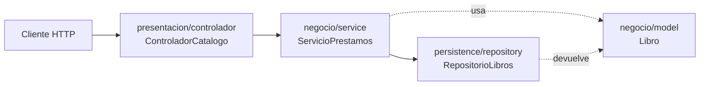

# 💡 Ejemplo 08 — Estructura general de un proyecto Spring Boot

## 🌍 Contexto

Antes de escribir la primera aplicación Spring Boot conviene reconocer cómo se
organizan sus archivos y carpetas. Spring Boot no obliga una única estructura,
pero sí existe una convención ampliamente adoptada que este curso sigue en todos
sus ejemplos, aplicada aquí a un proyecto `biblioteca-api`.

**Qué busca demostrar este ejemplo**: que la carpeta y el paquete en el que vive
una clase no son un detalle arbitrario, sino que comunican su responsabilidad
(recibir peticiones, aplicar reglas de negocio, acceder a datos, o representar
una entidad); y que una única clase con `@SpringBootApplication` alcanza para
que Spring Boot descubra y registre automáticamente todo lo demás.

## 🌳 Árbol de carpetas

```text
📁 biblioteca-api
├── 📄 pom.xml                                   (o build.gradle, ver Ejemplo 06)
└── 📁 src
    ├── 📁 main
    │   ├── 📁 java/com/biblioteca
    │   │   ├── 📄 BibliotecaApiApplication.java   (clase principal)
    │   │   ├── 📁 presentacion                  (1 · capa de presentación)
    │   │   │   ├── 📁 controlador
    │   │   │   │   └── 📄 ControladorCatalogo.java
    │   │   │   └── 📁 dto                       (datos que entran y salen de la API)
    │   │   ├── 📁 negocio                       (2 · capa de negocio)
    │   │   │   ├── 📁 model
    │   │   │   │   └── 📄 Libro.java
    │   │   │   └── 📁 service
    │   │   │       └── 📄 ServicioPrestamos.java
    │   │   └── 📁 persistence                   (3 · capa de persistencia)
    │   │       └── 📁 repository
    │   │           └── 📄 RepositorioLibros.java
    │   └── 📁 resources
    │       └── 📄 application.properties
    └── 📁 test/java/com/biblioteca
        └── 📄 ServicioPrestamosTest.java
```

## 🗺️ Diagrama: la arquitectura por capas



Cada flecha va en un solo sentido: `presentacion` conoce a `negocio`, y
`negocio` conoce a `persistence`. Ninguna capa "de más abajo" conoce a las de
arriba: `RepositorioLibros` no sabe que existe `ControladorCatalogo`. Esa
dirección única es la que evita que un cambio en `presentacion/` obligue a
tocar `persistence/`. El modelo (`Libro`) vive dentro de `negocio` porque
representa el dominio, y las otras capas lo usan.

## 💻 Código — la clase principal (`BibliotecaApiApplication.java`)

```java
package com.biblioteca;

import org.springframework.boot.SpringApplication;
import org.springframework.boot.autoconfigure.SpringBootApplication;

@SpringBootApplication
public class BibliotecaApiApplication {

    public static void main(String[] args) {
        SpringApplication.run(BibliotecaApiApplication.class, args);
    }
}
```

## 🔍 Qué contiene cada parte

| Ruta | Propósito |
|---|---|
| `pom.xml` / `build.gradle` | Declara las dependencias del proyecto (starters) y cómo construirlo (Ejemplo 06). |
| `BibliotecaApiApplication.java` | Clase principal, anotada `@SpringBootApplication`; contiene el método `main` que arranca la aplicación. |
| `presentacion/controlador/` | Capa de presentación: clases que reciben peticiones HTTP y devuelven una respuesta (`@RestController`); no contienen lógica de negocio. |
| `presentacion/dto/` | Capa de presentación: los datos que entran y salen de la API, separados de las entidades (se usan desde el Módulo 5). |
| `negocio/service/` | Capa de negocio: clases con la lógica de negocio (por ejemplo, las reglas para prestar un libro); es lo que en este módulo se vio como `ServicioPrestamos`. |
| `negocio/model/` | Capa de negocio: clases que representan las entidades del dominio (`Libro`, `Usuario`), como las vistas en POO aplicada (Ejemplo 04). |
| `persistence/repository/` | Capa de persistencia: clases o interfaces responsables de acceder a los datos (en este módulo, en memoria; en el módulo de persistencia, contra una base de datos real). |
| `src/main/resources/application.properties` | Configuración de la aplicación (por ejemplo, `server.port`), vista en el Ejemplo 07. |
| `src/test/java/...` | Pruebas automatizadas, organizadas con el mismo paquete que el código que prueban. |

## 🧭 Explicación paso a paso

1. La separación en `presentacion`, `negocio` y `persistence` no es exigida por el
   compilador de Java: es una **convención de arquitectura por capas** (la misma
   del curso de Java), que separa "cómo llega la petición" (presentación), "qué
   regla de negocio se aplica" (negocio) y "de dónde vienen los datos"
   (persistencia). Este curso la usa en todos sus módulos y la profundiza en el
   Módulo 5.
2. `BibliotecaApiApplication.java` suele ubicarse en el paquete raíz
   (`com.biblioteca`) porque, por convención, Spring Boot escanea ese paquete
   y todos sus subpaquetes en busca de componentes (`@Component`, `@Service`,
   `@RestController`, etc.) para registrarlos como beans.
3. `src/main/resources/application.properties` es el lugar donde Spring Boot
   busca configuración externa; si no existe, la aplicación igual arranca con
   valores por defecto, coherente con la autoconfiguración vista en el Ejemplo 07.
4. La carpeta `src/test/` es paralela a `src/main/`, con la misma estructura de
   paquetes: esto permite que una prueba de `ServicioPrestamos` acceda a sus
   miembros `package-private` si los tuviera, y facilita ubicar qué prueba
   corresponde a qué clase.

## ✅ Resultado esperado

Al ejecutar `BibliotecaApiApplication.main(...)`, la consola muestra algo como:

```text
  .   ____          _            __ _ _
 /\\ / ___'_ __ _ _(_)_ __  __ _ \ \ \ \
( ( )\___ | '_ | '_| | '_ \/ _` | \ \ \ \
 \\/  ___)| |_)| | | | | || (_| |  ) ) ) )
  '  |____| .__|_| |_|_| |_\__, | / / / /
 =========|_|==============|___/=/_/_/_/
 :: Spring Boot ::

Iniciando BibliotecaApiApplication...
Tomcat inicializado en el puerto 8080
Started BibliotecaApiApplication in 1.234 seconds
```

Spring Boot escaneó `com.biblioteca` y sus subpaquetes, registró
`ControladorCatalogo`, `ServicioPrestamos` y `RepositorioLibros` como beans, leyó
`application.properties`, y dejó la aplicación escuchando en el puerto
configurado (por defecto, `8080`), lista para recibir peticiones HTTP.

## 📌 Idea clave

Esta estructura por capas es la que los ejemplos y ejercicios de los módulos
siguientes del curso asumen como punto de partida: presentación → negocio →
persistencia, la misma separación de responsabilidades que promueve el
patrón MVC mencionado en el Ejemplo 01.

## ❓ Preguntas de repaso

**1. [Selección]** ¿Qué contiene, por convención, el paquete `negocio/service`?

- **A.** Las clases que reciben peticiones HTTP.
- **B.** La lógica de negocio de la aplicación.
- **C.** La configuración de `application.properties`.
- **D.** Las entidades del dominio.

<details>
<summary>🔑 Ver respuesta</summary>

**Respuesta correcta: B**. `presentacion/controlador` recibe peticiones,
`persistence/repository` accede a datos y `negocio/model` representa entidades;
`negocio/service` es donde vive la regla de negocio.

</details>

**2. [Selección múltiple]** Seleccioná **todas** las afirmaciones correctas
sobre la estructura de un proyecto Spring Boot.

- **A.** `src/test/java` refleja la misma estructura de paquetes que
  `src/main/java`.
- **B.** `BibliotecaApiApplication.java` suele ubicarse en el paquete raíz.
- **C.** Spring Boot exige, por especificación del lenguaje, usar los nombres
  `presentacion`/`negocio`/`persistence`.
- **D.** Si falta `application.properties`, la aplicación igual arranca con
  valores por defecto.

<details>
<summary>🔑 Ver respuesta</summary>

**Respuestas correctas: A, B, D**. La C es falsa: esos nombres son una
convención de la comunidad Spring, no una exigencia del compilador de Java.

</details>

**3. [Abierta]** ¿Por qué se dice que la separación en `presentacion/`,
`negocio/` y `persistence/` es una convención y no una obligación del
compilador?

<details>
<summary>🔑 Ver respuesta modelo</summary>

**Respuesta modelo**: Porque el compilador de Java no exige ningún nombre de
paquete en particular: compilaría igual si todas las clases estuvieran en un
único paquete. La separación por capas es una convención adoptada por la
comunidad Spring para organizar responsabilidades (recibir peticiones, aplicar
reglas de negocio, acceder a datos) de forma predecible entre proyectos, no una
regla del lenguaje.

</details>
