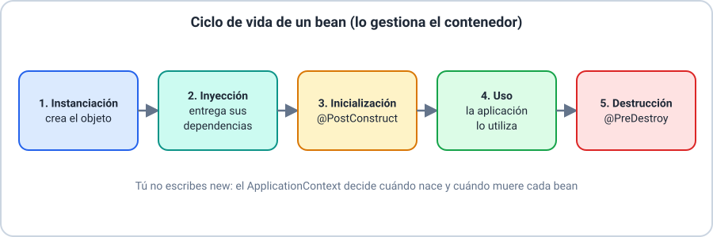
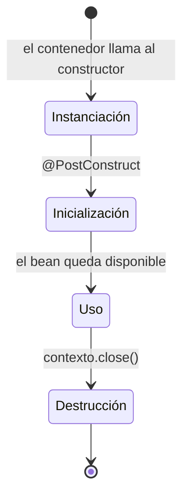

# 💡 Ejemplo 10 — IoC Container: ApplicationContext y ciclo de vida de un bean

## 🌍 Contexto

La Inversión de Control (mencionada desde el Ejemplo 01 como una de las
características de todo framework) tiene, en Spring, un nombre concreto para su
mecanismo: el **contenedor IoC**, representado por la interfaz
`ApplicationContext`. En vez de que una clase cree sus propias dependencias con
`new`, el contenedor las crea, las configura y se las entrega, administrando
además cuándo nace y cuándo muere cada una de esas instancias (los **beans**).

**Qué busca demostrar este ejemplo**: que el ciclo de vida de un bean no es una
lista abstracta de fases, sino algo que se puede **ver ejecutarse en orden**: el
propio `ServicioCitas` imprime un mensaje en cada fase (instanciación,
inicialización, uso, destrucción), y `Main` —una aplicación Spring Boot— deja en
evidencia que el desarrollador nunca escribe `new ServicioCitas()`: solo se lo
pide al contenedor que Spring Boot crea al arrancar.

## 🗺️ El contenedor y el contexto, de un vistazo


**Contenedor y contexto son lo mismo, visto de dos formas**: el *contenedor IoC* es la idea (quien crea y entrega los objetos) y el `ApplicationContext` es el objeto de Spring que lo implementa. `SpringApplication.run(...)` lo crea al arrancar.

## 🏥 Caso de estudio

MediSalud: un `ServicioCitas` administrado por el contenedor IoC, para observar en
orden las fases de su ciclo de vida.



## 🌳 Árbol de archivos (como se vería en VS Code)

```text
📁 ejemplo-10-ciclo-de-vida
└── 📁 src/com/medisalud
    ├── 📄 Main.java                   (@SpringBootApplication; ▶️ clase que arranca la aplicación)
    └── 📁 negocio                     (capa de negocio)
        └── 📁 service
            └── 📄 ServicioCitas.java
```

Es un proyecto Spring Boot normal: se crea con Spring Initializr (Ejemplo 06) y
basta la dependencia `spring-boot-starter`.

## 💻 Archivo: `ServicioCitas.java`

```java
package com.medisalud.negocio.service;

@Component
public class ServicioCitas {

    public ServicioCitas() {
        System.out.println("1) Instanciación: el contenedor crea el objeto ServicioCitas");
    }

    @PostConstruct
    public void inicializar() {
        System.out.println("2) Inicialización: @PostConstruct — el bean ya tiene sus dependencias listas");
    }

    public void agendar(String paciente) {
        System.out.println("3) Uso: agendando cita para " + paciente);
    }

    @PreDestroy
    public void liberar() {
        System.out.println("4) Destrucción: @PreDestroy — el contenedor libera el bean antes de apagarse");
    }
}
```

## 💻 Archivo: `Main.java` (▶️ clic derecho → "Run Java" en VS Code)

```java
package com.medisalud;

import com.medisalud.negocio.service.ServicioCitas;

import org.springframework.boot.SpringApplication;
import org.springframework.boot.autoconfigure.SpringBootApplication;
import org.springframework.context.ConfigurableApplicationContext;

@SpringBootApplication
public class Main {

    public static void main(String[] args) {
        // Arranca Spring Boot: crea el contenedor (ApplicationContext) y los beans
        ConfigurableApplicationContext contexto = SpringApplication.run(Main.class, args);

        ServicioCitas servicioCitas = contexto.getBean(ServicioCitas.class);
        servicioCitas.agendar("Ana Gómez");

        contexto.close(); // dispara la fase de destrucción de los beans
    }
}
```

`@SpringBootApplication` ya incluye el escaneo de componentes: Spring busca clases
anotadas (`@Component`, `@Service`, …) en `com.medisalud` y todos sus subpaquetes,
por eso no hace falta ninguna clase de configuración aparte.

## 🗺️ Diagrama: las cuatro fases, en orden



Cada flecha representa un evento que el **contenedor** dispara, no el código
del estudiante: nadie llama explícitamente a `inicializar()` ni a
`liberar()` — Spring los invoca al cruzar cada fase.

## 🧭 Explicación paso a paso

1. `Main`, anotada `@SpringBootApplication`, es el punto de entrada: incluye el
   escaneo de componentes (Ejemplo 08), así que le indica a Spring en qué paquete
   buscar clases anotadas (`@Component`, `@Service`, etc.): `com.medisalud` y sus
   subpaquetes.
2. `SpringApplication.run(...)` crea el `ApplicationContext`, el **contenedor
   IoC**: al arrancar, escanea las clases anotadas (`@Component`, entre otras) y
   decide qué beans crear. Devuelve ese contexto para poder pedirle beans.
3. **Instanciación**: el contenedor llama al constructor de `ServicioCitas`. El
   código cliente nunca escribe `new ServicioCitas()`.
4. **Inyección de dependencias**: si `ServicioCitas` dependiera de otro bean (por
   ejemplo, un repositorio), el contenedor se lo entregaría en este punto, antes de
   inicializar (no se muestra aquí porque este bean no tiene dependencias).
5. **Inicialización**: el método anotado `@PostConstruct` se ejecuta una sola vez,
   cuando el bean ya está completamente construido e inyectado; es el lugar
   correcto para lógica de arranque (por ejemplo, precargar una caché).
6. **Uso**: mientras la aplicación corre, el bean permanece disponible; el
   contenedor entrega la **misma instancia** cada vez que se pide (por defecto,
   los beans son *singleton*).
7. **Destrucción**: al cerrar el contexto (`contexto.close()`), el contenedor
   invoca `@PreDestroy` en cada bean, dando la oportunidad de liberar recursos
   (conexiones, hilos, archivos abiertos).

## ✅ Resultado esperado

En la consola aparecen el banner y los logs de arranque de Spring Boot; entre ellos,
las líneas del ciclo de vida del bean:

```text
1) Instanciación: el contenedor crea el objeto ServicioCitas
2) Inicialización: @PostConstruct — el bean ya tiene sus dependencias listas
3) Uso: agendando cita para Ana Gómez
4) Destrucción: @PreDestroy — el contenedor libera el bean antes de apagarse
```

Las líneas 1 y 2 salen mientras Spring arranca (antes de `Started Main in ...`).
La 3 sale cuando `Main` pide el bean y lo usa, y la 4 al ejecutar
`contexto.close()`.

## 📌 Idea clave

El estudiante nunca instancia `ServicioCitas` con `new`: **pide** una instancia al
`ApplicationContext` (`contexto.getBean(...)`), o —más habitual en una aplicación
real— simplemente declara que otro bean lo necesita como dependencia, y el
contenedor resuelve toda esta secuencia por detrás.

## ❓ Preguntas de repaso

**1. [Selección]** ¿En qué fase del ciclo de vida de un bean se ejecuta el
método anotado `@PostConstruct`?

- **A.** Instanciación.
- **B.** Inicialización.
- **C.** Uso.
- **D.** Destrucción.

<details>
<summary>🔑 Ver respuesta</summary>

**Respuesta correcta: B**. `@PostConstruct` se ejecuta una sola vez, cuando el
bean ya está construido e inyectado: es la fase de inicialización.

</details>

**2. [Selección múltiple]** Sobre `ApplicationContext` en este ejemplo,
seleccioná **todas** las afirmaciones correctas.

- **A.** El código cliente llama a `new ServicioCitas()` directamente.
- **B.** `contexto.getBean(ServicioCitas.class)` pide una instancia ya
  administrada por el contenedor.
- **C.** `contexto.close()` dispara la ejecución de `@PreDestroy`.
- **D.** `@SpringBootApplication` hace que el contenedor busque componentes en
  el paquete de `Main` y sus subpaquetes.

<details>
<summary>🔑 Ver respuesta</summary>

**Respuestas correctas: B, C, D**. La A es falsa: el código de
`Main` nunca escribe `new ServicioCitas()`.

</details>

**3. [Abierta]** Ordená y explicá, con tus palabras, las cuatro fases del ciclo
de vida de `ServicioCitas` que se ven reflejadas en la salida de este ejemplo.

<details>
<summary>🔑 Ver respuesta modelo</summary>

**Respuesta modelo**: Primero, **instanciación**: el contenedor llama al
constructor de `ServicioCitas`. Después, **inicialización**: se ejecuta
`inicializar()` (anotado `@PostConstruct`), una sola vez, con el bean ya listo.
Luego, **uso**: mientras la aplicación corre, se puede llamar a `agendar(...)`
las veces que haga falta, sobre la misma instancia. Por último,
**destrucción**: al cerrar el contexto, el contenedor ejecuta `liberar()`
(anotado `@PreDestroy`) para dar oportunidad de liberar recursos.

</details>
