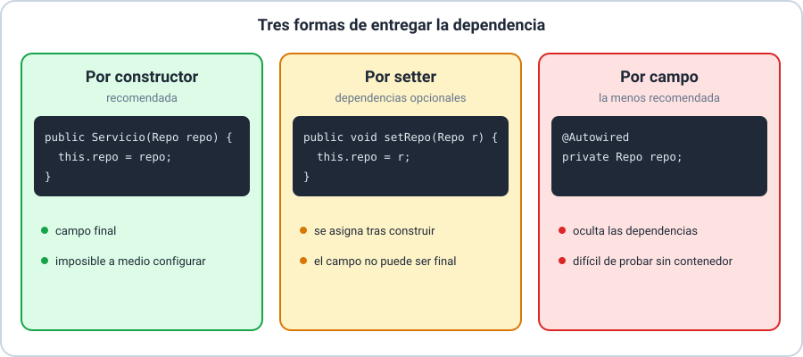
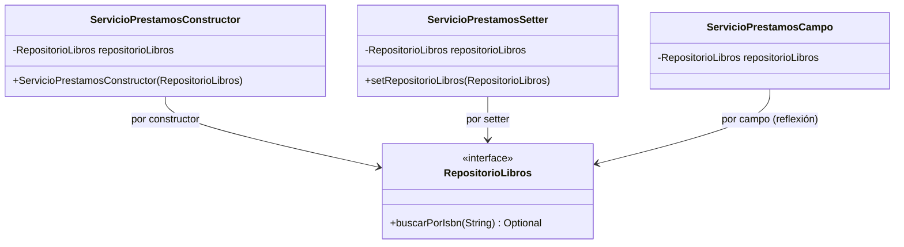

# 💡 Ejemplo 11 — Inyección de Dependencias: constructor, setter y campo

## 🌍 Contexto

La Inyección de Dependencias es el mecanismo concreto con el que el contenedor
IoC (Ejemplo 10) le entrega a un bean lo que necesita, en vez de que el propio
bean lo cree. Spring ofrece tres formas de recibir esa dependencia —constructor,
setter y campo— y las tres funcionan igual dentro de una aplicación en marcha;
la diferencia real aparece recién cuando se necesita reemplazar esa dependencia
por una versión de prueba, fuera del contenedor.

**Qué busca demostrar este ejemplo**: que en una aplicación Spring Boot normal
**nadie escribe `new`**: las tres clases reciben su `RepositorioLibros` del
contenedor, cada una a su manera, y dan el mismo resultado. La diferencia entre
las formas se ve después, en la sección de pruebas, donde solo la de constructor
se arma con una línea.

## 📚 Caso de estudio

Biblioteca Universitaria: un `ServicioPrestamos` que depende de un
`RepositorioLibros`, implementado con las tres formas de inyección para poder
compararlas.



## 🌳 Árbol de archivos (como se vería en VS Code)

En Java, cada clase o interfaz pública va en su propio archivo `.java` con su
mismo nombre. Si abrieras este ejemplo como una carpeta en VS Code, el panel
`EXPLORER` de la izquierda se vería así:

```text
📁 ejemplo-11-inyeccion-dependencias
└── 📁 src/com/biblioteca
    ├── 📄 Main.java                                  (@SpringBootApplication; ▶️ clase que arranca la aplicación)
    ├── 📁 negocio                                    (capa de negocio)
    │   ├── 📁 model
    │   │   └── 📄 Libro.java                         (record)
    │   └── 📁 service
    │       ├── 📄 ServicioPrestamosConstructor.java
    │       ├── 📄 ServicioPrestamosSetter.java
    │       └── 📄 ServicioPrestamosCampo.java
    └── 📁 persistence                                (capa de persistencia)
        └── 📁 repository
            ├── 📄 RepositorioLibros.java             (interfaz)
            └── 📄 RepositorioLibrosEnMemoria.java    (@Repository)
```

Cada bloque de código de abajo está encabezado con el nombre exacto del archivo
en el que iría, en ese mismo orden.

Es un proyecto Spring Boot normal: se crea con Spring Initializr (Ejemplo 06) y
basta la dependencia `spring-boot-starter`; no necesita base de datos ni web.

## 🧠 Qué hace Spring en este ejemplo

Es una aplicación Spring Boot completa: `Main` lleva `@SpringBootApplication`,
así que al arrancar Spring **escanea** el paquete `com.biblioteca` y sus
subpaquetes, encuentra las clases anotadas (`@Repository`, `@Service`), crea un
bean de cada una y **resuelve sus dependencias**:

1. Crea `RepositorioLibrosEnMemoria` (es el único bean que cumple el tipo
   `RepositorioLibros`).
2. Crea `ServicioPrestamosConstructor` llamando a su constructor con ese
   repositorio.
3. Crea `ServicioPrestamosSetter` y llama a `setRepositorioLibros(...)`
   (por la anotación `@Autowired` del setter).
4. Crea `ServicioPrestamosCampo` y asigna el campo `repositorioLibros` (por
   `@Autowired` sobre el campo).

Tu código no hace nada de eso: solo **declara** qué necesita cada clase. En
`Main`, un `CommandLineRunner` recibe los tres servicios ya construidos y los
usa.

## 💻 Archivo: `RepositorioLibros.java`

```java
package com.biblioteca.persistence.repository;

import com.biblioteca.negocio.model.Libro;

public interface RepositorioLibros {
    Optional<Libro> buscarPorIsbn(String isbn);
}
```

## 💻 Archivo: `Libro.java`

```java
package com.biblioteca.negocio.model;

public record Libro(String isbn, String titulo) {}
```

## 💻 Archivo: `RepositorioLibrosEnMemoria.java`

```java
package com.biblioteca.persistence.repository;

import com.biblioteca.negocio.model.Libro;

@Repository
public class RepositorioLibrosEnMemoria implements RepositorioLibros {

    private final List<Libro> libros = List.of(
            new Libro("978-3-16-148410-0", "Estructuras de Datos")
    );

    @Override
    public Optional<Libro> buscarPorIsbn(String isbn) {
        return libros.stream().filter(libro -> libro.isbn().equals(isbn)).findFirst();
    }
}
```

## 💻 Archivo: `ServicioPrestamosConstructor.java` (recomendada)

```java
package com.biblioteca.negocio.service;

import com.biblioteca.persistence.repository.RepositorioLibros;

@Service
public class ServicioPrestamosConstructor {

    private final RepositorioLibros repositorioLibros; // puede ser final

    public ServicioPrestamosConstructor(RepositorioLibros repositorioLibros) {
        this.repositorioLibros = repositorioLibros;
    }

    public boolean prestar(String isbn) {
        return repositorioLibros.buscarPorIsbn(isbn).isPresent();
    }
}
```

## 💻 Archivo: `ServicioPrestamosSetter.java`

```java
package com.biblioteca.negocio.service;

import com.biblioteca.persistence.repository.RepositorioLibros;

@Service
public class ServicioPrestamosSetter {

    private RepositorioLibros repositorioLibros; // no puede ser final

    @Autowired
    public void setRepositorioLibros(RepositorioLibros repositorioLibros) {
        this.repositorioLibros = repositorioLibros;
    }

    public boolean prestar(String isbn) {
        return repositorioLibros.buscarPorIsbn(isbn).isPresent();
    }
}
```

## 💻 Archivo: `ServicioPrestamosCampo.java`

```java
package com.biblioteca.negocio.service;

import com.biblioteca.persistence.repository.RepositorioLibros;

@Service
public class ServicioPrestamosCampo {

    @Autowired
    private RepositorioLibros repositorioLibros; // Spring lo asigna por reflexión

    public boolean prestar(String isbn) {
        return repositorioLibros.buscarPorIsbn(isbn).isPresent();
    }
}
```

## 🗺️ Diagrama: mismo destino, tres caminos distintos



Las tres clases apuntan al mismo tipo (`RepositorioLibros`); lo único que
cambia, marcado en cada flecha, es **cómo** llega esa dependencia a cada una.
Eso es justo lo que la tabla siguiente compara en detalle.

## 🔍 Análisis comparado

| Forma | Ventaja | Desventaja |
|---|---|---|
| Constructor | Dependencia obligatoria y explícita; permite `final`; se puede instanciar en un test con `new ServicioPrestamosConstructor(repositorioDePrueba)` sin contenedor | Constructores largos si hay muchas dependencias (suele ser una señal de que la clase hace demasiado) |
| Setter | Útil para dependencias realmente opcionales, que pueden cambiarse después de construir el objeto | El objeto puede existir temporalmente sin la dependencia asignada (estado inconsistente) |
| Campo | Muy compacta de escribir | Oculta las dependencias reales de la clase (no aparecen en ningún constructor ni setter); para instanciarla en un test sin contenedor, hay que recurrir a reflexión o a un framework de mocks |

## 🧭 Explicación paso a paso

1. Las tres versiones son **funcionalmente equivalentes** en una aplicación Spring
   en ejecución: el contenedor resuelve `RepositorioLibros` y se lo entrega a
   cada servicio de una forma u otra, sin que `Main` lo haga a mano.
2. `Main` solo hace dos cosas: arrancar Spring (`SpringApplication.run`) y
   declarar un `CommandLineRunner`, un bloque de código que Spring ejecuta
   **una vez, justo después de arrancar**. Sus tres parámetros son los
   servicios: Spring los inyecta también ahí.
3. La diferencia aparece en las **pruebas** y en la **legibilidad**: con
   `ServicioPrestamosConstructor`, un test puede escribir
   `new ServicioPrestamosConstructor(repositorioFalso)` directamente, sin arrancar
   ningún `ApplicationContext`.
4. Con `ServicioPrestamosCampo`, no hay ningún constructor ni setter que reciba
   `RepositorioLibros`: para probarlo sin Spring hay que asignar el campo con
   reflexión o usar un framework como Mockito con `@InjectMocks`, lo cual agrega
   complejidad innecesaria.
5. Por eso Spring recomienda, desde hace varias versiones, **inyección por
   constructor** como forma preferida para dependencias obligatorias, dejando
   setter para casos realmente opcionales y evitando la inyección por campo en
   código nuevo.

## 💻 Archivo: `Main.java` (▶️ clic derecho → "Run Java" en VS Code)

```java
package com.biblioteca;

import com.biblioteca.negocio.service.ServicioPrestamosCampo;
import com.biblioteca.negocio.service.ServicioPrestamosConstructor;
import com.biblioteca.negocio.service.ServicioPrestamosSetter;

import org.springframework.boot.CommandLineRunner;
import org.springframework.boot.SpringApplication;
import org.springframework.boot.autoconfigure.SpringBootApplication;
import org.springframework.context.annotation.Bean;

@SpringBootApplication
public class Main {

    public static void main(String[] args) {
        SpringApplication.run(Main.class, args);
    }

    // Spring ejecuta este bloque una vez, después de arrancar.
    // Los tres servicios llegan ya construidos: Spring los inyecta como parámetros.
    @Bean
    CommandLineRunner demostracion(ServicioPrestamosConstructor porConstructor,
                                   ServicioPrestamosSetter porSetter,
                                   ServicioPrestamosCampo porCampo) {
        return args -> {
            String isbnExistente = "978-3-16-148410-0";
            String isbnInexistente = "000-0-00-000000-0";

            System.out.println("Por constructor -> " + porConstructor.prestar(isbnExistente));
            System.out.println("Por setter -> " + porSetter.prestar(isbnExistente));
            System.out.println("Por campo -> " + porCampo.prestar(isbnExistente));
            System.out.println("ISBN inexistente por constructor -> " + porConstructor.prestar(isbnInexistente));
        };
    }
}
```

Nótese lo que **no** aparece en `Main`: ningún `new ServicioPrestamos...`, ningún
`new RepositorioLibrosEnMemoria()` y ninguna asignación del repositorio. Eso es
la inyección de dependencias funcionando.

## 🧪 ¿Dónde se nota la diferencia? Al probar sin Spring

Dentro de la aplicación las tres formas se ven igual. La diferencia aparece en un
**test unitario**, donde no hay contenedor y hay que armar el objeto a mano con un
repositorio falso:

```java
// Por constructor: una línea, el compilador obliga a pasar la dependencia
var servicio = new ServicioPrestamosConstructor(repositorioFalso);

// Por setter: dos pasos (y entre ambos el objeto está incompleto)
var servicio = new ServicioPrestamosSetter();
servicio.setRepositorioLibros(repositorioFalso);

// Por campo: no hay constructor ni setter; hace falta reflexión
var servicio = new ServicioPrestamosCampo();
Field campo = ServicioPrestamosCampo.class.getDeclaredField("repositorioLibros");
campo.setAccessible(true);
campo.set(servicio, repositorioFalso);
```

Ese es el "costo" de la inyección por campo: dentro de Spring pasa
desapercibido, pero fuera de Spring obliga a recurrir a reflexión.

## ✅ Resultado esperado

En VS Code, al abrir `Main.java` aparece un botón **▶ Run** (o "Run Java")
arriba del método `main`; al hacer clic, el panel `TERMINAL` muestra primero el
arranque de Spring Boot y, al final, las líneas del `CommandLineRunner`:

```text
  .   ____          _            __ _ _
 /\\ / ___'_ __ _ _(_)_ __  __ _ \ \ \ \
( ( )\___ | '_ | '_| | '_ \/ _` | \ \ \ \
 \\/  ___)| |_)| | | | | || (_| |  ) ) ) )
  '  |____| .__|_| |_|_| |_\__, | / / / /
 =========|_|==============|___/=/_/_/_/
 :: Spring Boot ::

Started Main in 0.9 seconds
Por constructor -> true
Por setter -> true
Por campo -> true
ISBN inexistente por constructor -> false
```

Las tres clases, con el mismo `RepositorioLibros`, devuelven el mismo resultado de
negocio; la elección entre las tres no cambia **qué** responden, solo qué tan
fácil es armarlas fuera de un contenedor Spring, como en el test de arriba.

## ❓ Preguntas de repaso

**1. [Selección]** ¿Cuál es la forma de inyección recomendada por Spring para
una dependencia obligatoria?

- **A.** Por campo.
- **B.** Por constructor.
- **C.** Por setter.
- **D.** Cualquiera; las tres son igual de recomendadas.

<details>
<summary>🔑 Ver respuesta</summary>

**Respuesta correcta: B**. Por constructor es explícita, permite `final` y es la
más fácil de instanciar en un test sin contenedor.

</details>

**2. [Selección múltiple]** Sobre `Main.java` de este ejemplo, seleccioná
**todas** las afirmaciones correctas.

- **A.** Crea los tres servicios con `new` y les asigna el repositorio.
- **B.** `@SpringBootApplication` hace que Spring escanee `com.biblioteca` y sus
  subpaquetes en busca de `@Repository` y `@Service`.
- **C.** El `CommandLineRunner` recibe los tres servicios ya construidos,
  inyectados por Spring.
- **D.** Se ejecuta el bloque del `CommandLineRunner` una vez, después de arrancar.

<details>
<summary>🔑 Ver respuesta</summary>

**Respuestas correctas: B, C, D**. La A es falsa: `Main` nunca usa `new` para los
servicios; los crea y los inyecta Spring.

</details>

**3. [Abierta]** ¿Por qué `ServicioPrestamosCampo` funciona sin problemas dentro
de la aplicación, pero resulta incómodo de probar en un test unitario?

<details>
<summary>🔑 Ver respuesta modelo</summary>

**Respuesta modelo**: Dentro de la aplicación, Spring asigna el campo
`repositorioLibros` por reflexión gracias a `@Autowired`, así que nadie nota que
la clase no tiene constructor ni setter para recibirlo. En un test unitario no hay
contenedor: para darle un repositorio falso hay que repetir esa reflexión a mano
(`getDeclaredField`, `setAccessible`, `set`) o usar un framework como Mockito.
Con inyección por constructor bastaría `new ServicioPrestamosConstructor(repositorioFalso)`.

</details>
