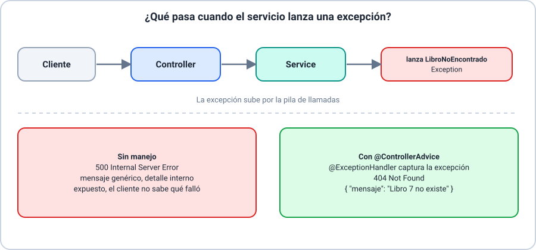
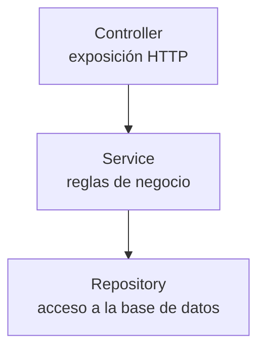
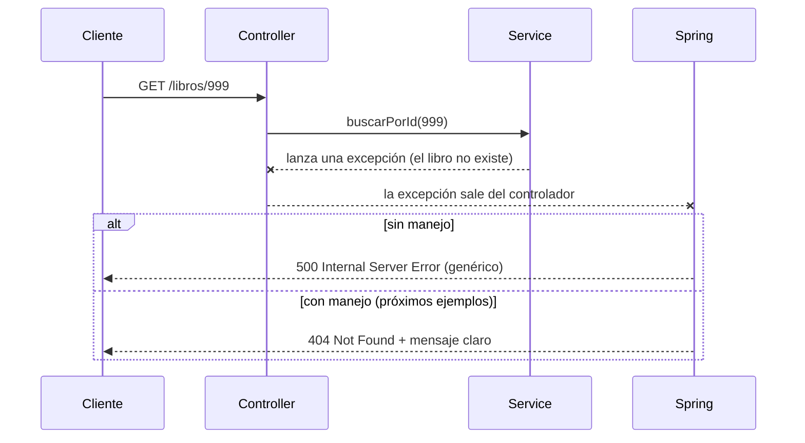

# 💡 Ejemplo 02 — Excepciones en una API REST

## 🌍 Contexto

El Ejemplo 01 explicó qué es una excepción. Este ejemplo muestra por qué importa en una API REST como la del Módulo 5, y en qué capa conviene lanzar y manejar cada error.

**Qué busca demostrar este ejemplo**: por qué manejar excepciones es importante en una API REST y en qué capa (`Controller`, `Service` o `Repository`) se origina cada tipo de error.

## 🧠 Por qué importa manejar excepciones en una API REST

En una API REST, los errores no son fallos raros: son **situaciones normales** del flujo. Por ejemplo:

- Un recurso no existe.
- Se intenta crear un registro duplicado.
- Los datos enviados son inválidos.
- No se cumple una regla de negocio.

Sin un manejo adecuado:

- La API responde con un error genérico (`500`).
- El cliente no entiende qué ocurrió.
- El código se llena de bloques `try/catch` innecesarios.

El manejo de excepciones **transforma errores internos en respuestas HTTP claras y consistentes**. Es justo lo que le falta a `ControladorLibros` del Módulo 5, que todavía arma sus respuestas de error a mano.

## 🧠 Dónde se producen las excepciones

| Capa | Qué errores origina |
|---|---|
| `Repository` | Errores de base de datos (conexión, restricciones violadas). |
| `Service` | Reglas de negocio (recurso no encontrado, duplicado, validaciones). |
| `Controller` | Ninguno de negocio: solo expone HTTP y **traduce** los errores. |

**Regla del módulo**: la excepción se **lanza en el `Service`** (donde vive la regla) y se **maneja** en el `Controller` o, preferiblemente, de forma global. Nunca al revés.

## 🧭 Explicación

### 1. ¿Cómo se ejecuta? El recorrido de una excepción

Ejemplo: `GET /libros/999`, un libro que no existe.

1. El cliente envía la petición y el `Controller` la delega al `Service`.
2. El `Service` detecta el problema y **lanza** la excepción. El método se interrumpe.
3. La excepción **sube** por las capas: sale del `Service` y luego del `Controller`.
4. Si nadie la captura, llega a Spring, que responde `500` sin importar la causa real.
5. Si hay un manejador, Spring lo invoca y responde con el **código y el mensaje adecuados**.

### 2. ¿Por qué `500` es un problema?

El `500` significa "el servidor falló", pero un libro inexistente **no es un fallo del servidor**: es un error del cliente que la API debería explicar.

| Situación | Respuesta sin manejo | Respuesta adecuada |
|---|---|---|
| Libro inexistente | `500` | `404 Not Found` |
| Libro duplicado | `500` | `409 Conflict` |
| Datos inválidos | `500` | `400 Bad Request` |

### 3. Separación de responsabilidades

- El `Service` sabe **por qué** falló algo, porque conoce la regla de negocio.
- El `Controller` sabe **cómo** comunicarlo por HTTP.

Esta división es la misma arquitectura en capas del Módulo 5 (Ejemplo 03).

### 4. ¿Qué sigue?

Los próximos ejemplos muestran tres formas de lograr esa traducción. Las tres respetan la regla anterior: la excepción se lanza en el `Service`.

| Mecanismo | Qué hace | Ejemplo |
|---|---|---|
| `@ResponseStatus` | Asocia una excepción con un código HTTP | 03 y 04 |
| `@ExceptionHandler` | Controla el código **y el cuerpo** de la respuesta en un controlador | 05 |
| `@ControllerAdvice` | Lo mismo, pero compartido por **todos** los controladores | 06 |

## ❓ Preguntas de repaso

**1. [Selección]** En una API REST, un cliente intenta crear un libro con
un isbn que ya existe. ¿Cómo se clasifica esta situación?

- **A.** Un fallo inesperado del servidor.
- **B.** Una situación normal del flujo de la aplicación.
- **C.** Un error de la JVM.
- **D.** Un problema de conectividad de red.

🔑 Ver respuesta

**Respuesta correcta: B**. Los recursos duplicados, igual que los
recursos inexistentes o los datos inválidos, son parte normal del flujo
de una API REST, no fallos inesperados.

**2. [Selección múltiple]** Seleccionar **todas** las afirmaciones
correctas sobre dónde se originan los errores en una arquitectura en
capas.

- **A.** Los errores de conexión a la base de datos se originan en el `Repository`.
- **B.** Las reglas de negocio (por ejemplo, rechazar un duplicado) se validan en el `Controller`.
- **C.** La buena práctica es lanzar la excepción desde el `Service`.
- **D.** El `Controller` es responsable de exponer HTTP, no de contener reglas de negocio.

🔑 Ver respuesta

**Respuestas correctas: A, C, D**. La B es falsa: las reglas de negocio
se validan en el `Service`, no en el `Controller`.

**3. [Abierta]** Un compañero escribe la validación de "isbn duplicado"
directamente dentro del método del `Controller`, antes de llamar al
`Service`.

**Pregunta**: ¿Por qué eso no sigue la buena práctica de este módulo, y
qué problema podría causar a futuro?

🔑 Ver respuesta modelo

**Respuesta modelo**: Mezcla la responsabilidad de exposición HTTP
(`Controller`) con una regla de negocio (validar duplicados), que
debería vivir en el `Service`. El problema concreto a futuro: si mañana
se necesita la misma validación desde otro punto de entrada (por
ejemplo, un proceso batch que también crea libros, sin pasar por el
`Controller`), la regla de negocio no estaría disponible ahí — habría que
duplicarla. Si la regla vive en el `Service`, cualquier consumidor del
`Service` la respeta automáticamente.

