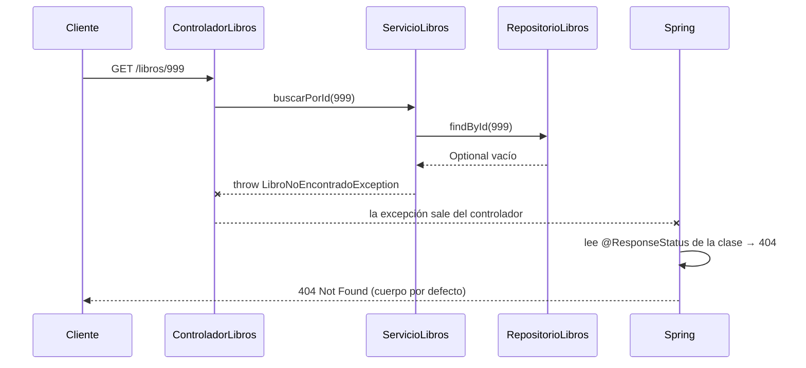

# 💡 Ejemplo 03 — `@ResponseStatus`: recurso no encontrado

## 🌍 Contexto

`ControladorLibros.buscarPorId(...)` (Módulo 5) construye manualmente
`ResponseEntity.notFound().build()` cuando `ServicioLibros` no encuentra
el libro. Este ejemplo reemplaza ese patrón manual por una excepción
personalizada.

**Qué busca demostrar este ejemplo**: crear `LibroNoEncontradoException`
anotada con `@ResponseStatus(HttpStatus.NOT_FOUND)`, y modificar
`ServicioLibros`/`ControladorLibros` para que la excepción —no el
`Controller`— sea la responsable de producir el `404`.

## 📚 Caso de estudio

Biblioteca Universitaria: `Libro`/`RepositorioLibros`/`ServicioLibros`/
`ControladorLibros` del Módulo 5.

## 🌳 Árbol de archivos (como se vería en VS Code)

```text
📁 gestion-bd-jpa
└── 📁 src/com/biblioteca
    └── 📁 src/main
        ├── 📁 java/com/biblioteca
        │   ├── 📄 Libro.java                       (del Módulo 3, reutilizada)
        │   ├── 📄 RepositorioLibros.java           (del Módulo 3, reutilizada)
        │   ├── 📄 LibroNoEncontradoException.java
        │   ├── 📄 ServicioLibros.java              (modificada en este ejemplo)
        │   └── 📄 ControladorLibros.java           (modificada en este ejemplo)
        └── 📁 resources
            └── 📄 application.properties           (del Módulo 3, reutilizada)
```

<details>
<summary>📄 Ver código completo de <code>Libro.java</code> (reutilizado del Módulo 3)</summary>

```java
package com.biblioteca.negocio.model;

@Entity
public class Libro {

    @Id
    @GeneratedValue(strategy = GenerationType.IDENTITY)
    private Long id;

    @Column(unique = true)
    private String isbn;

    private String titulo;

    protected Libro() {
    }

    public Libro(String isbn, String titulo) {
        this.isbn = isbn;
        this.titulo = titulo;
    }

    public Long getId() { return id; }
    public String getIsbn() { return isbn; }
    public String getTitulo() { return titulo; }
    public void setTitulo(String titulo) { this.titulo = titulo; }
}
```

</details>

<details>
<summary>📄 Ver código completo de <code>RepositorioLibros.java</code> (reutilizado del Módulo 3)</summary>

```java
package com.biblioteca.persistence.repository;

import com.biblioteca.negocio.model.Libro;

public interface RepositorioLibros extends JpaRepository<Libro, Long> {
    Optional<Libro> findByIsbn(String isbn);
}
```

</details>

<details>
<summary>📄 Ver código completo de <code>application.properties</code> (reutilizado del Módulo 3)</summary>

```properties
spring.datasource.url=jdbc:h2:mem:biblioteca;DB_CLOSE_DELAY=-1
spring.datasource.driver-class-name=org.h2.Driver
spring.datasource.username=sa
spring.datasource.password=
spring.jpa.database-platform=org.hibernate.dialect.H2Dialect
spring.jpa.hibernate.ddl-auto=update
```

</details>

## 💻 Archivo: `LibroNoEncontradoException.java`

```java
package com.biblioteca.negocio.excepcion;

@ResponseStatus(HttpStatus.NOT_FOUND)
public class LibroNoEncontradoException extends RuntimeException {

    public LibroNoEncontradoException(Long id) {
        super("No existe un libro con id " + id);
    }
}
```

## 💻 Archivo: `ServicioLibros.java` (modificada: `buscarPorId` ya no devuelve `Optional`)

```java
package com.biblioteca.negocio.service;

import com.biblioteca.negocio.excepcion.LibroNoEncontradoException;
import com.biblioteca.negocio.model.Libro;
import com.biblioteca.persistence.repository.RepositorioLibros;

@Service
public class ServicioLibros {

    private final RepositorioLibros repositorioLibros;

    public ServicioLibros(RepositorioLibros repositorioLibros) {
        this.repositorioLibros = repositorioLibros;
    }

    public List<Libro> listarTodos() {
        return repositorioLibros.findAll();
    }

    public Libro buscarPorId(Long id) {
        return repositorioLibros.findById(id)
                .orElseThrow(() -> new LibroNoEncontradoException(id));
    }

    public Optional<Libro> buscarPorIsbn(String isbn) {
        return repositorioLibros.findByIsbn(isbn);
    }

    public Libro crear(Libro libro) {
        return repositorioLibros.save(libro);
    }

    public Libro actualizar(Long id, Libro datos) {
        Libro libro = buscarPorId(id);
        libro.setTitulo(datos.getTitulo());
        return repositorioLibros.save(libro);
    }

    public void eliminar(Long id) {
        Libro libro = buscarPorId(id);
        repositorioLibros.delete(libro);
    }
}
```

## 💻 Archivo: `ControladorLibros.java` (modificada: `buscarPorId` ya no construye `ResponseEntity.notFound()`)

```java
package com.biblioteca.presentacion.controlador;

import com.biblioteca.negocio.model.Libro;
import com.biblioteca.negocio.service.ServicioLibros;

@RestController
@RequestMapping("/libros")
public class ControladorLibros {

    private final ServicioLibros servicioLibros;

    public ControladorLibros(ServicioLibros servicioLibros) {
        this.servicioLibros = servicioLibros;
    }

    @GetMapping
    public List<Libro> listarTodos() {
        return servicioLibros.listarTodos();
    }

    @GetMapping("/{id}")
    public Libro buscarPorId(@PathVariable Long id) {
        return servicioLibros.buscarPorId(id);
    }

    @GetMapping("/buscar")
    public ResponseEntity<Libro> buscarPorIsbn(@RequestParam String isbn) {
        return servicioLibros.buscarPorIsbn(isbn)
                .map(ResponseEntity::ok)
                .orElseGet(() -> ResponseEntity.notFound().build());
    }

    @PostMapping
    public ResponseEntity<Libro> crear(@RequestBody Libro libro) {
        Libro creado = servicioLibros.crear(libro);
        return ResponseEntity.status(HttpStatus.CREATED).body(creado);
    }

    @PutMapping("/{id}")
    public Libro actualizar(@PathVariable Long id, @RequestBody Libro datos) {
        return servicioLibros.actualizar(id, datos);
    }

    @DeleteMapping("/{id}")
    public ResponseEntity<Void> eliminar(@PathVariable Long id) {
        servicioLibros.eliminar(id);
        return ResponseEntity.ok().build();
    }
}
```

## 🧭 Explicación

### 1. ¿Qué cambió respecto al Módulo 5?

| | Módulo 5 (antes) | Este ejemplo (ahora) |
|---|---|---|
| `ServicioLibros.buscarPorId` | Devuelve `Optional<Libro>` | Devuelve `Libro` y **lanza** `LibroNoEncontradoException` si no existe |
| `ControladorLibros.buscarPorId` | Decide con `.map(...)`/`.orElseGet(...)` y construye `ResponseEntity.notFound()` | Solo devuelve `Libro`; no decide nada sobre errores |
| Quién produce el `404` | El controlador, de forma manual | La excepción, mediante `@ResponseStatus` |

`actualizar` y `eliminar` también se simplifican: reutilizan `buscarPorId(id)`, que ya lanza la excepción, y se evita repetir la misma verificación.

### 2. ¿Qué hace `@ResponseStatus`?

```java
@ResponseStatus(HttpStatus.NOT_FOUND)
public class LibroNoEncontradoException extends RuntimeException { ... }
```

La anotación **asocia una excepción con un código HTTP**. Se declara sobre la **clase de la excepción**, no sobre un método. Por eso basta con lanzarla desde cualquier lugar (incluido el servicio) para que Spring la traduzca al código correcto.

### 3. ¿Cómo se ejecuta? (`GET /libros/999`)



1. El cliente envía `GET /libros/999` y Spring llama a `ControladorLibros.buscarPorId(999)`.
2. El controlador delega en `ServicioLibros.buscarPorId(999)`.
3. El servicio consulta `findById(999)`. No hay libro: el `Optional` llega vacío.
4. `orElseThrow(...)` **lanza** `LibroNoEncontradoException`. El método se interrumpe y el `return` nunca se ejecuta.
5. La excepción **no se captura** en ningún punto, así que sale del controlador.
6. Spring detecta la excepción, encuentra `@ResponseStatus(NOT_FOUND)` en su clase y arma la respuesta con **código `404`**.

> 🔑 Ningún método llama explícitamente a una respuesta `404`: es Spring quien la produce al ver la excepción.

### 4. Límite de este enfoque

`@ResponseStatus` define **solo el código**. El cuerpo lo genera Spring Boot por defecto (`timestamp`, `status`, `error`, `path`) y **no se puede personalizar** con esta anotación. Para controlar el cuerpo se usa `@ExceptionHandler` (Ejemplo 05).

## ✅ Resultado esperado

```text
Método: GET
URL: http://localhost:8080/libros/999
Respuesta: 404 Not Found
{
  "timestamp": "...",
  "status": 404,
  "error": "Not Found",
  "path": "/libros/999"
}
```

## ❓ Preguntas de repaso

**1. [Selección]** ¿Dónde se declara la anotación `@ResponseStatus` para
asociar una excepción a un código HTTP?

- **A.** Sobre el método del controlador.
- **B.** Sobre la clase de la excepción.
- **C.** Sobre la clase del servicio.
- **D.** En `application.properties`.

<details>
<summary>🔑 Ver respuesta</summary>

**Respuesta correcta: B**. `@ResponseStatus` se declara sobre la clase de
la excepción; Spring la aplica automáticamente cuando esa excepción se
propaga sin ser capturada.

</details>

**2. [Selección múltiple]** Sobre el cambio de este ejemplo respecto al
Módulo 5, seleccionar **todas** las afirmaciones correctas.

- **A.** `ServicioLibros.buscarPorId` ya no devuelve `Optional<Libro>`.
- **B.** `ControladorLibros.buscarPorId` sigue construyendo `ResponseEntity.notFound()` manualmente.
- **C.** `LibroNoEncontradoException` extiende `RuntimeException`.
- **D.** El `404` se produce automáticamente cuando la excepción se propaga sin capturar.

<details>
<summary>🔑 Ver respuesta</summary>

**Respuestas correctas: A, C, D**. La B es falsa: justamente ese es el
código manual que este ejemplo elimina.

</details>

**3. [Abierta]** Un compañero pregunta: "si `@ResponseStatus` ya
resuelve el código de estado automáticamente, ¿para qué existen
`@ExceptionHandler` y `@ControllerAdvice`?".

**Pregunta**: ¿Qué respuesta corresponde, considerando el cuerpo de la
respuesta de este ejemplo?

<details>
<summary>🔑 Ver respuesta modelo</summary>

**Respuesta modelo**: `@ResponseStatus` resuelve el **código** de estado,
pero el **cuerpo** de la respuesta sigue siendo el que Spring Boot genera
por defecto (`timestamp`, `status`, `error`, `path`) — no hay forma de
personalizarlo solo con esta anotación. `@ExceptionHandler` y
`@ControllerAdvice` (próximos ejemplos) permiten controlar tanto el
código como el cuerpo exacto de la respuesta, útil cuando se necesita un
formato de error propio y consistente en toda la API.

</details>
