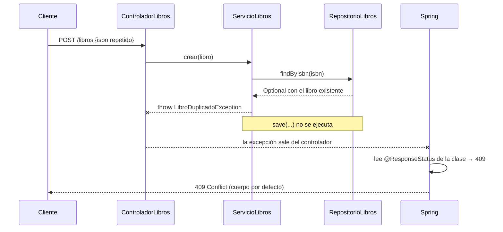

# 💡 Ejemplo 04 — `@ResponseStatus`: recurso duplicado

## 🌍 Contexto

Hasta el Módulo 5, `ServicioLibros.crear(...)` guardaba cualquier `Libro` recibido, incluso si su `isbn` ya existía en el catálogo. Faltaba esa regla de negocio. Este ejemplo la agrega.

**Qué busca demostrar este ejemplo**: crear `LibroDuplicadoException`, anotada con `@ResponseStatus(HttpStatus.CONFLICT)`, y verificar el duplicado en `ServicioLibros.crear` con `findByIsbn` (ya existente desde el Módulo 3).

## 📚 Caso de estudio

Biblioteca Universitaria: mismo proyecto del Ejemplo 03.

<details>
<summary>💻 <b>Código fuente</b> (reutilizado del Ejemplo 03)</summary>

<details>
<summary>📄 Ver código completo de <code>Libro.java</code> (reutilizado del Ejemplo 03)</summary>

```java
package com.biblioteca.negocio.model;

@Entity
public class Libro {

    @Id
    @GeneratedValue(strategy = GenerationType.IDENTITY)
    private Long id;

    @Column(unique = true)
    private String isbn;

    private String titulo;

    protected Libro() {
    }

    public Libro(String isbn, String titulo) {
        this.isbn = isbn;
        this.titulo = titulo;
    }

    public Long getId() { return id; }
    public String getIsbn() { return isbn; }
    public String getTitulo() { return titulo; }
    public void setTitulo(String titulo) { this.titulo = titulo; }
}
```

</details>

<details>
<summary>📄 Ver código completo de <code>RepositorioLibros.java</code> (reutilizado del Ejemplo 03)</summary>

```java
package com.biblioteca.persistence.repository;

import com.biblioteca.negocio.model.Libro;

public interface RepositorioLibros extends JpaRepository<Libro, Long> {
    Optional<Libro> findByIsbn(String isbn);
}
```

</details>

<details>
<summary>📄 Ver código completo de <code>LibroNoEncontradoException.java</code> (reutilizado del Ejemplo 03)</summary>

```java
package com.biblioteca.negocio.excepcion;

@ResponseStatus(HttpStatus.NOT_FOUND)
public class LibroNoEncontradoException extends RuntimeException {

    public LibroNoEncontradoException(Long id) {
        super("No existe un libro con id " + id);
    }
}
```

</details>

</details>

<details>
<summary>💻 Archivo: <code>LibroDuplicadoException.java</code></summary>

```java
package com.biblioteca.negocio.excepcion;

@ResponseStatus(HttpStatus.CONFLICT)
public class LibroDuplicadoException extends RuntimeException {

    public LibroDuplicadoException(String isbn) {
        super("Ya existe un libro con isbn " + isbn);
    }
}
```

</details>

<details>
<summary>💻 Archivo: <code>ServicioLibros.java</code> (método <code>crear</code> modificado)</summary>

```java
public Libro crear(Libro libro) {
    repositorioLibros.findByIsbn(libro.getIsbn())
            .ifPresent(existente -> {
                throw new LibroDuplicadoException(libro.getIsbn());
            });
    return repositorioLibros.save(libro);
}
```

El resto de `ServicioLibros` (`listarTodos`, `buscarPorId`, `buscarPorIsbn`, `actualizar`, `eliminar`) queda igual que en el Ejemplo 03.

</details>

## 🧭 Explicación

### 1. ¿Qué cambió respecto al Módulo 5?

| | Antes (Módulo 5) | Ahora (este ejemplo) |
|---|---|---|
| `ServicioLibros.crear` | Guarda cualquier libro, sin verificar nada | Verifica el `isbn` y **lanza** `LibroDuplicadoException` si ya existe |
| Resultado ante un `isbn` repetido | Se intentaba guardar el duplicado | Se rechaza con `409`, sin guardar nada |

### 2. ¿Qué hace el código?

```java
repositorioLibros.findByIsbn(libro.getIsbn())      // (a) busca un libro con ese isbn
        .ifPresent(existente -> {                   // (b) si lo encuentra...
            throw new LibroDuplicadoException(...); // (c) ...lanza la excepción
        });
return repositorioLibros.save(libro);               // (d) solo se llega aquí si no hubo duplicado
```

- `findByIsbn` devuelve un `Optional<Libro>`: vacío si no hay coincidencia.
- `ifPresent(...)` ejecuta la lambda **solo si el `Optional` tiene valor**. Es una forma breve de "verificar y fallar" sin un `if` explícito.
- Al lanzarse la excepción, el método se interrumpe: `save` **nunca se ejecuta**.

### 3. ¿Qué hace `@ResponseStatus(CONFLICT)`?

Asocia `LibroDuplicadoException` con el código `409 Conflict`: la solicitud es válida, pero **choca con el estado actual** de los datos (ya existe ese libro). Funciona igual que `LibroNoEncontradoException` del Ejemplo 03; solo cambia el código.

### 4. ¿Cómo se ejecuta? (`POST /libros` con un `isbn` repetido)



1. El cliente envía `POST /libros` con un libro cuyo `isbn` ya está registrado.
2. El controlador delega en `ServicioLibros.crear(libro)`.
3. El servicio consulta `findByIsbn`: encuentra el libro existente.
4. `ifPresent` ejecuta la lambda y **lanza** `LibroDuplicadoException`. No se guarda nada.
5. Ningún método captura la excepción, así que sale del controlador.
6. Spring lee `@ResponseStatus(CONFLICT)` en la clase de la excepción y responde **`409`**.

Si el `isbn` **no** existe, `findByIsbn` devuelve un `Optional` vacío, `ifPresent` no hace nada y `save` guarda el libro con normalidad (`201 Created`).

> 💡 La columna `isbn` también es `@Column(unique = true)`: la base de datos rechazaría el duplicado como última defensa. La verificación del servicio permite además un **error claro y controlado** (`409`) en lugar de una falla de base de datos.

### 5. Límite de este enfoque

Igual que en el Ejemplo 03, `@ResponseStatus` fija **solo el código**; el cuerpo es el que Spring Boot genera por defecto. Para personalizarlo se usa `@ExceptionHandler` (Ejemplo 05).

## ✅ Resultado esperado

```text
Método: POST
URL: http://localhost:8080/libros
Cuerpo:
{
  "isbn": "978-0-13-468599-1",
  "titulo": "Effective Java (copia)"
}
Respuesta: 409 Conflict
{
  "timestamp": "...",
  "status": 409,
  "error": "Conflict",
  "path": "/libros"
}
```

(Suponiendo que ya existe un libro con ese mismo isbn.)

## ❓ Preguntas de repaso

**1. [Selección]** ¿Qué código de estado HTTP se asocia convencionalmente
a un intento de crear un recurso duplicado?

- **A.** `200`.
- **B.** `404`.
- **C.** `409`.
- **D.** `500`.

<details>
<summary>🔑 Ver respuesta</summary>

**Respuesta correcta: C**. `409 Conflict` es el código estándar para una
solicitud que entra en conflicto con el estado actual del recurso (como
un duplicado).

</details>

**2. [Selección múltiple]** Sobre este ejemplo, seleccionar **todas** las
afirmaciones correctas.

- **A.** `ServicioLibros.crear` verifica el isbn antes de guardar, usando `findByIsbn`.
- **B.** `findByIsbn` es un método nuevo, creado específicamente para este ejemplo.
- **C.** `LibroDuplicadoException` y `LibroNoEncontradoException` siguen el mismo mecanismo (`@ResponseStatus`), con códigos distintos.
- **D.** Antes del Módulo 7, `crear` no verificaba si el isbn ya existía.

<details>
<summary>🔑 Ver respuesta</summary>

**Respuestas correctas: A, C, D**. La B es falsa: `findByIsbn` ya existía
desde el Módulo 3; este ejemplo solo lo reutiliza con un propósito nuevo.

</details>

**3. [Abierta]** Un compañero pregunta: "¿por qué no lanzar
simplemente `LibroNoEncontradoException` también para el caso de
duplicado, para no crear una clase nueva?".

**Pregunta**: ¿Qué respuesta corresponde?

<details>
<summary>🔑 Ver respuesta modelo</summary>

**Respuesta modelo**: Porque son dos situaciones semánticamente distintas
que deberían traducirse a códigos HTTP distintos: "no encontrado" es
`404`, "duplicado" es `409`. Si ambas usaran la misma excepción, no
habría forma de que `@ResponseStatus` distinguiera cuál código devolver
en cada caso — la anotación está fija en la clase, no puede variar según
el contexto en que se lanza. Cada situación de negocio con un
significado HTTP distinto necesita su propia clase de excepción.

</details>
