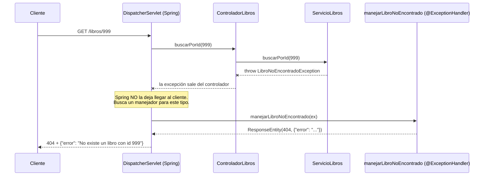

# 💡 Ejemplo 05 — `@ExceptionHandler`: cuerpo personalizado

## 🌍 Contexto

El Ejemplo 03 dejó `LibroNoEncontradoException` respondiendo `404`, pero
con el cuerpo de error por defecto de Spring Boot (`timestamp`, `status`,
`error`, `path`) — no el formato `{"error": "..."}"` ya usado en el
Módulo 5. Este ejemplo lo personaliza.

**Qué busca demostrar este ejemplo**: agregar un método
`@ExceptionHandler` dentro de `ControladorLibros` para controlar el
cuerpo exacto de la respuesta ante `LibroNoEncontradoException`, y
explicar que este manejo es local a ese controlador.

## 📚 Caso de estudio

Biblioteca Universitaria: mismo proyecto de los Ejemplos 03-04.

<details>
<summary>📄 Ver código completo de <code>Libro.java</code>, <code>RepositorioLibros.java</code>, <code>LibroNoEncontradoException.java</code>, <code>LibroDuplicadoException.java</code> y <code>ServicioLibros.java</code> (reutilizados de los Ejemplos 03-04)</summary>

## 💻 Archivo: `Libro.java`

```java
package com.biblioteca.negocio.model;

@Entity
public class Libro {

    @Id
    @GeneratedValue(strategy = GenerationType.IDENTITY)
    private Long id;

    @Column(unique = true)
    private String isbn;

    private String titulo;

    protected Libro() {
    }

    public Libro(String isbn, String titulo) {
        this.isbn = isbn;
        this.titulo = titulo;
    }

    public Long getId() { return id; }
    public String getIsbn() { return isbn; }
    public String getTitulo() { return titulo; }
    public void setTitulo(String titulo) { this.titulo = titulo; }
}
```

## 💻 Archivo: `RepositorioLibros.java`

```java
package com.biblioteca.persistence.repository;

import com.biblioteca.negocio.model.Libro;

public interface RepositorioLibros extends JpaRepository<Libro, Long> {
    Optional<Libro> findByIsbn(String isbn);
}
```

## 💻 Archivo: `LibroNoEncontradoException.java`

```java
package com.biblioteca.negocio.excepcion;

@ResponseStatus(HttpStatus.NOT_FOUND)
public class LibroNoEncontradoException extends RuntimeException {

    public LibroNoEncontradoException(Long id) {
        super("No existe un libro con id " + id);
    }
}
```

## 💻 Archivo: `LibroDuplicadoException.java`

```java
package com.biblioteca.negocio.excepcion;

@ResponseStatus(HttpStatus.CONFLICT)
public class LibroDuplicadoException extends RuntimeException {

    public LibroDuplicadoException(String isbn) {
        super("Ya existe un libro con isbn " + isbn);
    }
}
```

## 💻 Archivo: `ServicioLibros.java`

```java
package com.biblioteca.negocio.service;

import com.biblioteca.negocio.excepcion.LibroDuplicadoException;
import com.biblioteca.negocio.excepcion.LibroNoEncontradoException;
import com.biblioteca.negocio.model.Libro;
import com.biblioteca.persistence.repository.RepositorioLibros;

@Service
public class ServicioLibros {

    private final RepositorioLibros repositorioLibros;

    public ServicioLibros(RepositorioLibros repositorioLibros) {
        this.repositorioLibros = repositorioLibros;
    }

    public List<Libro> listarTodos() {
        return repositorioLibros.findAll();
    }

    public Libro buscarPorId(Long id) {
        return repositorioLibros.findById(id)
                .orElseThrow(() -> new LibroNoEncontradoException(id));
    }

    public Optional<Libro> buscarPorIsbn(String isbn) {
        return repositorioLibros.findByIsbn(isbn);
    }

    public Libro crear(Libro libro) {
        repositorioLibros.findByIsbn(libro.getIsbn())
                .ifPresent(existente -> {
                    throw new LibroDuplicadoException(libro.getIsbn());
                });
        return repositorioLibros.save(libro);
    }

    public Libro actualizar(Long id, Libro datos) {
        Libro libro = buscarPorId(id);
        libro.setTitulo(datos.getTitulo());
        return repositorioLibros.save(libro);
    }

    public void eliminar(Long id) {
        Libro libro = buscarPorId(id);
        repositorioLibros.delete(libro);
    }
}
```

</details>

## Archivo: `RespuestaError.java` (`com.biblioteca.presentacion.dto`, nueva)

Un **DTO** (*Data Transfer Object*) define qué datos viaja en la respuesta de la API. Este `record` reemplaza al `Map<String, String>`: el cuerpo sigue siendo `{"error": "<mensaje>"}`, pero ahora su forma queda declarada en una clase de la capa de presentación.

```java
package com.biblioteca.presentacion.dto;

public record RespuestaError(String error) {
}
```

## 💻 Archivo: `ControladorLibros.java` (con `@ExceptionHandler` agregado)

```java
package com.biblioteca.presentacion.controlador;

import com.biblioteca.negocio.excepcion.LibroNoEncontradoException;
import com.biblioteca.negocio.model.Libro;
import com.biblioteca.negocio.service.ServicioLibros;
import com.biblioteca.presentacion.dto.RespuestaError;

@RestController
@RequestMapping("/libros")
public class ControladorLibros {

    private final ServicioLibros servicioLibros;

    public ControladorLibros(ServicioLibros servicioLibros) {
        this.servicioLibros = servicioLibros;
    }

    @GetMapping
    public List<Libro> listarTodos() {
        return servicioLibros.listarTodos();
    }

    @GetMapping("/{id}")
    public Libro buscarPorId(@PathVariable Long id) {
        return servicioLibros.buscarPorId(id);
    }

    @GetMapping("/buscar")
    public ResponseEntity<Libro> buscarPorIsbn(@RequestParam String isbn) {
        return servicioLibros.buscarPorIsbn(isbn)
                .map(ResponseEntity::ok)
                .orElseGet(() -> ResponseEntity.notFound().build());
    }

    @PostMapping
    public ResponseEntity<Libro> crear(@RequestBody Libro libro) {
        Libro creado = servicioLibros.crear(libro);
        return ResponseEntity.status(HttpStatus.CREATED).body(creado);
    }

    @PutMapping("/{id}")
    public Libro actualizar(@PathVariable Long id, @RequestBody Libro datos) {
        return servicioLibros.actualizar(id, datos);
    }

    @DeleteMapping("/{id}")
    public ResponseEntity<Void> eliminar(@PathVariable Long id) {
        servicioLibros.eliminar(id);
        return ResponseEntity.ok().build();
    }

    @ExceptionHandler(LibroNoEncontradoException.class)
    public ResponseEntity<RespuestaError> manejarLibroNoEncontrado(LibroNoEncontradoException ex) {
        return ResponseEntity.status(HttpStatus.NOT_FOUND).body(new RespuestaError(ex.getMessage()));
    }
}
```

## 🧠 ¿Qué es `@ExceptionHandler`? (explicación desde cero)

### 1. El problema que resuelve

Cuando alguien pide `GET /libros/999`, el servicio no encuentra el libro y **lanza** una excepción:

```java
throw new LibroNoEncontradoException(999L);
```

Una excepción es un "grito de error" que sube por las capas (servicio → controlador → Spring). Si **nadie la atrapa**, Spring decide qué responder por su cuenta. Con solo `@ResponseStatus` (Ejemplo 03) se obtiene el código correcto (`404`), pero **el cuerpo lo arma Spring**:

```json
{ "timestamp": "...", "status": 404, "error": "Not Found", "path": "/libros/999" }
```

Se requiere otro cuerpo: `{"error": "No existe un libro con id 999"}`. Para lograrlo, **la propia aplicación debe atrapar la excepción y escribir la respuesta**.

### 2. Qué es y qué función cumple

`@ExceptionHandler` es una anotación que se pone sobre un método y dice:

> *"Si en este controlador se lanza una excepción de **este tipo**, no debe subir más: **se ejecuta este método** y lo que devuelva se usa como respuesta HTTP."*

Es el equivalente, en el mundo web, de un `try/catch`. La diferencia: el `catch` no está dentro del método que falla, sino **en un método aparte** que Spring invoca de forma automática.

| Idea | `try/catch` normal | `@ExceptionHandler` |
|---|---|---|
| Dónde se escribe | Alrededor del código que puede fallar | En un método aparte del controlador |
| Quién lo ejecuta | El flujo del programa | **Spring**, cuando detecta la excepción |
| Qué produce | Lo que el programador decida | **La respuesta HTTP** (código + cuerpo) |

> 🏪 **Analogía:** el controlador es un mostrador de atención. `buscarPorId` es el empleado que busca el libro. Si no lo encuentra, no le grita al cliente: levanta la mano (lanza la excepción) y el **supervisor** (`@ExceptionHandler`) interviene, habla con el cliente y entrega una respuesta con el formato oficial.

### 3. Cómo se ejecuta, paso a paso

Se sigue la petición `GET /libros/999`:



En palabras:

1. **Llega la petición** y Spring llama a `buscarPorId(999)`.
2. El servicio **lanza** `LibroNoEncontradoException`. El método `buscarPorId` se interrumpe: el `return` nunca ocurre.
3. La excepción **sale del controlador**. Spring la atrapa (no hace falta escribir ningún `catch`).
4. Spring **busca en `ControladorLibros`** un método con `@ExceptionHandler` cuyo tipo coincida con la excepción lanzada (o sea una **superclase** de ella).
5. Encuentra `manejarLibroNoEncontrado` y lo **invoca pasándole la excepción** como parámetro `ex`.
6. Lo que ese método **devuelve** (`ResponseEntity`) se trata **igual que el retorno de cualquier método del controlador**: Spring lo convierte a JSON y lo envía al cliente.
7. Como la excepción ya fue "manejada", **termina ahí**: no se muestra la página/cuerpo de error por defecto.

> 🔑 Detalle importante: el método anotado **nunca se llama de forma explícita**. No existe ninguna invocación a `manejarLibroNoEncontrado(...)` en el código. Lo invoca Spring, igual que invoca `buscarPorId` cuando llega la petición.

### 4. Leyendo el código línea por línea

```java
@ExceptionHandler(LibroNoEncontradoException.class)          // (a)
public ResponseEntity<RespuestaError> manejarLibroNoEncontrado(  // (b)
        LibroNoEncontradoException ex) {                       // (c)
    return ResponseEntity
            .status(HttpStatus.NOT_FOUND)                       // (d)
            .body(new RespuestaError(ex.getMessage()));         // (e)
}
```

| Marca | Qué es | Para qué sirve |
|:-:|---|---|
| (a) | `@ExceptionHandler(X.class)` | **Cuándo** se ejecuta: solo si se lanza `X` (o una subclase) |
| (b) | Retorno `ResponseEntity<RespuestaError>` | **Qué** se responde: código HTTP + cuerpo. El nombre del método es libre |
| (c) | Parámetro `ex` | Spring **entrega la excepción lanzada**, para leer su mensaje o sus datos |
| (d) | `.status(NOT_FOUND)` | El código HTTP. Debe indicarse de forma explícita: **ya no lo decide `@ResponseStatus`** (ver sección 5) |
| (e) | `.body(new RespuestaError(...))` | El cuerpo. `ex.getMessage()` es el texto que se pasó al `super(...)` de la excepción: *"No existe un libro con id 999"* |

### 5. ¿Y el `@ResponseStatus` de la excepción? ¿Cuál gana?

`LibroNoEncontradoException` sigue teniendo `@ResponseStatus(NOT_FOUND)`, y ahora además hay un `@ExceptionHandler`. Gana **el `@ExceptionHandler`**. La razón es el orden en que Spring prueba sus "resolvedores de excepciones":

1. 🥇 `@ExceptionHandler` (en el controlador, o en un `@ControllerAdvice` en el Ejemplo 06)
2. 🥈 `@ResponseStatus` en la clase de la excepción
3. 🥉 El comportamiento por defecto de Spring

**Se usa el primero que sepa manejar la excepción y los demás ya no se consultan.** Por eso en el método se repite `NOT_FOUND`: el `@ResponseStatus` quedó "tapado" y el código HTTP ahora sale del `.status(...)` del método.

### 6. ¿Hasta dónde llega? (alcance)

El método vive **dentro de `ControladorLibros`**, así que solo atrapa excepciones lanzadas por los métodos **de ese controlador**:

| Situación | ¿Lo atrapa? |
|---|---|
| `GET /libros/999` (ControladorLibros → servicio → excepción) | ✅ Sí |
| `GET /autores/999` lanza una excepción desde `ControladorAutores` | ❌ No, aunque fuera del mismo tipo |
| `LibroDuplicadoException` lanzada en `POST /libros` | ❌ No: este handler solo declara `LibroNoEncontradoException`; esa sigue con su `@ResponseStatus` |

Por eso el siguiente ejemplo (06) introduce `@ControllerAdvice`: un manejador **compartido por todos los controladores**.

### 7. Prueba mental (comprobación de lo aprendido)

Si se elimina el método `manejarLibroNoEncontrado` de `ControladorLibros`, ¿qué responde `GET /libros/999`?
→ `404` (por el `@ResponseStatus`), pero con el cuerpo por defecto de Spring (`timestamp`, `status`, ...) y **no** `{"error": "..."}`.

Si se agrega de nuevo el método, vuelve el cuerpo personalizado. Esa diferencia **es** lo que aporta `@ExceptionHandler`.

> 💡 **¿Por qué un DTO y no un `Map`?** `RespuestaError` es un *Data Transfer Object*: una clase (aquí un `record`) que declara qué datos viajan en la respuesta de la API. Vive en `presentacion/dto` porque describe lo que sale por HTTP, no una regla de negocio. El JSON es el mismo (`{"error": "<mensaje>"}`), pero el contrato queda escrito en código y el compilador lo verifica.

## ✅ Resultado esperado

```text
Método: GET
URL: http://localhost:8080/libros/999
Respuesta: 404 Not Found
{
  "error": "No existe un libro con id 999"
}
```

(Contrastar con el cuerpo por defecto del Ejemplo 03, antes de agregar
este `@ExceptionHandler`.)

## ❓ Preguntas de repaso

**1. [Selección]** ¿Qué le agrega `@ExceptionHandler` frente a usar
solamente `@ResponseStatus`?

- **A.** Nada; ambos producen exactamente el mismo resultado siempre.
- **B.** La posibilidad de controlar el cuerpo exacto de la respuesta, no solo el código de estado.
- **C.** La posibilidad de aplicar el manejo a todos los controladores de la aplicación.
- **D.** Genera automáticamente pruebas unitarias para la excepción.

<details>
<summary>🔑 Ver respuesta</summary>

**Respuesta correcta: B**. `@ExceptionHandler` permite construir
explícitamente el cuerpo de la respuesta, algo que `@ResponseStatus` solo
no permite.

</details>

**2. [Selección múltiple]** Sobre el alcance de `@ExceptionHandler` en
este ejemplo, seleccioná **todas** las afirmaciones correctas.

- **A.** El método `manejarLibroNoEncontrado` solo aplica a excepciones lanzadas dentro de `ControladorLibros`.
- **B.** Si `ControladorAutores` lanzara `LibroNoEncontradoException`, este método también lo cubriría.
- **C.** `LibroNoEncontradoException` sigue teniendo `@ResponseStatus`, aunque ahora también tenga un `@ExceptionHandler`.
- **D.** El `@ExceptionHandler` toma precedencia sobre el `@ResponseStatus` de la clase cuando ambos aplican.

<details>
<summary>🔑 Ver respuesta</summary>

**Respuestas correctas: A, C, D**. La B es falsa: `@ExceptionHandler` es
local al controlador donde se declara, no se extiende a otros
controladores (y, en este caso, `LibroNoEncontradoException` tampoco la
lanzaría `ControladorAutores`, que tiene su propia excepción).

</details>

**3. [Abierta]** Un compañero agrega un `@ExceptionHandler` para
`LibroNoEncontradoException` en `ControladorAutores`, copiando y pegando
el mismo código que en `ControladorLibros`, "para que también tenga un
cuerpo bonito".

**Pregunta**: ¿Tiene sentido ese cambio? ¿Qué le recomendarías en su
lugar?

<details>
<summary>🔑 Ver respuesta modelo</summary>

**Respuesta modelo**: No tiene sentido: `ControladorAutores` nunca lanza
`LibroNoEncontradoException` (lanza `AutorNoEncontradoException`, de la
Intermedio 01), así que ese `@ExceptionHandler` nunca se ejecutaría ahí.
Si lo que quiere es que `ControladorAutores` también devuelva un cuerpo
personalizado ante su propia excepción, necesitaría su propio
`@ExceptionHandler(AutorNoEncontradoException.class)` — pero copiar y
pegar el mismo manejador en cada controlador es exactamente el problema
que el Ejemplo 06 (`@ControllerAdvice`) resuelve, centralizando el manejo
en un solo lugar en vez de duplicarlo.

</details>
