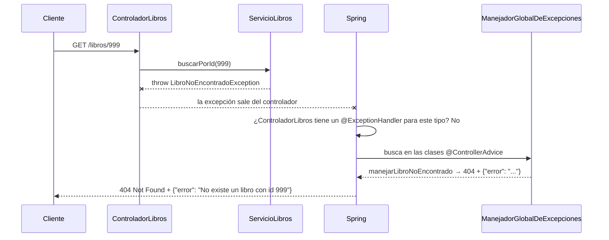

# 💡 Ejemplo 06 — `@ControllerAdvice`: manejo global

## 🌍 Contexto

El Ejemplo 05 dejó el manejo de `LibroNoEncontradoException` dentro de `ControladorLibros`. Si otra excepción necesitara el mismo tratamiento, o si el proyecto agregara un controlador nuevo, habría que repetir ese código en cada lugar. Este ejemplo lo centraliza.

**Qué busca demostrar este ejemplo**: crear `ManejadorGlobalDeExcepciones`, anotada con `@ControllerAdvice`, que maneje `LibroNoEncontradoException` y `LibroDuplicadoException` para **toda la aplicación**, y dejar `ControladorLibros` sin ningún método de manejo de errores.

## 📚 Caso de estudio

Biblioteca Universitaria: mismo proyecto de los Ejemplos 03 al 05.

<details>
<summary>💻 <b>Código fuente</b> (reutilizado de los Ejemplos 03 al 05)</summary>

<details>
<summary>📄 Ver código completo de <code>Libro.java</code></summary>

```java
package com.biblioteca.negocio.model;

@Entity
public class Libro {

    @Id
    @GeneratedValue(strategy = GenerationType.IDENTITY)
    private Long id;

    @Column(unique = true)
    private String isbn;

    private String titulo;

    protected Libro() {
    }

    public Libro(String isbn, String titulo) {
        this.isbn = isbn;
        this.titulo = titulo;
    }

    public Long getId() { return id; }
    public String getIsbn() { return isbn; }
    public String getTitulo() { return titulo; }
    public void setTitulo(String titulo) { this.titulo = titulo; }
}
```

</details>

<details>
<summary>📄 Ver código completo de <code>RepositorioLibros.java</code></summary>

```java
package com.biblioteca.persistence.repository;

import com.biblioteca.negocio.model.Libro;

public interface RepositorioLibros extends JpaRepository<Libro, Long> {
    Optional<Libro> findByIsbn(String isbn);
}
```

</details>

<details>
<summary>📄 Ver código completo de <code>LibroNoEncontradoException.java</code></summary>

```java
package com.biblioteca.negocio.excepcion;

@ResponseStatus(HttpStatus.NOT_FOUND)
public class LibroNoEncontradoException extends RuntimeException {

    public LibroNoEncontradoException(Long id) {
        super("No existe un libro con id " + id);
    }
}
```

</details>

<details>
<summary>📄 Ver código completo de <code>LibroDuplicadoException.java</code></summary>

```java
package com.biblioteca.negocio.excepcion;

@ResponseStatus(HttpStatus.CONFLICT)
public class LibroDuplicadoException extends RuntimeException {

    public LibroDuplicadoException(String isbn) {
        super("Ya existe un libro con isbn " + isbn);
    }
}
```

</details>

<details>
<summary>📄 Ver código completo de <code>ServicioLibros.java</code></summary>

```java
package com.biblioteca.negocio.service;

import com.biblioteca.negocio.excepcion.LibroDuplicadoException;
import com.biblioteca.negocio.excepcion.LibroNoEncontradoException;
import com.biblioteca.negocio.model.Libro;
import com.biblioteca.persistence.repository.RepositorioLibros;

@Service
public class ServicioLibros {

    private final RepositorioLibros repositorioLibros;

    public ServicioLibros(RepositorioLibros repositorioLibros) {
        this.repositorioLibros = repositorioLibros;
    }

    public List<Libro> listarTodos() {
        return repositorioLibros.findAll();
    }

    public Libro buscarPorId(Long id) {
        return repositorioLibros.findById(id)
                .orElseThrow(() -> new LibroNoEncontradoException(id));
    }

    public Optional<Libro> buscarPorIsbn(String isbn) {
        return repositorioLibros.findByIsbn(isbn);
    }

    public Libro crear(Libro libro) {
        repositorioLibros.findByIsbn(libro.getIsbn())
                .ifPresent(existente -> {
                    throw new LibroDuplicadoException(libro.getIsbn());
                });
        return repositorioLibros.save(libro);
    }

    public Libro actualizar(Long id, Libro datos) {
        Libro libro = buscarPorId(id);
        libro.setTitulo(datos.getTitulo());
        return repositorioLibros.save(libro);
    }

    public void eliminar(Long id) {
        Libro libro = buscarPorId(id);
        repositorioLibros.delete(libro);
    }
}
```

</details>

<details>
<summary>📄 Ver código completo de <code>RespuestaError.java</code></summary>

```java
package com.biblioteca.presentacion.dto;

public record RespuestaError(String error) {
}
```

</details>

</details>

<details>
<summary>💻 Archivo: <code>ControladorLibros.java</code> (sin ningún <code>@ExceptionHandler</code>)</summary>

```java
package com.biblioteca.presentacion.controlador;

import com.biblioteca.negocio.model.Libro;
import com.biblioteca.negocio.service.ServicioLibros;

@RestController
@RequestMapping("/libros")
public class ControladorLibros {

    private final ServicioLibros servicioLibros;

    public ControladorLibros(ServicioLibros servicioLibros) {
        this.servicioLibros = servicioLibros;
    }

    @GetMapping
    public List<Libro> listarTodos() {
        return servicioLibros.listarTodos();
    }

    @GetMapping("/{id}")
    public Libro buscarPorId(@PathVariable Long id) {
        return servicioLibros.buscarPorId(id);
    }

    @GetMapping("/buscar")
    public ResponseEntity<Libro> buscarPorIsbn(@RequestParam String isbn) {
        return servicioLibros.buscarPorIsbn(isbn)
                .map(ResponseEntity::ok)
                .orElseGet(() -> ResponseEntity.notFound().build());
    }

    @PostMapping
    public ResponseEntity<Libro> crear(@RequestBody Libro libro) {
        Libro creado = servicioLibros.crear(libro);
        return ResponseEntity.status(HttpStatus.CREATED).body(creado);
    }

    @PutMapping("/{id}")
    public Libro actualizar(@PathVariable Long id, @RequestBody Libro datos) {
        return servicioLibros.actualizar(id, datos);
    }

    @DeleteMapping("/{id}")
    public ResponseEntity<Void> eliminar(@PathVariable Long id) {
        servicioLibros.eliminar(id);
        return ResponseEntity.ok().build();
    }
}
```

</details>


<details>
<summary>💻 Archivo: <code>ManejadorGlobalDeExcepciones.java</code> (nuevo)</summary>

```java
package com.biblioteca.presentacion.excepcion;

import com.biblioteca.negocio.excepcion.LibroDuplicadoException;
import com.biblioteca.negocio.excepcion.LibroNoEncontradoException;
import com.biblioteca.presentacion.dto.RespuestaError;

@ControllerAdvice
public class ManejadorGlobalDeExcepciones {

    @ExceptionHandler(LibroNoEncontradoException.class)
    public ResponseEntity<RespuestaError> manejarLibroNoEncontrado(LibroNoEncontradoException ex) {
        return ResponseEntity.status(HttpStatus.NOT_FOUND).body(new RespuestaError(ex.getMessage()));
    }

    @ExceptionHandler(LibroDuplicadoException.class)
    public ResponseEntity<RespuestaError> manejarLibroDuplicado(LibroDuplicadoException ex) {
        return ResponseEntity.status(HttpStatus.CONFLICT).body(new RespuestaError(ex.getMessage()));
    }
}
```

</details>

## 🧭 Explicación

### 1. ¿Qué cambió respecto al Ejemplo 05?

| | Ejemplo 05 | Este ejemplo |
|---|---|---|
| Dónde vive el `@ExceptionHandler` | **Dentro** de `ControladorLibros` | En una clase aparte: `ManejadorGlobalDeExcepciones` |
| Alcance | Solo `ControladorLibros` | **Todos** los controladores |
| `LibroDuplicadoException` | Cuerpo por defecto de Spring | Cuerpo `{"error": "..."}`, igual que la otra excepción |
| `ControladorLibros` | Contiene código de manejo de errores | No contiene ninguno |

La lógica de los métodos **no cambió**: solo se trasladaron de lugar.

### 2. ¿Qué hace `@ControllerAdvice`?

```java
@ControllerAdvice
public class ManejadorGlobalDeExcepciones { ... }
```

Marca una clase como un **manejador compartido**: sus métodos `@ExceptionHandler` valen para cualquier controlador de la aplicación. Spring la detecta por sí solo (es un componente más), sin registrarla en ningún lugar.

| Anotación | Dónde se declara | Alcance |
|---|---|---|
| `@ExceptionHandler` | En un método **de un controlador** | Solo ese controlador |
| `@ExceptionHandler` | En un método **de una clase `@ControllerAdvice`** | Toda la aplicación |

> 🔑 `@ControllerAdvice` no reemplaza a `@ExceptionHandler`: lo sigue necesitando. Solo cambia **dónde vive** el método.

### 3. ¿Cómo se ejecuta? (`GET /libros/999`)



1. El cliente envía `GET /libros/999` y el servicio **lanza** `LibroNoEncontradoException`.
2. La excepción sale del controlador sin ser capturada.
3. Spring busca primero un `@ExceptionHandler` **dentro del propio controlador**. No hay ninguno.
4. Spring busca entonces en las clases `@ControllerAdvice` y encuentra `manejarLibroNoEncontrado`, cuyo tipo coincide.
5. Spring invoca ese método, que construye el `ResponseEntity` con el código `404` y el cuerpo `{"error": ...}`.
6. Esa respuesta es la que recibe el cliente.

Con `LibroDuplicadoException` ocurre lo mismo, pero Spring invoca `manejarLibroDuplicado` y responde `409`.

### 4. ¿Qué ocurre si hay un manejador local y uno global?

Gana el **local**: Spring revisa primero el controlador y, solo si no encuentra un manejador allí, consulta las clases `@ControllerAdvice`. Esto permite un tratamiento especial para un controlador concreto sin afectar al resto.

### 5. Ventaja principal

Si el proyecto agrega un controlador nuevo (por ejemplo, para `Editorial`) que también lanza estas excepciones, queda cubierto **sin escribir código de manejo adicional**. Con `@ExceptionHandler` local habría que repetirlo en cada controlador.

> 💡 **¿Por qué un DTO y no un `Map`?** `RespuestaError` (Ejemplo 05) es un *Data Transfer Object*: una clase (aquí un `record`) que declara qué datos viajan en la respuesta de la API. Vive en `presentacion/dto` porque describe lo que sale por HTTP, no una regla de negocio. El JSON es el mismo (`{"error": "<mensaje>"}`), pero el contrato queda escrito en código y el compilador lo verifica.

## ✅ Resultado esperado

```text
Método: GET
URL: http://localhost:8080/libros/999
Respuesta: 404 Not Found
{
  "error": "No existe un libro con id 999"
}
```

```text
Método: POST
URL: http://localhost:8080/libros
Cuerpo: {"isbn": "978-0-13-468599-1", "titulo": "Effective Java (copia)"}
Respuesta: 409 Conflict
{
  "error": "Ya existe un libro con isbn 978-0-13-468599-1"
}
```

(Mismo resultado que antes para `LibroNoEncontradoException`; nuevo cuerpo
personalizado para `LibroDuplicadoException`, que en el Ejemplo 05 no lo
tenía.)

## ❓ Preguntas de repaso

**1. [Selección]** ¿Qué anotación permite que una clase maneje
excepciones para todos los controladores de una aplicación?

- **A.** `@ExceptionHandler`.
- **B.** `@RestController`.
- **C.** `@ControllerAdvice`.
- **D.** `@ResponseStatus`.

<details>
<summary>🔑 Ver respuesta</summary>

**Respuesta correcta: C**. `@ControllerAdvice` marca una clase como
manejador global, aplicable a todos los controladores.

</details>

**2. [Selección múltiple]** Sobre este ejemplo, seleccionar **todas** las
afirmaciones correctas.

- **A.** `ControladorLibros` ya no tiene ningún método `@ExceptionHandler` propio.
- **B.** `ManejadorGlobalDeExcepciones` solo aplica a `ControladorLibros`.
- **C.** Un controlador nuevo que lance `LibroDuplicadoException` quedaría cubierto automáticamente.
- **D.** El código de los métodos dentro de `ManejadorGlobalDeExcepciones` es el mismo que tenían los `@ExceptionHandler` locales.

<details>
<summary>🔑 Ver respuesta</summary>

**Respuestas correctas: A, C, D**. La B es falsa: `@ControllerAdvice`
aplica a todos los controladores de la aplicación, no solo a uno.

</details>

**3. [Abierta]** Un compañero pregunta: "si `@ControllerAdvice` es
claramente superior a `@ExceptionHandler` local, ¿por qué este módulo
enseñó primero el local, en vez de ir directo al global?".

**Pregunta**: ¿Qué respuesta corresponde?

<details>
<summary>🔑 Ver respuesta modelo</summary>

**Respuesta modelo**: `@ControllerAdvice` no reemplaza el concepto de
`@ExceptionHandler`: lo **traslada** de un controlador a una clase
centralizada — el método sigue siendo un `@ExceptionHandler`, solo cambia
dónde vive. Entender primero cómo funciona `@ExceptionHandler` dentro de
un controlador (Ejemplo 05) deja claro qué hace cada mecanismo por
separado, antes de ver por qué centralizarlo con `@ControllerAdvice`
resuelve el problema de duplicación entre varios controladores — el mismo
criterio de progresión pedagógica (de lo simple a lo más completo) usado
en todo el curso.

</details>
