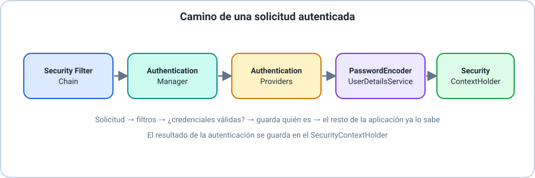
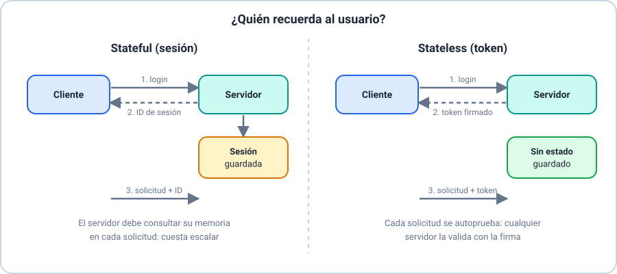
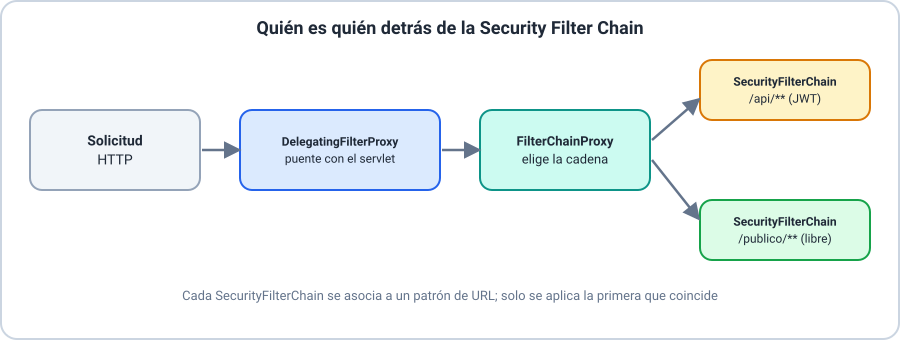
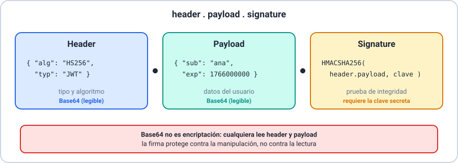
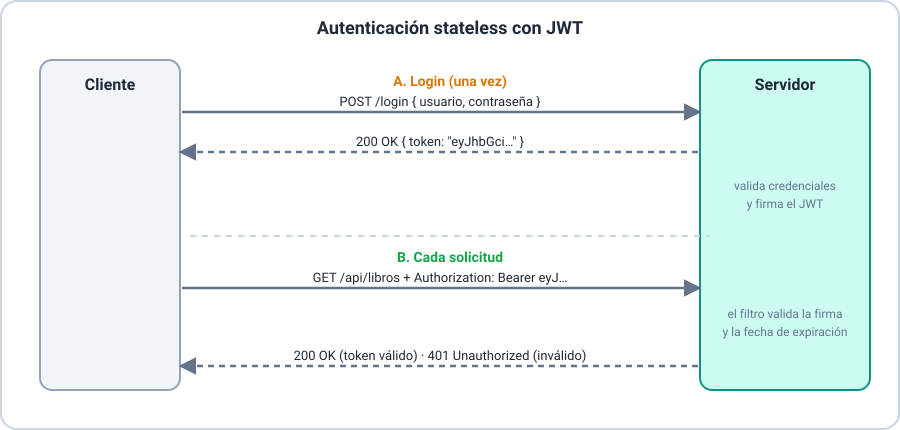

# 🖥️ Presentación — Módulo 8: Spring Boot Security y JWT

## Slide 1 — Título

**Módulo 8 — Spring Boot Security y JWT**
Curso Spring Boot para Aplicaciones Empresariales

## Slide 2 — Objetivos del módulo

Al finalizar, vas a poder proteger tu API REST con Spring Security,
primero con autenticación básica y luego con autenticación stateless
completa usando JWT.

## Slide 3 — Ruta de la sesión

5 bloques: ¿Qué es Spring Security? → Stateful vs. Stateless →
Filtros en servicios Stateless → Implementación básica → JWT.

## Slide 4 — El problema de hoy

`ControladorLibros`, `ControladorPacientes` y `ControladorCitas`
responden a cualquiera que conozca su URL, sin ninguna verificación de
identidad.

## Slide 5 — ¿Qué es Spring Boot Security?

Parte del framework Spring que gestiona **autenticación** (quién sos) y
**autorización** (qué podés hacer).

## Slide 6 — Conceptos clave

Roles y autoridades · cadena de filtros de seguridad · protección CSRF ·
control de sesiones.

## Slide 7 — Actividad práctica: Ejemplo 01

Repasar los conceptos clave de Spring Security con ejemplos concretos.

## Slide 8 — 🗺️ Arquitectura de Spring Security

## Slide 9 — El flujo completo

Si las credenciales coinciden, el resultado se guarda en el
`SecurityContextHolder` — el resto de la aplicación ya sabe quién hizo la
solicitud.

## Slide 10 — Actividad práctica: Ejemplo 02 e Intermedio 02

Ubicar cada componente de la arquitectura en un paso concreto del
proceso de autenticación.

## Slide 11 — Dos tipos de arquitectura RESTful

**Stateful**: el servidor recuerda el estado entre solicitudes.
**Stateless**: cada solicitud se procesa de forma independiente.

## Slide 12 — 🗺️ Stateful vs. Stateless

## Slide 13 — Aplicaciones típicas de arquitecturas stateless

Servicios REST · archivos estáticos · serverless · balanceadores de
carga · buscadores · autenticación JWT · microservicios.

## Slide 14 — Actividad práctica: Ejemplo 03 y Básico 01

Clasificar sistemas reales como stateful o stateless.

## Slide 15 — Detrás de la Security Filter Chain

Tres clases concretas: `FilterChainProxy`, `DelegatingFilterProxy`,
`SecurityFilterChain`.

## Slide 16 — Los tres roles

`DelegatingFilterProxy` integra con Servlet · `FilterChainProxy` coordina
cadenas · `SecurityFilterChain` define una cadena para un patrón de URL.

## Slide 17 — Actividad práctica: Ejemplo 04

Explicar la diferencia entre `FilterChainProxy` y `SecurityFilterChain`.

## Slide 18 — Primer paso práctico

Agregar `spring-boot-starter-security` al `pom.xml` — sin escribir
ninguna configuración.

## Slide 19 — El efecto inmediato

Todos los endpoints quedan protegidos; la consola muestra una contraseña
autogenerada para el usuario `user`.

## Slide 20 — Probar con Basic Auth

En Insomnia: pestaña de autenticación → "Basic Auth" → usuario `user` +
contraseña de consola.

## Slide 21 — Actividad práctica: Ejemplo 05 e Intermedio 01

Agregar Spring Security a un proyecto dado y probarlo con autenticación
básica.

## Slide 22 — Las limitaciones de Basic Auth

Contraseña autogenerada que cambia en cada arranque; un único usuario
sin roles distintos — no escala a un sistema real.

## Slide 23 — ¿Qué es JWT?

JSON Web Token: estándar abierto (RFC 7519) para representar información
firmada digitalmente entre dos partes.

## Slide 24 — 🗺️ Estructura de un JWT

Base64 no es encriptación: cualquiera puede decodificar header y
payload; la firma protege contra la manipulación, no contra la lectura.

## Slide 25 — Actividad práctica: Ejemplo 06 y Básico 02

Identificar las tres partes de un JWT dado.

## Slide 26 — 🗺️ Ciclo de vida de un JWT

## Slide 27 — Detección de manipulación

Si se modifica el payload sin recalcular la firma, la firma ya no
coincide — el servidor rechaza el token.

## Slide 28 — Actividad práctica: Ejemplo 07

Explicar por qué un JWT con el payload modificado es rechazado.

## Slide 29 — Implementación completa: login + filtro

`ControladorAutenticacion` (emite el JWT) + `FiltroAutenticacionJwt`
(lo valida en cada solicitud) — sin tocar ninguna clase de dominio.

## Slide 30 — `Credencial`, no `Usuario`

Una entidad de credenciales de seguridad, deliberadamente distinta de
cualquier entidad de dominio existente.

## Slide 31 — Actividad práctica: Ejemplo 08, Intermedio 03 y Avanzado 01-03

Implementar y diagnosticar el login y el filtro de validación de JWT.

## Slide 32 — Actividad práctica: Taller 01 y Desafío 01

Taller: Spring Security + JWT sobre `Paciente`. Desafío: mismo patrón
sobre `Cita`.

## Slide 33 — Resumen del módulo

Qué es Spring Security → arquitectura → stateful/stateless → filtros →
Basic Auth → JWT (estructura, ciclo de vida, implementación completa).

## Slide 34 — Evaluación

Quiz de 16 ítems + 9 ejercicios (incluido 1 Desafío) + 1 Taller,
cubriendo los 10 resultados de aprendizaje del módulo.

## Slide 35 — Próximo módulo

El curso continúa construyendo sobre esta API ya protegida, con
autenticación stateless de nivel profesional en cada capa.
