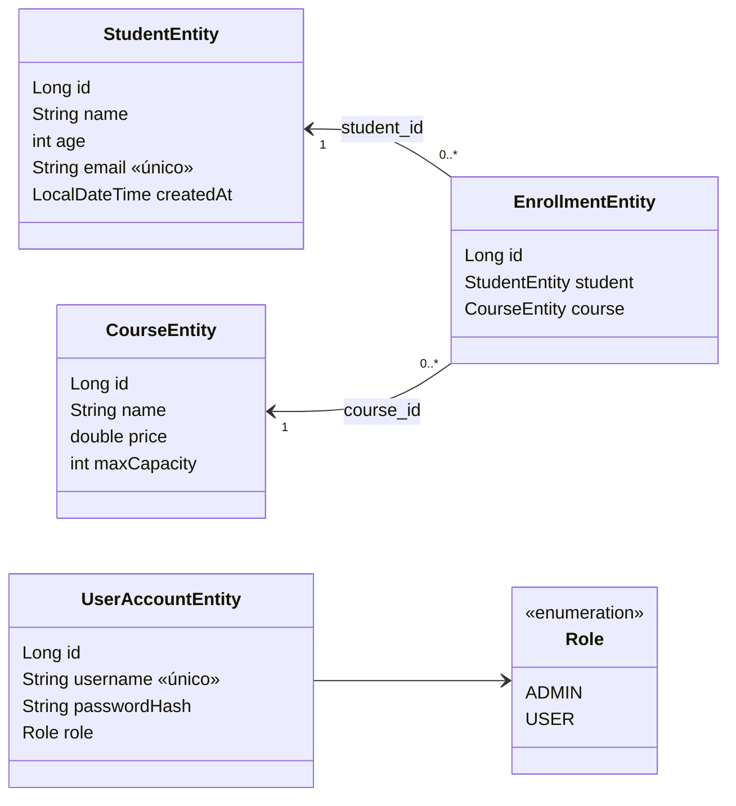
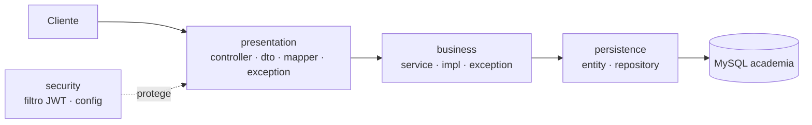

# 🎓 Guía práctica: construir la API Academia desde cero

> **Objetivo:** construir, paso a paso y en modo práctica, la API de **estudiantes, cursos y matrículas** con capas, DTO, validaciones, manejo de excepciones, Swagger y Spring Security + JWT.
> Es un resumen: solo lo esencial de cada concepto, corto y para teclear. El proyecto terminado está en [`academica-security`](../../../../curso-spring-boot-src/07-01-proyecto-academico/backend/academica-security/).

⏱️ ~2 h · ☕ Java 21 · Maven · MySQL 8 · Spring Boot 4.1.2

---

## 📁 Estructura final del proyecto

<details>
<summary><strong>📁 Árbol de archivos (con el paso que crea cada uno)</strong></summary>

```text
📁 academica-security
├── 📄 pom.xml                                   Paso 0
├── 📄 migrate.sql                               datos de ejemplo (opcional)
├── 📄 probar-apis.sh                            pruebas por consola (opcional)
└── 📁 src/main
    ├── 📁 java/com/academy
    │   ├── 📄 AcademyApplication.java           Paso 0
    │   ├── 📁 persistence
    │   │   ├── 📁 entity
    │   │   │   ├── 📄 StudentEntity.java        Paso 2
    │   │   │   ├── 📄 CourseEntity.java         Paso 2
    │   │   │   ├── 📄 EnrollmentEntity.java     Paso 2
    │   │   │   ├── 📄 Role.java                 Paso 9
    │   │   │   └── 📄 UserAccountEntity.java    Paso 9
    │   │   └── 📁 repository
    │   │       ├── 📄 StudentJpaRepository.java      Paso 2
    │   │       ├── 📄 CourseJpaRepository.java       Paso 2
    │   │       ├── 📄 EnrollmentJpaRepository.java   Paso 2
    │   │       └── 📄 UserAccountJpaRepository.java  Paso 9
    │   ├── 📁 business
    │   │   ├── 📁 exception                     Paso 3
    │   │   │   ├── 📄 StudentNotFoundException.java
    │   │   │   ├── 📄 StudentEmailAlreadyExistsException.java
    │   │   │   ├── 📄 CourseNotFoundException.java
    │   │   │   ├── 📄 EnrollmentNotFoundException.java
    │   │   │   ├── 📄 AlreadyEnrolledException.java
    │   │   │   └── 📄 CourseFullException.java
    │   │   ├── 📁 service                       Paso 3 (interfaces)
    │   │   │   ├── 📄 StudentService.java
    │   │   │   ├── 📄 CourseService.java
    │   │   │   └── 📄 EnrollmentService.java
    │   │   └── 📁 impl                          Paso 3 (implementaciones)
    │   │       ├── 📄 StudentServiceImpl.java
    │   │       ├── 📄 CourseServiceImpl.java
    │   │       └── 📄 EnrollmentServiceImpl.java
    │   ├── 📁 presentation
    │   │   ├── 📁 dto
    │   │   │   ├── 📄 StudentRequest · CourseRequest · EnrollmentRequest        Paso 4
    │   │   │   ├── 📄 StudentResponse · CourseResponse · EnrollmentResponse     Paso 4
    │   │   │   ├── 📄 EnrolledResponse · PageResponse · ErrorResponse           Paso 4
    │   │   │   └── 📄 LoginRequest · LoginResponse · MeResponse                 Paso 12
    │   │   ├── 📁 mapper                        Paso 5
    │   │   │   ├── 📄 StudentMapper.java
    │   │   │   ├── 📄 CourseMapper.java
    │   │   │   └── 📄 EnrollmentMapper.java
    │   │   ├── 📁 controller
    │   │   │   ├── 📄 StudentController.java    Paso 6
    │   │   │   ├── 📄 CourseController.java     Paso 6
    │   │   │   ├── 📄 EnrollmentController.java Paso 6
    │   │   │   ├── 📄 InternalController.java   Paso 6
    │   │   │   └── 📄 AuthController.java       Paso 12
    │   │   ├── 📁 exception
    │   │   │   └── 📄 GlobalExceptionHandler.java   Paso 7
    │   │   └── 📁 config
    │   │       └── 📄 OpenApiConfig.java        Paso 8
    │   └── 📁 security
    │       ├── 📄 AccountSeeder.java            Paso 9
    │       ├── 📄 JpaUserDetailsService.java    Paso 9
    │       ├── 📄 JwtProperties.java            Paso 10
    │       ├── 📄 JwtService.java               Paso 10
    │       ├── 📄 AuthService.java              Paso 10
    │       ├── 📄 JwtAuthenticationFilter.java  Paso 10
    │       ├── 📄 SecurityErrorWriter.java      Paso 10
    │       ├── 📄 RestAuthenticationEntryPoint.java  Paso 10
    │       ├── 📄 RestAccessDeniedHandler.java  Paso 10
    │       └── 📄 SecurityConfig.java           Paso 11
    └── 📁 resources
        └── 📄 application.properties            Paso 1 (+ app.jwt.* en el Paso 10)
```

</details>

---

## 1. 🧩 Diagrama de clases (entidades)



- **Matrícula** = relación estudiante–curso (un estudiante no puede repetirse en un curso).
- **Cuenta de usuario** es independiente del estudiante: solo sirve para autenticarse.

### Arquitectura en 3 capas



Regla: cada capa solo habla con la de abajo. El controller **nunca** devuelve entidades: devuelve DTO.

---

## 2. 🌐 Endpoints que tendrá la API

Base: `http://localhost:8080` · Cabecera: `Authorization: Bearer <token>`

| Método | Ruta | Acceso | Éxito | Errores |
|---|---|---|---|---|
| `POST` | `/api/v1/auth/login` | 🌍 Público | 200 token | 400, 401 |
| `GET` | `/api/v1/auth/me` | 🔑 Autenticado | 200 | 401 |
| `GET` | `/api/v1/students` | 🔑 | 200 página | 400 |
| `GET` | `/api/v1/students/{id}` | 🔑 | 200 | 404 |
| `GET` | `/api/v1/students/by-email?email=` | 🔑 | 200 | 400, 404 |
| `POST` | `/api/v1/students` | 🔑 | 201 + `Location` | 400, 409 (correo repetido) |
| `GET` | `/api/v1/courses` | 🔑 | 200 página | 400 |
| `GET` | `/api/v1/courses/{id}` | 🔑 | 200 | 404 |
| `GET` | `/api/v1/courses/{id}/enrolled` | 🔑 | 200 `{courseId, enrolled}` | 404 |
| `POST` | `/api/v1/courses` | 👑 `ADMIN` | 201 + `Location` | 400, 403 |
| `GET` | `/api/v1/enrollments/{id}` | 🔑 | 200 | 404 |
| `POST` | `/api/v1/enrollments` | 🔑 | 201 + `Location` | 400, 404, 409 (repetida / sin cupo) |
| `GET` | `/internal/health` | 🌍 | 200 | — |
| `POST` | `/internal/seed` | 👑 `ADMIN` | 200 | 403 |
| `GET` | `/swagger-ui.html` · `/api-docs` | 🌍 | — | — |

**Servicios de negocio**

| Interfaz | Métodos |
|---|---|
| `StudentService` | `findAll(Pageable)` · `findById(id)` · `findByEmail(email)` · `create(student)` |
| `CourseService` | `findAll(Pageable)` · `findById(id)` · `create(course)` · `countEnrolled(courseId)` |
| `EnrollmentService` | `findById(id)` · `enroll(studentId, courseId)` |

**Reglas de negocio:** correo único · no matricular dos veces al mismo estudiante en el mismo curso · no pasar del cupo (`maxCapacity`).

**Cuentas de práctica:** `admin / admin123` (ADMIN) · `ana / ana123` (USER).

---

## 3. 🛠️ Paso a paso

> 📌 **Cómo leer los pasos.** Cada bloque de código trae encima su **📄 ruta** (relativa a la raíz del proyecto, la carpeta donde está `pom.xml`) y el archivo **completo**: con su `package` y todos sus `import`. Se crea el archivo en esa ruta, se pega el contenido tal cual y funciona; no hay que añadir librerías aparte (todas están en el `pom.xml` del Paso 0).
> Las rutas Java empiezan en `src/main/java/com/academy/`; cada carpeta nueva (`persistence/entity`, `business/service`…) se crea en el IDE con *New → Package*.

<details>
<summary><strong>Paso 0 · Preparar el entorno y el <code>pom.xml</code></strong></summary>

```bash
docker run -d --name academy-mysql -e MYSQL_ROOT_PASSWORD=root \
  -e MYSQL_DATABASE=academia -p 3306:3306 mysql:8.0
```

Crear el proyecto en <https://start.spring.io>: Maven · Java 21 · Spring Boot 4.1.2 · group `com.academy` · artifact `academy`. Estas son **todas** las dependencias del proyecto:

| # | Dependencia (`groupId:artifactId`) | Versión | Scope | Initializr | Para qué se usa | Paso |
|---|---|---|---|---|---|---|
| 1 | `org.springframework.boot:spring-boot-starter-webmvc` | la de Boot (4.1.2) | compile | Spring Web | Controladores REST, JSON | 6 |
| 2 | `org.springframework.boot:spring-boot-starter-data-jpa` | la de Boot | compile | Spring Data JPA | Entidades, repositorios, Hibernate | 2 |
| 3 | `org.springframework.boot:spring-boot-starter-validation` | la de Boot | compile | Validation | `@Valid`, `@NotBlank`, `@Email`… | 4 |
| 4 | `org.springframework.boot:spring-boot-starter-security` | la de Boot | compile | Spring Security | Autenticación, roles, BCrypt | 9 |
| 5 | `org.springdoc:springdoc-openapi-starter-webmvc-ui` | 3.2.0 | compile | — (a mano) | Swagger UI y OpenAPI | 8 |
| 6 | `io.jsonwebtoken:jjwt-api` | 0.12.6 | compile | — (a mano) | API para crear y leer JWT | 10 |
| 7 | `io.jsonwebtoken:jjwt-impl` | 0.12.6 | runtime | — (a mano) | Implementación de JJWT | 10 |
| 8 | `io.jsonwebtoken:jjwt-jackson` | 0.12.6 | runtime | — (a mano) | JSON de JJWT con Jackson | 10 |
| 9 | `com.mysql:mysql-connector-j` | la de Boot | runtime | MySQL Driver | Conexión con MySQL | 1 |
| 10 | `org.springframework.boot:spring-boot-devtools` | la de Boot | runtime, `optional` | Spring Boot DevTools | Reinicio automático al editar | — |

Además, el plugin `spring-boot-maven-plugin` (`build`) para ejecutar con `./mvnw spring-boot:run`.

> 💡 «La de Boot» = no se escribe `<version>`: la gestiona el `spring-boot-starter-parent` 4.1.2. Solo las filas 5-8 llevan versión.

Si se genera el proyecto en Initializr, **reemplazar su `pom.xml`** por este (ya incluye todas las dependencias, también Swagger y JWT, que Initializr no ofrece):

**📄 `pom.xml`**

```xml
<?xml version="1.0" encoding="UTF-8"?>
<project xmlns="http://maven.apache.org/POM/4.0.0" xmlns:xsi="http://www.w3.org/2001/XMLSchema-instance" xsi:schemaLocation="http://maven.apache.org/POM/4.0.0 https://maven.apache.org/xsd/maven-4.0.0.xsd">
    <modelVersion>4.0.0</modelVersion>
    <parent>
        <groupId>org.springframework.boot</groupId>
        <artifactId>spring-boot-starter-parent</artifactId>
        <version>4.1.2</version>
        <relativePath/>
    </parent>
    <groupId>com.academy</groupId>
    <artifactId>academy-security</artifactId>
    <version>0.0.1-SNAPSHOT</version>
    <name>academy</name>
    <description>Taller de gestión de cursos con base de datos</description>
    <properties>
        <java.version>21</java.version>
    </properties>
    <dependencies>
        <dependency>
            <groupId>org.springframework.boot</groupId>
            <artifactId>spring-boot-starter-webmvc</artifactId>
        </dependency>
        <dependency>
            <groupId>org.springframework.boot</groupId>
            <artifactId>spring-boot-starter-data-jpa</artifactId>
        </dependency>
        <dependency>
            <groupId>org.springframework.boot</groupId>
            <artifactId>spring-boot-starter-validation</artifactId>
        </dependency>
        <dependency>
            <groupId>org.springframework.boot</groupId>
            <artifactId>spring-boot-starter-security</artifactId>
        </dependency>
        <dependency>
            <groupId>org.springdoc</groupId>
            <artifactId>springdoc-openapi-starter-webmvc-ui</artifactId>
            <version>3.2.0</version>
        </dependency>
        <dependency>
            <groupId>io.jsonwebtoken</groupId>
            <artifactId>jjwt-api</artifactId>
            <version>0.12.6</version>
        </dependency>
        <dependency>
            <groupId>io.jsonwebtoken</groupId>
            <artifactId>jjwt-impl</artifactId>
            <version>0.12.6</version>
            <scope>runtime</scope>
        </dependency>
        <dependency>
            <groupId>io.jsonwebtoken</groupId>
            <artifactId>jjwt-jackson</artifactId>
            <version>0.12.6</version>
            <scope>runtime</scope>
        </dependency>
        <dependency>
            <groupId>com.mysql</groupId>
            <artifactId>mysql-connector-j</artifactId>
            <scope>runtime</scope>
        </dependency>
        <dependency>
            <groupId>org.springframework.boot</groupId>
            <artifactId>spring-boot-devtools</artifactId>
            <scope>runtime</scope>
            <optional>true</optional>
        </dependency>
    </dependencies>
    <build>
        <plugins>
            <plugin>
                <groupId>org.springframework.boot</groupId>
                <artifactId>spring-boot-maven-plugin</artifactId>
            </plugin>
        </plugins>
    </build>
</project>
```

Archivo de arranque (Initializr ya lo crea; si falta, se crea así):

**📄 `src/main/java/com/academy/AcademyApplication.java`**

```java
package com.academy;

import org.springframework.boot.SpringApplication;
import org.springframework.boot.autoconfigure.SpringBootApplication;

@SpringBootApplication
public class AcademyApplication {

    public static void main(String[] args) {
        SpringApplication.run(AcademyApplication.class, args);
    }
}
```

Estructura de paquetes bajo `com.academy` (se crean vacíos ahora y se llenan en los pasos siguientes):

```text
persistence/{entity,repository}
business/{service,impl,exception}
presentation/{controller,dto,mapper,exception,config}
security
```

> ⚠️ **Spring Security está en el `pom.xml` desde este paso**, así que **hasta terminar el Paso 11 toda petición HTTP responde `401`**. Para probar los pasos 1-8 sin haber hecho el login se usa el usuario que Spring crea solo: `curl -u user:<contraseña> …`, con la contraseña que aparece en consola en la línea `Using generated security password`. Desde el Paso 11 se usa el token JWT.

</details>

<details>
<summary><strong>Paso 1 · <code>application.properties</code></strong></summary>

Archivo de configuración: conexión a MySQL, JPA, límites de paginación, errores sin detalles internos, clave JWT y Swagger. (La parte `app.jwt.*` se usa en el Paso 10.)

**📄 `src/main/resources/application.properties`**

```properties
# MySQL connection
spring.datasource.url=jdbc:mysql://localhost:3306/academia?createDatabaseIfNotExist=true
spring.datasource.username=root
spring.datasource.password=root

# JPA and Hibernate
spring.jpa.hibernate.ddl-auto=create
spring.jpa.show-sql=true

# Pagination limits (protect the API)
spring.data.web.pageable.default-page-size=10
spring.data.web.pageable.max-page-size=50

# Error responses: do not expose internals (DevTools shows them by default)
server.error.include-stacktrace=never
server.error.include-message=never
server.error.include-binding-errors=never

# JWT -- SOLO PARA FINES EDUCATIVOS: en un proyecto real la clave se entrega por
# variable de entorno (JWT_SECRET) o un gestor de secretos, nunca escrita en el repositorio.
app.jwt.secret=${JWT_SECRET:academy-clave-solo-educativa-cambiar-en-produccion-0123456789}
app.jwt.expiration-seconds=3600

# Swagger (springdoc)
springdoc.api-docs.path=/api-docs
springdoc.swagger-ui.path=/swagger-ui.html
springdoc.swagger-ui.urls-primary-name=Academy
springdoc.swagger-ui.deep-linking=true
springdoc.swagger-ui.operations-sorter=method
springdoc.swagger-ui.tags-sorter=alpha
springdoc.swagger-ui.display-request-duration=true
springdoc.swagger-ui.doc-expansion=list
springdoc.swagger-ui.try-it-out-enabled=true
springdoc.swagger-ui.persist-authorization=true
springdoc.default-produces-media-type=application/json
springdoc.default-consumes-media-type=application/json
```

✅ **Checkpoint:** `./mvnw spring-boot:run` arranca y crea la base `academia`.

</details>

<details>
<summary><strong>Paso 2 · Persistencia: entidades y repositorios</strong></summary>

**📄 `src/main/java/com/academy/persistence/entity/StudentEntity.java`**

```java
package com.academy.persistence.entity;

import jakarta.persistence.Column;
import jakarta.persistence.Entity;
import jakarta.persistence.GeneratedValue;
import jakarta.persistence.GenerationType;
import jakarta.persistence.Id;
import jakarta.persistence.Table;
import org.hibernate.annotations.CreationTimestamp;

import java.time.LocalDateTime;

@Entity
@Table(name = "student")
public class StudentEntity {

    @Id
    @GeneratedValue(strategy = GenerationType.IDENTITY)
    private Long id;

    private String name;

    private int age;

    @Column(unique = true)
    private String email;

    @CreationTimestamp
    @Column(name = "created_at", updatable = false)
    private LocalDateTime createdAt;

    protected StudentEntity() {
    }

    public StudentEntity(String name, int age, String email) {
        this.name = name;
        this.age = age;
        this.email = email;
    }

    public Long getId() { return id; }
    public String getName() { return name; }
    public int getAge() { return age; }
    public String getEmail() { return email; }

    public LocalDateTime getCreatedAt() { return createdAt; }
}
```

**📄 `src/main/java/com/academy/persistence/entity/CourseEntity.java`**

```java
package com.academy.persistence.entity;

import jakarta.persistence.Entity;
import jakarta.persistence.GeneratedValue;
import jakarta.persistence.GenerationType;
import jakarta.persistence.Id;
import jakarta.persistence.Table;

@Entity
@Table(name = "course")
public class CourseEntity {

    @Id
    @GeneratedValue(strategy = GenerationType.IDENTITY)
    private Long id;

    private String name;

    private double price;

    private int maxCapacity;

    protected CourseEntity() {
    }

    public CourseEntity(String name, double price, int maxCapacity) {
        this.name = name;
        this.price = price;
        this.maxCapacity = maxCapacity;
    }

    public Long getId() { return id; }
    public String getName() { return name; }
    public double getPrice() { return price; }
    public int getMaxCapacity() { return maxCapacity; }
}
```

**📄 `src/main/java/com/academy/persistence/entity/EnrollmentEntity.java`**

```java
package com.academy.persistence.entity;

import jakarta.persistence.Entity;
import jakarta.persistence.GeneratedValue;
import jakarta.persistence.GenerationType;
import jakarta.persistence.Id;
import jakarta.persistence.JoinColumn;
import jakarta.persistence.ManyToOne;
import jakarta.persistence.Table;

@Entity
@Table(name = "enrollment")
public class EnrollmentEntity {

    @Id
    @GeneratedValue(strategy = GenerationType.IDENTITY)
    private Long id;

    @ManyToOne
    @JoinColumn(name = "student_id")
    private StudentEntity student;

    @ManyToOne
    @JoinColumn(name = "course_id")
    private CourseEntity course;

    protected EnrollmentEntity() {
    }

    public EnrollmentEntity(StudentEntity student, CourseEntity course) {
        this.student = student;
        this.course = course;
    }

    public Long getId() { return id; }
    public StudentEntity getStudent() { return student; }
    public CourseEntity getCourse() { return course; }
}
```

**📄 `src/main/java/com/academy/persistence/repository/StudentJpaRepository.java`**

```java
package com.academy.persistence.repository;

import com.academy.persistence.entity.StudentEntity;
import org.springframework.data.jpa.repository.JpaRepository;

import java.util.Optional;

public interface StudentJpaRepository extends JpaRepository<StudentEntity, Long> {

    Optional<StudentEntity> findByEmailIgnoreCase(String email);

    boolean existsByEmailIgnoreCase(String email);
}
```

**📄 `src/main/java/com/academy/persistence/repository/CourseJpaRepository.java`**

```java
package com.academy.persistence.repository;

import com.academy.persistence.entity.CourseEntity;
import org.springframework.data.jpa.repository.JpaRepository;

public interface CourseJpaRepository extends JpaRepository<CourseEntity, Long> {
}
```

**📄 `src/main/java/com/academy/persistence/repository/EnrollmentJpaRepository.java`**

```java
package com.academy.persistence.repository;

import com.academy.persistence.entity.EnrollmentEntity;
import org.springframework.data.jpa.repository.JpaRepository;

public interface EnrollmentJpaRepository extends JpaRepository<EnrollmentEntity, Long> {

    boolean existsByStudentIdAndCourseId(Long studentId, Long courseId);

    long countByCourseId(Long courseId);
}
```

💡 Los métodos de los repositorios se **derivan del nombre** (`findBy…`, `existsBy…`, `countBy…`): no se escribe SQL.

✅ **Checkpoint:** al arrancar, Hibernate crea las tablas `student`, `course`, `enrollment` (mira el SQL en consola).

</details>

<details>
<summary><strong>Paso 3 · Negocio: excepciones y servicios</strong></summary>

Excepciones (todas `extends RuntimeException`, con mensaje claro):

| Clase | Mensaje |
|---|---|
| `StudentNotFoundException` | «No existe un estudiante con id X» (`byId`, `byEmail`) |
| `CourseNotFoundException` | «No existe un curso con id X» |
| `EnrollmentNotFoundException` | «No existe una matrícula con id X» |
| `StudentEmailAlreadyExistsException` | «El correo X ya está registrado» |
| `AlreadyEnrolledException` | «El estudiante X ya está matriculado en el curso Y» |
| `CourseFullException` | «El curso X ya alcanzó su cupo de N» |

Servicios: interfaz en `business/service` + `…Impl` en `business/impl` con `@Service`. Lectura con `@Transactional(readOnly = true)`, escritura con `@Transactional`.

**Excepciones**

**📄 `src/main/java/com/academy/business/exception/StudentNotFoundException.java`**

```java
package com.academy.business.exception;

public class StudentNotFoundException extends RuntimeException {

    public StudentNotFoundException(String message) {
        super(message);
    }

    public static StudentNotFoundException byId(Long id) {
        return new StudentNotFoundException("No existe un estudiante con id " + id);
    }

    public static StudentNotFoundException byEmail(String email) {
        return new StudentNotFoundException("No existe un estudiante con el correo " + email);
    }
}
```

**📄 `src/main/java/com/academy/business/exception/CourseNotFoundException.java`**

```java
package com.academy.business.exception;

public class CourseNotFoundException extends RuntimeException {

    public CourseNotFoundException(Long id) {
        super("No existe un curso con id " + id);
    }
}
```

**📄 `src/main/java/com/academy/business/exception/EnrollmentNotFoundException.java`**

```java
package com.academy.business.exception;

public class EnrollmentNotFoundException extends RuntimeException {

    public EnrollmentNotFoundException(Long id) {
        super("No existe una matrícula con id " + id);
    }
}
```

**📄 `src/main/java/com/academy/business/exception/StudentEmailAlreadyExistsException.java`**

```java
package com.academy.business.exception;

public class StudentEmailAlreadyExistsException extends RuntimeException {

    public StudentEmailAlreadyExistsException(String email) {
        super("El correo " + email + " ya está registrado");
    }
}
```

**📄 `src/main/java/com/academy/business/exception/AlreadyEnrolledException.java`**

```java
package com.academy.business.exception;

public class AlreadyEnrolledException extends RuntimeException {

    public AlreadyEnrolledException(Long studentId, Long courseId) {
        super("El estudiante " + studentId + " ya está matriculado en el curso " + courseId);
    }
}
```

**📄 `src/main/java/com/academy/business/exception/CourseFullException.java`**

```java
package com.academy.business.exception;

public class CourseFullException extends RuntimeException {

    public CourseFullException(Long courseId, int maxCapacity) {
        super("El curso " + courseId + " ya alcanzó su cupo de " + maxCapacity);
    }
}
```

**Servicios (interfaces)**

**📄 `src/main/java/com/academy/business/service/StudentService.java`**

```java
package com.academy.business.service;

import com.academy.persistence.entity.StudentEntity;
import org.springframework.data.domain.Page;
import org.springframework.data.domain.Pageable;

public interface StudentService {

    Page<StudentEntity> findAll(Pageable pageable);

    StudentEntity findById(Long id);

    StudentEntity findByEmail(String email);

    StudentEntity create(StudentEntity student);
}
```

**📄 `src/main/java/com/academy/business/service/CourseService.java`**

```java
package com.academy.business.service;

import com.academy.persistence.entity.CourseEntity;
import org.springframework.data.domain.Page;
import org.springframework.data.domain.Pageable;

public interface CourseService {

    Page<CourseEntity> findAll(Pageable pageable);

    CourseEntity findById(Long id);

    CourseEntity create(CourseEntity course);

    long countEnrolled(Long courseId);
}
```

**📄 `src/main/java/com/academy/business/service/EnrollmentService.java`**

```java
package com.academy.business.service;

import com.academy.persistence.entity.EnrollmentEntity;

public interface EnrollmentService {

    EnrollmentEntity findById(Long id);

    EnrollmentEntity enroll(Long studentId, Long courseId);
}
```

**Implementaciones**

**📄 `src/main/java/com/academy/business/impl/StudentServiceImpl.java`**

```java
package com.academy.business.impl;

import com.academy.business.exception.StudentEmailAlreadyExistsException;
import com.academy.business.exception.StudentNotFoundException;
import com.academy.business.service.StudentService;
import com.academy.persistence.entity.StudentEntity;
import com.academy.persistence.repository.StudentJpaRepository;
import org.springframework.data.domain.Page;
import org.springframework.data.domain.Pageable;
import org.springframework.stereotype.Service;
import org.springframework.transaction.annotation.Transactional;

@Service
public class StudentServiceImpl implements StudentService {

    private final StudentJpaRepository students;

    public StudentServiceImpl(StudentJpaRepository students) {
        this.students = students;
    }

    @Override
    @Transactional(readOnly = true)
    public Page<StudentEntity> findAll(Pageable pageable) {
        return students.findAll(pageable);
    }

    @Override
    @Transactional(readOnly = true)
    public StudentEntity findById(Long id) {
        return students.findById(id)
                .orElseThrow(() -> StudentNotFoundException.byId(id));
    }

    @Override
    @Transactional(readOnly = true)
    public StudentEntity findByEmail(String email) {
        return students.findByEmailIgnoreCase(email)
                .orElseThrow(() -> StudentNotFoundException.byEmail(email));
    }

    @Override
    @Transactional
    public StudentEntity create(StudentEntity student) {
        if (students.existsByEmailIgnoreCase(student.getEmail())) {
            throw new StudentEmailAlreadyExistsException(student.getEmail());
        }
        return students.save(student);
    }
}
```

**📄 `src/main/java/com/academy/business/impl/CourseServiceImpl.java`**

```java
package com.academy.business.impl;

import com.academy.business.exception.CourseNotFoundException;
import com.academy.business.service.CourseService;
import com.academy.persistence.entity.CourseEntity;
import com.academy.persistence.repository.CourseJpaRepository;
import com.academy.persistence.repository.EnrollmentJpaRepository;
import org.springframework.data.domain.Page;
import org.springframework.data.domain.Pageable;
import org.springframework.stereotype.Service;
import org.springframework.transaction.annotation.Transactional;

@Service
public class CourseServiceImpl implements CourseService {

    private final CourseJpaRepository courses;
    private final EnrollmentJpaRepository enrollments;

    public CourseServiceImpl(CourseJpaRepository courses, EnrollmentJpaRepository enrollments) {
        this.courses = courses;
        this.enrollments = enrollments;
    }

    @Override
    @Transactional(readOnly = true)
    public Page<CourseEntity> findAll(Pageable pageable) {
        return courses.findAll(pageable);
    }

    @Override
    @Transactional(readOnly = true)
    public CourseEntity findById(Long id) {
        return courses.findById(id)
                .orElseThrow(() -> new CourseNotFoundException(id));
    }

    @Override
    @Transactional
    public CourseEntity create(CourseEntity course) {
        return courses.save(course);
    }

    @Override
    @Transactional(readOnly = true)
    public long countEnrolled(Long courseId) {
        if (!courses.existsById(courseId)) {
            throw new CourseNotFoundException(courseId);
        }
        return enrollments.countByCourseId(courseId);
    }
}
```

**📄 `src/main/java/com/academy/business/impl/EnrollmentServiceImpl.java`**

```java
package com.academy.business.impl;

import com.academy.business.exception.AlreadyEnrolledException;
import com.academy.business.exception.CourseFullException;
import com.academy.business.exception.CourseNotFoundException;
import com.academy.business.exception.EnrollmentNotFoundException;
import com.academy.business.exception.StudentNotFoundException;
import com.academy.business.service.EnrollmentService;
import com.academy.persistence.entity.CourseEntity;
import com.academy.persistence.entity.EnrollmentEntity;
import com.academy.persistence.entity.StudentEntity;
import com.academy.persistence.repository.CourseJpaRepository;
import com.academy.persistence.repository.EnrollmentJpaRepository;
import com.academy.persistence.repository.StudentJpaRepository;
import org.springframework.stereotype.Service;
import org.springframework.transaction.annotation.Transactional;

@Service
public class EnrollmentServiceImpl implements EnrollmentService {

    private final StudentJpaRepository students;
    private final CourseJpaRepository courses;
    private final EnrollmentJpaRepository enrollments;

    public EnrollmentServiceImpl(StudentJpaRepository students, CourseJpaRepository courses,
                                 EnrollmentJpaRepository enrollments) {
        this.students = students;
        this.courses = courses;
        this.enrollments = enrollments;
    }

    @Override
    @Transactional(readOnly = true)
    public EnrollmentEntity findById(Long id) {
        return enrollments.findById(id)
                .orElseThrow(() -> new EnrollmentNotFoundException(id));
    }

    @Override
    @Transactional
    public EnrollmentEntity enroll(Long studentId, Long courseId) {
        StudentEntity student = students.findById(studentId)
                .orElseThrow(() -> StudentNotFoundException.byId(studentId));
        CourseEntity course = courses.findById(courseId)
                .orElseThrow(() -> new CourseNotFoundException(courseId));
        if (enrollments.existsByStudentIdAndCourseId(studentId, courseId)) {
            throw new AlreadyEnrolledException(studentId, courseId);
        }
        if (enrollments.countByCourseId(courseId) >= course.getMaxCapacity()) {
            throw new CourseFullException(courseId, course.getMaxCapacity());
        }
        return enrollments.save(new EnrollmentEntity(student, course));
    }
}
```

</details>

<details>
<summary><strong>Paso 4 · DTO con validaciones</strong></summary>

Los DTO son `record`: lo que el cliente **envía** (Request) y lo que **ve** (Response).

| Response | Campos |
|---|---|
| `StudentResponse` | `id, name, age, email` |
| `CourseResponse` | `id, name, price, maxCapacity` |
| `EnrollmentResponse` | `id, studentId, studentName, courseId, courseName` (aplanada) |
| `EnrolledResponse` | `courseId, enrolled` |
| `PageResponse<T>` | `content, page, size, totalElements, totalPages` |
| `ErrorResponse` | `timestamp, status, error, message, path, details[]` |

**📄 `src/main/java/com/academy/presentation/dto/StudentRequest.java`**

```java
package com.academy.presentation.dto;

import io.swagger.v3.oas.annotations.media.Schema;
import jakarta.validation.constraints.Email;
import jakarta.validation.constraints.Max;
import jakarta.validation.constraints.Min;
import jakarta.validation.constraints.NotBlank;
import jakarta.validation.constraints.Size;

@Schema(description = "Datos que el cliente envía para registrar un estudiante")
public record StudentRequest(

        @Schema(description = "Nombre completo", example = "Ana Torres")
        @NotBlank(message = "es obligatorio")
        @Size(min = 2, max = 100, message = "debe tener entre 2 y 100 caracteres")
        String name,

        @Schema(description = "Edad en años", example = "22")
        @Min(value = 16, message = "debe ser 16 o más")
        @Max(value = 99, message = "debe ser 99 o menos")
        int age,

        @Schema(description = "Correo electrónico, único entre estudiantes", example = "ana@mail.com")
        @NotBlank(message = "es obligatorio")
        @Email(message = "no tiene formato de correo electrónico")
        String email
) {
}
```

**📄 `src/main/java/com/academy/presentation/dto/CourseRequest.java`**

```java
package com.academy.presentation.dto;

import io.swagger.v3.oas.annotations.media.Schema;
import jakarta.validation.constraints.Min;
import jakarta.validation.constraints.NotBlank;
import jakarta.validation.constraints.Positive;
import jakarta.validation.constraints.Size;

@Schema(description = "Datos que el cliente envía para crear un curso")
public record CourseRequest(

        @Schema(description = "Nombre del curso", example = "Java desde cero")
        @NotBlank(message = "es obligatorio")
        @Size(min = 2, max = 100, message = "debe tener entre 2 y 100 caracteres")
        String name,

        @Schema(description = "Precio en pesos; debe ser mayor que cero", example = "150000")
        @Positive(message = "debe ser mayor que cero")
        double price,

        @Schema(description = "Cupo máximo de matriculados; al menos 1", example = "30")
        @Min(value = 1, message = "debe ser 1 o más")
        int maxCapacity
) {
}
```

**📄 `src/main/java/com/academy/presentation/dto/EnrollmentRequest.java`**

```java
package com.academy.presentation.dto;

import io.swagger.v3.oas.annotations.media.Schema;
import jakarta.validation.constraints.NotNull;

@Schema(description = "Datos que el cliente envía para matricular a un estudiante en un curso")
public record EnrollmentRequest(

        @Schema(description = "Identificador del estudiante", example = "1")
        @NotNull(message = "es obligatorio")
        Long studentId,

        @Schema(description = "Identificador del curso", example = "1")
        @NotNull(message = "es obligatorio")
        Long courseId
) {
}
```

**📄 `src/main/java/com/academy/presentation/dto/StudentResponse.java`**

```java
package com.academy.presentation.dto;

import io.swagger.v3.oas.annotations.media.Schema;

@Schema(description = "Estudiante tal como lo ve el cliente")
public record StudentResponse(

        @Schema(description = "Identificador generado por la base", example = "1")
        Long id,

        @Schema(description = "Nombre completo", example = "Ana Torres")
        String name,

        @Schema(description = "Edad en años", example = "22")
        int age,

        @Schema(description = "Correo electrónico", example = "ana@mail.com")
        String email
) {
}
```

**📄 `src/main/java/com/academy/presentation/dto/CourseResponse.java`**

```java
package com.academy.presentation.dto;

import io.swagger.v3.oas.annotations.media.Schema;

@Schema(description = "Curso tal como lo ve el cliente")
public record CourseResponse(

        @Schema(description = "Identificador generado por la base", example = "1")
        Long id,

        @Schema(description = "Nombre del curso", example = "Java desde cero")
        String name,

        @Schema(description = "Precio en pesos", example = "150000")
        double price,

        @Schema(description = "Cupo máximo de matriculados", example = "30")
        int maxCapacity
) {
}
```

**📄 `src/main/java/com/academy/presentation/dto/EnrollmentResponse.java`**

```java
package com.academy.presentation.dto;

import io.swagger.v3.oas.annotations.media.Schema;

@Schema(description = "Matrícula tal como la ve el cliente (aplanada)")
public record EnrollmentResponse(

        @Schema(description = "Identificador de la matrícula", example = "1")
        Long id,

        @Schema(description = "Identificador del estudiante", example = "1")
        Long studentId,

        @Schema(description = "Nombre del estudiante", example = "Ana Torres")
        String studentName,

        @Schema(description = "Identificador del curso", example = "1")
        Long courseId,

        @Schema(description = "Nombre del curso", example = "Java desde cero")
        String courseName
) {
}
```

**📄 `src/main/java/com/academy/presentation/dto/EnrolledResponse.java`**

```java
package com.academy.presentation.dto;

import io.swagger.v3.oas.annotations.media.Schema;

@Schema(description = "Cuántos estudiantes tiene matriculados un curso")
public record EnrolledResponse(

        @Schema(description = "Identificador del curso", example = "1")
        Long courseId,

        @Schema(description = "Cantidad de matriculados", example = "2")
        long enrolled
) {
}
```

**📄 `src/main/java/com/academy/presentation/dto/PageResponse.java`**

```java
package com.academy.presentation.dto;

import io.swagger.v3.oas.annotations.media.Schema;

import java.util.List;

@Schema(description = "Una página de resultados")
public record PageResponse<T>(

        @Schema(description = "Elementos de la página")
        List<T> content,

        @Schema(description = "Número de página, desde 0", example = "0")
        int page,

        @Schema(description = "Elementos por página (máximo 50)", example = "10")
        int size,

        @Schema(description = "Total de elementos", example = "3")
        long totalElements,

        @Schema(description = "Total de páginas", example = "1")
        int totalPages
) {
}
```

**📄 `src/main/java/com/academy/presentation/dto/ErrorResponse.java`**

```java
package com.academy.presentation.dto;

import com.fasterxml.jackson.annotation.JsonInclude;
import io.swagger.v3.oas.annotations.media.Schema;
import org.springframework.http.HttpStatus;

import java.time.Instant;
import java.time.temporal.ChronoUnit;
import java.util.List;

@Schema(description = "Cuerpo de toda respuesta de error de la API")
public record ErrorResponse(

        @Schema(description = "Momento en que ocurrió el error, en UTC (ISO-8601)", type = "string", example = "2026-11-01T10:15:30.123Z")
        Instant timestamp,

        @Schema(description = "Código de estado HTTP", example = "404")
        int status,

        @Schema(description = "Nombre del estado HTTP", example = "Not Found")
        String error,

        @Schema(description = "Qué pasó, en lenguaje claro", example = "No existe un estudiante con id 999")
        String message,

        @Schema(description = "Ruta de la petición que falló", example = "/api/v1/students/999")
        String path,

        @Schema(description = "Detalle campo por campo (solo en errores de validación)")
        @JsonInclude(JsonInclude.Include.NON_EMPTY)
        List<FieldIssue> details
) {

    @Schema(description = "Un campo inválido y la razón")
    public record FieldIssue(

            @Schema(description = "Nombre del campo", example = "email")
            String field,

            @Schema(description = "Por qué es inválido", example = "debe ser una dirección de correo electrónico bien formada")
            String message
    ) {
    }

    public static ErrorResponse of(HttpStatus status, String message, String path) {
        return new ErrorResponse(Instant.now().truncatedTo(ChronoUnit.MILLIS), status.value(), status.getReasonPhrase(), message, path, List.of());
    }

    public static ErrorResponse of(HttpStatus status, String message, String path, List<FieldIssue> details) {
        return new ErrorResponse(Instant.now().truncatedTo(ChronoUnit.MILLIS), status.value(), status.getReasonPhrase(), message, path, details);
    }
}
```

</details>

<details>
<summary><strong>Paso 5 · Mappers (entidad ⇄ DTO)</strong></summary>

Clases `final` con métodos estáticos, sin lógica de negocio. `EnrollmentMapper` aplana estudiante y curso.

**📄 `src/main/java/com/academy/presentation/mapper/StudentMapper.java`**

```java
package com.academy.presentation.mapper;

import com.academy.persistence.entity.StudentEntity;
import com.academy.presentation.dto.PageResponse;
import com.academy.presentation.dto.StudentRequest;
import com.academy.presentation.dto.StudentResponse;
import org.springframework.data.domain.Page;

public final class StudentMapper {

    private StudentMapper() {
    }

    public static StudentEntity toEntity(StudentRequest request) {
        return new StudentEntity(request.name(), request.age(), request.email());
    }

    public static StudentResponse toResponse(StudentEntity entity) {
        return new StudentResponse(entity.getId(), entity.getName(), entity.getAge(), entity.getEmail());
    }

    public static PageResponse<StudentResponse> toPageResponse(Page<StudentEntity> page) {
        return new PageResponse<>(
                page.getContent().stream().map(StudentMapper::toResponse).toList(),
                page.getNumber(), page.getSize(), page.getTotalElements(), page.getTotalPages());
    }
}
```

**📄 `src/main/java/com/academy/presentation/mapper/CourseMapper.java`**

```java
package com.academy.presentation.mapper;

import com.academy.persistence.entity.CourseEntity;
import com.academy.presentation.dto.CourseRequest;
import com.academy.presentation.dto.CourseResponse;
import com.academy.presentation.dto.PageResponse;
import org.springframework.data.domain.Page;

public final class CourseMapper {

    private CourseMapper() {
    }

    public static CourseEntity toEntity(CourseRequest request) {
        return new CourseEntity(request.name(), request.price(), request.maxCapacity());
    }

    public static CourseResponse toResponse(CourseEntity entity) {
        return new CourseResponse(entity.getId(), entity.getName(), entity.getPrice(), entity.getMaxCapacity());
    }

    public static PageResponse<CourseResponse> toPageResponse(Page<CourseEntity> page) {
        return new PageResponse<>(
                page.getContent().stream().map(CourseMapper::toResponse).toList(),
                page.getNumber(), page.getSize(), page.getTotalElements(), page.getTotalPages());
    }
}
```

**📄 `src/main/java/com/academy/presentation/mapper/EnrollmentMapper.java`**

```java
package com.academy.presentation.mapper;

import com.academy.persistence.entity.EnrollmentEntity;
import com.academy.presentation.dto.EnrollmentResponse;

public final class EnrollmentMapper {

    private EnrollmentMapper() {
    }

    public static EnrollmentResponse toResponse(EnrollmentEntity entity) {
        return new EnrollmentResponse(
                entity.getId(),
                entity.getStudent().getId(), entity.getStudent().getName(),
                entity.getCourse().getId(), entity.getCourse().getName());
    }
}
```

</details>

<details>
<summary><strong>Paso 6 · Controladores</strong></summary>

Patrón para todos: `@RestController` + `@RequestMapping` + servicio inyectado por constructor + `@Valid @RequestBody` + `ResponseEntity`.

- `StudentController`: `GET` (paginado), `GET /{id}`, `GET /by-email`, `POST` (201 + `Location`).
- `CourseController`: `GET`, `GET /{id}`, `POST` (201), `GET /{id}/enrolled`.
- `EnrollmentController`: `GET /{id}`, `POST` (201).
- `InternalController`: `GET /internal/health` → `{"status":"UP"}` · `POST /internal/seed` → crea estudiantes y cursos de ejemplo.

**📄 `src/main/java/com/academy/presentation/controller/StudentController.java`**

```java
package com.academy.presentation.controller;

import com.academy.business.service.StudentService;
import com.academy.presentation.dto.PageResponse;
import com.academy.presentation.dto.StudentRequest;
import com.academy.presentation.dto.StudentResponse;
import com.academy.presentation.mapper.StudentMapper;
import io.swagger.v3.oas.annotations.Hidden;
import io.swagger.v3.oas.annotations.Operation;
import io.swagger.v3.oas.annotations.Parameter;
import io.swagger.v3.oas.annotations.headers.Header;
import io.swagger.v3.oas.annotations.media.Content;
import io.swagger.v3.oas.annotations.media.ExampleObject;
import io.swagger.v3.oas.annotations.media.Schema;
import io.swagger.v3.oas.annotations.responses.ApiResponse;
import io.swagger.v3.oas.annotations.tags.Tag;
import jakarta.validation.Valid;
import org.springdoc.core.annotations.ParameterObject;
import org.springframework.data.domain.Pageable;
import org.springframework.http.ResponseEntity;
import org.springframework.web.bind.annotation.GetMapping;
import org.springframework.web.bind.annotation.PathVariable;
import org.springframework.web.bind.annotation.PostMapping;
import org.springframework.web.bind.annotation.RequestBody;
import org.springframework.web.bind.annotation.RequestMapping;
import org.springframework.web.bind.annotation.RequestParam;
import org.springframework.web.bind.annotation.RestController;
import org.springframework.web.servlet.support.ServletUriComponentsBuilder;

import java.net.URI;

@RestController
@RequestMapping("/api/v1/students")
@Tag(name = "Students", description = "Operaciones sobre estudiantes")
public class StudentController {

    private final StudentService service;

    public StudentController(StudentService service) {
        this.service = service;
    }

    @Operation(operationId = "listStudents", summary = "Listar estudiantes",
            description = "Devuelve una página de estudiantes. El tamaño máximo de página es 50.")
    @ApiResponse(responseCode = "200", description = "Página de estudiantes")
    @ApiResponse(responseCode = "400", ref = "BadRequest")
    @GetMapping
    public PageResponse<StudentResponse> findAll(@ParameterObject Pageable pageable) {
        return StudentMapper.toPageResponse(service.findAll(pageable));
    }

    @Operation(operationId = "getStudent", summary = "Buscar un estudiante por id")
    @ApiResponse(responseCode = "200", description = "Estudiante encontrado")
    @ApiResponse(responseCode = "400", ref = "BadRequest")
    @ApiResponse(responseCode = "404", ref = "NotFound")
    @GetMapping("/{id}")
    public ResponseEntity<StudentResponse> findById(
            @Parameter(description = "Identificador del estudiante", example = "1") @PathVariable Long id) {
        return ResponseEntity.ok(StudentMapper.toResponse(service.findById(id)));
    }

    @Operation(operationId = "getStudentByEmail", summary = "Buscar un estudiante por correo",
            description = "Obsoleto: usar `GET /api/v1/students/{id}`.",
            deprecated = true)
    @ApiResponse(responseCode = "200", description = "Estudiante encontrado")
    @ApiResponse(responseCode = "400", ref = "BadRequest")
    @ApiResponse(responseCode = "404", ref = "NotFound")
    @GetMapping("/by-email")
    public ResponseEntity<StudentResponse> findByEmail(
            @Parameter(description = "Correo exacto", example = "ana@mail.com") @RequestParam String email) {
        return ResponseEntity.ok(StudentMapper.toResponse(service.findByEmail(email)));
    }

    @Operation(operationId = "createStudent", summary = "Registrar un estudiante",
            description = "El `id` lo genera la base y no se envía. Si el correo ya existe responde `409`.")
    @io.swagger.v3.oas.annotations.parameters.RequestBody(
            description = "Datos del estudiante",
            content = @Content(examples = {
                    @ExampleObject(name = "Estudiante adulto", summary = "Un estudiante de 22 años",
                            value = "{\"name\":\"Ana Torres\",\"age\":22,\"email\":\"ana@mail.com\"}"),
                    @ExampleObject(name = "Estudiante mayor", summary = "Un estudiante de 31 años",
                            value = "{\"name\":\"María Gómez\",\"age\":31,\"email\":\"maria@mail.com\"}")
            }))
    @ApiResponse(responseCode = "201", description = "Estudiante registrado",
            headers = @Header(name = "Location", description = "URL del estudiante creado",
                    schema = @Schema(type = "string", example = "http://localhost:8080/api/v1/students/1")))
    @ApiResponse(responseCode = "400", ref = "BadRequest")
    @ApiResponse(responseCode = "409", ref = "Conflict")
    @PostMapping
    public ResponseEntity<StudentResponse> create(@Valid @RequestBody StudentRequest request) {
        StudentResponse body = StudentMapper.toResponse(service.create(StudentMapper.toEntity(request)));
        URI location = ServletUriComponentsBuilder.fromCurrentRequest()
                .path("/{id}").buildAndExpand(body.id()).toUri();
        return ResponseEntity.created(location).body(body);
    }

    @Hidden
    @GetMapping("/ping")
    public String ping() {
        return "pong";
    }
}
```

**📄 `src/main/java/com/academy/presentation/controller/CourseController.java`**

```java
package com.academy.presentation.controller;

import com.academy.business.service.CourseService;
import com.academy.persistence.entity.CourseEntity;
import com.academy.presentation.dto.CourseRequest;
import com.academy.presentation.dto.CourseResponse;
import com.academy.presentation.dto.EnrolledResponse;
import com.academy.presentation.dto.PageResponse;
import com.academy.presentation.mapper.CourseMapper;
import io.swagger.v3.oas.annotations.Operation;
import io.swagger.v3.oas.annotations.Parameter;
import io.swagger.v3.oas.annotations.headers.Header;
import io.swagger.v3.oas.annotations.media.Content;
import io.swagger.v3.oas.annotations.media.Schema;
import io.swagger.v3.oas.annotations.responses.ApiResponse;
import io.swagger.v3.oas.annotations.tags.Tag;
import jakarta.validation.Valid;
import org.springdoc.core.annotations.ParameterObject;
import org.springframework.data.domain.Pageable;
import org.springframework.http.ResponseEntity;
import org.springframework.web.bind.annotation.GetMapping;
import org.springframework.web.bind.annotation.PathVariable;
import org.springframework.web.bind.annotation.PostMapping;
import org.springframework.web.bind.annotation.RequestBody;
import org.springframework.web.bind.annotation.RequestMapping;
import org.springframework.web.bind.annotation.RestController;
import org.springframework.web.servlet.support.ServletUriComponentsBuilder;

import java.net.URI;

@RestController
@RequestMapping("/api/v1/courses")
@Tag(name = "Courses", description = "Operaciones sobre cursos")
public class CourseController {

    private final CourseService service;

    public CourseController(CourseService service) {
        this.service = service;
    }

    @Operation(operationId = "listCourses", summary = "Listar cursos",
            description = "Devuelve una página de cursos. El tamaño máximo de página es 50.")
    @ApiResponse(responseCode = "200", description = "Página de cursos")
    @ApiResponse(responseCode = "400", ref = "BadRequest")
    @GetMapping
    public PageResponse<CourseResponse> findAll(@ParameterObject Pageable pageable) {
        return CourseMapper.toPageResponse(service.findAll(pageable));
    }

    @Operation(operationId = "getCourse", summary = "Buscar un curso por id")
    @ApiResponse(responseCode = "200", description = "Curso encontrado")
    @ApiResponse(responseCode = "400", ref = "BadRequest")
    @ApiResponse(responseCode = "404", ref = "NotFound")
    @GetMapping("/{id}")
    public ResponseEntity<CourseResponse> findById(
            @Parameter(description = "Identificador del curso", example = "1") @PathVariable Long id) {
        return ResponseEntity.ok(CourseMapper.toResponse(service.findById(id)));
    }

    @Operation(operationId = "createCourse", summary = "Crear un curso",
            description = "Solo ADMIN. El precio debe ser mayor que cero y el cupo, al menos 1.")
    @ApiResponse(responseCode = "201", description = "Curso creado",
            headers = @Header(name = "Location", description = "URL del curso creado",
                    schema = @Schema(type = "string", example = "http://localhost:8080/api/v1/courses/1")))
    @ApiResponse(responseCode = "400", ref = "BadRequest")
    @PostMapping
    public ResponseEntity<CourseResponse> create(@Valid @RequestBody CourseRequest request) {
        CourseEntity created = service.create(CourseMapper.toEntity(request));
        CourseResponse body = CourseMapper.toResponse(created);
        URI location = ServletUriComponentsBuilder.fromCurrentRequest()
                .path("/{id}").buildAndExpand(body.id()).toUri();
        return ResponseEntity.created(location).body(body);
    }

    @Operation(operationId = "countCourseEnrolled", summary = "Contar los matriculados de un curso")
    @ApiResponse(responseCode = "200", description = "Cantidad de matriculados")
    @ApiResponse(responseCode = "400", ref = "BadRequest")
    @ApiResponse(responseCode = "404", ref = "NotFound")
    @GetMapping("/{id}/enrolled")
    public ResponseEntity<EnrolledResponse> countEnrolled(
            @Parameter(description = "Identificador del curso", example = "1") @PathVariable Long id) {
        return ResponseEntity.ok(new EnrolledResponse(id, service.countEnrolled(id)));
    }
}
```

**📄 `src/main/java/com/academy/presentation/controller/EnrollmentController.java`**

```java
package com.academy.presentation.controller;

import com.academy.business.service.EnrollmentService;
import com.academy.presentation.dto.EnrollmentRequest;
import com.academy.presentation.dto.EnrollmentResponse;
import com.academy.presentation.mapper.EnrollmentMapper;
import io.swagger.v3.oas.annotations.Operation;
import io.swagger.v3.oas.annotations.Parameter;
import io.swagger.v3.oas.annotations.headers.Header;
import io.swagger.v3.oas.annotations.media.Content;
import io.swagger.v3.oas.annotations.media.ExampleObject;
import io.swagger.v3.oas.annotations.media.Schema;
import io.swagger.v3.oas.annotations.responses.ApiResponse;
import io.swagger.v3.oas.annotations.tags.Tag;
import jakarta.validation.Valid;
import org.springframework.http.ResponseEntity;
import org.springframework.web.bind.annotation.GetMapping;
import org.springframework.web.bind.annotation.PathVariable;
import org.springframework.web.bind.annotation.PostMapping;
import org.springframework.web.bind.annotation.RequestBody;
import org.springframework.web.bind.annotation.RequestMapping;
import org.springframework.web.bind.annotation.RestController;
import org.springframework.web.servlet.support.ServletUriComponentsBuilder;

import java.net.URI;

@RestController
@RequestMapping("/api/v1/enrollments")
@Tag(name = "Enrollments", description = "Matrículas de estudiantes en cursos")
public class EnrollmentController {

    private final EnrollmentService service;

    public EnrollmentController(EnrollmentService service) {
        this.service = service;
    }

    @Operation(operationId = "getEnrollment", summary = "Buscar una matrícula por id")
    @ApiResponse(responseCode = "200", description = "Matrícula encontrada")
    @ApiResponse(responseCode = "400", ref = "BadRequest")
    @ApiResponse(responseCode = "404", ref = "NotFound")
    @GetMapping("/{id}")
    public ResponseEntity<EnrollmentResponse> findById(
            @Parameter(description = "Identificador de la matrícula", example = "1") @PathVariable Long id) {
        return ResponseEntity.ok(EnrollmentMapper.toResponse(service.findById(id)));
    }

    @Operation(operationId = "enroll", summary = "Matricular a un estudiante en un curso",
            description = "Responde `404` si el estudiante o el curso no existen, y `409` si ya está matriculado o el curso no tiene cupo.")
    @io.swagger.v3.oas.annotations.parameters.RequestBody(
            description = "Ids del estudiante y del curso",
            content = @Content(examples = @ExampleObject(name = "Matrícula", summary = "Estudiante 1 en el curso 1",
                    value = "{\"studentId\":1,\"courseId\":1}")))
    @ApiResponse(responseCode = "201", description = "Matrícula creada",
            headers = @Header(name = "Location", description = "URL de la matrícula creada",
                    schema = @Schema(type = "string", example = "http://localhost:8080/api/v1/enrollments/1")))
    @ApiResponse(responseCode = "400", ref = "BadRequest")
    @ApiResponse(responseCode = "404", ref = "NotFound")
    @ApiResponse(responseCode = "409", ref = "Conflict")
    @PostMapping
    public ResponseEntity<EnrollmentResponse> enroll(@Valid @RequestBody EnrollmentRequest request) {
        EnrollmentResponse body = EnrollmentMapper.toResponse(
                service.enroll(request.studentId(), request.courseId()));
        URI location = ServletUriComponentsBuilder.fromCurrentRequest()
                .path("/{id}").buildAndExpand(body.id()).toUri();
        return ResponseEntity.created(location).body(body);
    }
}
```

**📄 `src/main/java/com/academy/presentation/controller/InternalController.java`**

```java
package com.academy.presentation.controller;

import com.academy.business.service.CourseService;
import com.academy.business.exception.StudentEmailAlreadyExistsException;
import com.academy.business.service.StudentService;
import com.academy.persistence.entity.CourseEntity;
import com.academy.persistence.entity.StudentEntity;
import io.swagger.v3.oas.annotations.Operation;
import io.swagger.v3.oas.annotations.security.SecurityRequirements;
import io.swagger.v3.oas.annotations.tags.Tag;
import org.springframework.data.domain.PageRequest;
import org.springframework.web.bind.annotation.GetMapping;
import org.springframework.web.bind.annotation.PostMapping;
import org.springframework.web.bind.annotation.RequestMapping;
import org.springframework.web.bind.annotation.RestController;

import java.util.Map;

@RestController
@RequestMapping("/internal")
@Tag(name = "Internal", description = "Operaciones de apoyo para el equipo (no son parte de la API pública)")
public class InternalController {

    private final StudentService students;
    private final CourseService courses;

    public InternalController(StudentService students, CourseService courses) {
        this.students = students;
        this.courses = courses;
    }

    @Operation(summary = "Estado del servicio", description = "Público: no pide token.")
    @SecurityRequirements
    @GetMapping("/health")
    public Map<String, String> health() {
        return Map.of("status", "UP");
    }

    @Operation(summary = "Cargar datos de ejemplo",
            description = "Crea tres estudiantes (si sus correos no existen) y dos cursos (solo si no hay ninguno). Solo ADMIN.")
    @PostMapping("/seed")
    public Map<String, Integer> seed() {
        int createdStudents = 0;
        StudentEntity[] sampleStudents = {
                new StudentEntity("Ana Torres", 22, "ana@mail.com"),
                new StudentEntity("Luis Pérez", 25, "luis@mail.com"),
                new StudentEntity("María Gómez", 31, "maria@mail.com")
        };
        for (StudentEntity sample : sampleStudents) {
            try {
                students.create(sample);
                createdStudents++;
            } catch (StudentEmailAlreadyExistsException ignored) {
                // ya existe: no se vuelve a crear
            }
        }
        int createdCourses = 0;
        if (courses.findAll(PageRequest.of(0, 1)).isEmpty()) {
            courses.create(new CourseEntity("Java desde cero", 150000, 30));
            courses.create(new CourseEntity("Spring Boot", 250000, 20));
            createdCourses = 2;
        }
        return Map.of("students", createdStudents, "courses", createdCourses);
    }
}
```

✅ **Checkpoint (con el usuario temporal de Spring, ver Paso 0):** `POST /api/v1/students` crea; con `email` repetido todavía revienta con 500. Eso se arregla en el siguiente paso.

</details>

<details>
<summary><strong>Paso 7 · Manejo global de errores</strong></summary>

Un solo `@RestControllerAdvice` que extiende `ResponseEntityExceptionHandler` y responde siempre con `ErrorResponse`:

| Excepción | HTTP |
|---|---|
| `*NotFoundException` | **404** |
| `StudentEmailAlreadyExists`, `AlreadyEnrolled`, `CourseFull` | **409** |
| `MethodArgumentNotValidException` (validación) | **400** + `details` campo a campo |
| JSON mal formado / tipo de parámetro inválido / falta parámetro | **400** |
| `PropertyReferenceException` (`?sort=xyz`) | **400** |
| `AuthenticationException` (login fallido) | **401** |
| `AccessDeniedException` | **403** |
| `Exception` (cualquier otra) | **500** genérico (el detalle solo va al log) |

**📄 `src/main/java/com/academy/presentation/exception/GlobalExceptionHandler.java`**

```java
package com.academy.presentation.exception;

import com.academy.business.exception.AlreadyEnrolledException;
import com.academy.business.exception.CourseFullException;
import com.academy.business.exception.CourseNotFoundException;
import com.academy.business.exception.EnrollmentNotFoundException;
import com.academy.business.exception.StudentEmailAlreadyExistsException;
import com.academy.business.exception.StudentNotFoundException;
import com.academy.presentation.dto.ErrorResponse;
import com.academy.presentation.dto.ErrorResponse.FieldIssue;
import org.slf4j.Logger;
import org.slf4j.LoggerFactory;
import org.springframework.beans.TypeMismatchException;
import org.springframework.data.core.PropertyReferenceException;
import org.springframework.http.HttpHeaders;
import org.springframework.http.HttpStatus;
import org.springframework.http.HttpStatusCode;
import org.springframework.http.ResponseEntity;
import org.springframework.http.converter.HttpMessageNotReadableException;
import org.springframework.security.access.AccessDeniedException;
import org.springframework.security.core.AuthenticationException;
import org.springframework.web.bind.MethodArgumentNotValidException;
import org.springframework.web.bind.MissingServletRequestParameterException;
import org.springframework.web.bind.annotation.ExceptionHandler;
import org.springframework.web.bind.annotation.RestControllerAdvice;
import org.springframework.web.context.request.ServletWebRequest;
import org.springframework.web.context.request.WebRequest;
import org.springframework.web.servlet.mvc.method.annotation.ResponseEntityExceptionHandler;

import java.util.Comparator;
import java.util.List;

@RestControllerAdvice
public class GlobalExceptionHandler extends ResponseEntityExceptionHandler {

    private static final Logger log = LoggerFactory.getLogger(GlobalExceptionHandler.class);

    // ---------- Excepciones de la aplicación ----------

    @ExceptionHandler({StudentNotFoundException.class, CourseNotFoundException.class,
            EnrollmentNotFoundException.class})
    public ResponseEntity<Object> handleNotFound(RuntimeException ex, WebRequest request) {
        return build(HttpStatus.NOT_FOUND, ex.getMessage(), request, null);
    }

    @ExceptionHandler({StudentEmailAlreadyExistsException.class, AlreadyEnrolledException.class,
            CourseFullException.class})
    public ResponseEntity<Object> handleConflict(RuntimeException ex, WebRequest request) {
        return build(HttpStatus.CONFLICT, ex.getMessage(), request, null);
    }

    // El login falla dentro de un controlador (AuthenticationManager), así que SÍ pasa por este manejador.
    @ExceptionHandler(AuthenticationException.class)
    public ResponseEntity<Object> handleAuthentication(AuthenticationException ex, WebRequest request) {
        return build(HttpStatus.UNAUTHORIZED, "Usuario o contraseña incorrectos", request, null);
    }

    // Sin este manejador, el catch-all convertiría un AccessDeniedException en un 500.
    @ExceptionHandler(AccessDeniedException.class)
    public ResponseEntity<Object> handleAccessDenied(AccessDeniedException ex, WebRequest request) {
        return build(HttpStatus.FORBIDDEN, "No tiene permisos para realizar esta operación", request, null);
    }

    @ExceptionHandler(PropertyReferenceException.class)
    public ResponseEntity<Object> handleUnknownSortProperty(PropertyReferenceException ex, WebRequest request) {
        return build(HttpStatus.BAD_REQUEST, "No se puede ordenar por '" + ex.getPropertyName() + "'", request, null);
    }

    @ExceptionHandler(Exception.class)
    public ResponseEntity<Object> handleUnexpected(Exception ex, WebRequest request) {
        log.error("Error inesperado en {}", path(request), ex);
        return build(HttpStatus.INTERNAL_SERVER_ERROR,
                "Ocurrió un error inesperado. Intentar de nuevo más tarde.", request, null);
    }

    // ---------- Excepciones de Spring MVC (las maneja la clase base; aquí se les da el cuerpo propio) ----------

    @Override
    protected ResponseEntity<Object> handleMethodArgumentNotValid(MethodArgumentNotValidException ex,
                                                                  HttpHeaders headers, HttpStatusCode status,
                                                                  WebRequest request) {
        List<FieldIssue> details = ex.getBindingResult().getFieldErrors().stream()
                .map(error -> new FieldIssue(error.getField(), error.getDefaultMessage()))
                .sorted(Comparator.comparing(FieldIssue::field).thenComparing(FieldIssue::message))
                .toList();
        return build(HttpStatus.BAD_REQUEST, "Los datos enviados no son válidos", request, details);
    }

    @Override
    protected ResponseEntity<Object> handleHttpMessageNotReadable(HttpMessageNotReadableException ex,
                                                                  HttpHeaders headers, HttpStatusCode status,
                                                                  WebRequest request) {
        return build(HttpStatus.BAD_REQUEST,
                "El cuerpo de la petición no es un JSON válido o tiene un valor no permitido", request, null);
    }

    @Override
    protected ResponseEntity<Object> handleTypeMismatch(TypeMismatchException ex, HttpHeaders headers,
                                                        HttpStatusCode status, WebRequest request) {
        return build(HttpStatus.BAD_REQUEST,
                "El parámetro '" + ex.getPropertyName() + "' tiene un valor no válido: " + ex.getValue(),
                request, null);
    }

    @Override
    protected ResponseEntity<Object> handleMissingServletRequestParameter(MissingServletRequestParameterException ex,
                                                                          HttpHeaders headers, HttpStatusCode status,
                                                                          WebRequest request) {
        return build(HttpStatus.BAD_REQUEST,
                "Falta el parámetro obligatorio '" + ex.getParameterName() + "'", request, null);
    }

    // Todas las demás excepciones de Spring MVC (ruta inexistente, método no permitido...) pasan por aquí.
    @Override
    protected ResponseEntity<Object> handleExceptionInternal(Exception ex, Object body, HttpHeaders headers,
                                                             HttpStatusCode statusCode, WebRequest request) {
        HttpStatus status = HttpStatus.valueOf(statusCode.value());
        String message = switch (status) {
            case NOT_FOUND -> "No existe el recurso solicitado";
            case METHOD_NOT_ALLOWED -> "Ese método HTTP no está permitido en esta ruta";
            case UNSUPPORTED_MEDIA_TYPE -> "El tipo de contenido enviado no está soportado";
            case NOT_ACCEPTABLE -> "No se puede responder en el formato pedido";
            default -> status.getReasonPhrase();
        };
        ResponseEntity<Object> response = build(status, message, request, null);
        return ResponseEntity.status(status).headers(headers).body(response.getBody());
    }

    // ---------- Apoyo ----------

    private ResponseEntity<Object> build(HttpStatus status, String message, WebRequest request,
                                         List<FieldIssue> details) {
        ErrorResponse body = details == null
                ? ErrorResponse.of(status, message, path(request))
                : ErrorResponse.of(status, message, path(request), details);
        return ResponseEntity.status(status).body(body);
    }

    private String path(WebRequest request) {
        return request instanceof ServletWebRequest servletRequest
                ? servletRequest.getRequest().getRequestURI()
                : "";
    }
}
```

✅ **Checkpoint:** correo repetido → **409**; `age: 5` → **400** con `details`; `/students/999` → **404**.

</details>

<details>
<summary><strong>Paso 8 · Swagger (documentación)</strong></summary>

**📄 `src/main/java/com/academy/presentation/config/OpenApiConfig.java`**

```java
package com.academy.presentation.config;

import com.academy.presentation.dto.ErrorResponse;
import io.swagger.v3.core.converter.ModelConverters;
import io.swagger.v3.oas.models.Components;
import io.swagger.v3.oas.models.OpenAPI;
import io.swagger.v3.oas.models.PathItem;
import io.swagger.v3.oas.models.info.Contact;
import io.swagger.v3.oas.models.info.Info;
import io.swagger.v3.oas.models.info.License;
import io.swagger.v3.oas.models.media.Content;
import io.swagger.v3.oas.models.media.MediaType;
import io.swagger.v3.oas.models.media.Schema;
import io.swagger.v3.oas.models.responses.ApiResponse;
import io.swagger.v3.oas.models.security.SecurityRequirement;
import io.swagger.v3.oas.models.security.SecurityScheme;
import io.swagger.v3.oas.models.servers.Server;
import org.springdoc.core.customizers.OpenApiCustomizer;
import org.springdoc.core.models.GroupedOpenApi;
import org.springframework.context.annotation.Bean;
import org.springframework.context.annotation.Configuration;

import java.util.LinkedHashMap;
import java.util.List;
import java.util.Map;

@Configuration
public class OpenApiConfig {

    @Bean
    public OpenAPI academyOpenApi() {
        return new OpenAPI()
                .info(new Info()
                        .title("Academy API")
                        .version("1.0.0")
                        .description("Estudiantes, cursos y matrículas con DTO, excepciones y seguridad JWT, documentado con OpenAPI. Para probar: **POST /api/v1/auth/login**, copiar el token y pulsar **Authorize**.")
                        .contact(new Contact().name("Equipo Academy").email("academy@mail.com"))
                        .license(new License().name("Apache 2.0").url("https://www.apache.org/licenses/LICENSE-2.0")))
                .servers(List.of(new Server().url("http://localhost:8080").description("Local")))
                .addSecurityItem(new SecurityRequirement().addList("bearerAuth"))
                .components(components());
    }

    private Components components() {
        Components components = new Components()
                .addSecuritySchemes("bearerAuth", new SecurityScheme()
                        .type(SecurityScheme.Type.HTTP)
                        .scheme("bearer")
                        .bearerFormat("JWT"))
                .addResponses("BadRequest", errorResponse("La petición no es válida",
                        example(400, "Bad Request", "Los datos enviados no son válidos", "/api/v1/students",
                                List.of(Map.of("field", "email", "message", "no tiene formato de correo electrónico")))))
                .addResponses("NotFound", errorResponse("El recurso no existe",
                        example(404, "Not Found", "No existe un estudiante con id 999", "/api/v1/students/999", null)))
                .addResponses("Conflict", errorResponse(
                        "La operación choca con el estado actual (correo repetido, matrícula repetida o curso sin cupo)",
                        example(409, "Conflict", "El correo ana@mail.com ya está registrado", "/api/v1/students", null)))
                .addResponses("Unauthorized", errorResponse("No autenticado: falta el token, no es válido o expiró",
                        example(401, "Unauthorized", "Se requiere autenticación para acceder a este recurso", "/api/v1/students", null)))
                .addResponses("Forbidden", errorResponse("Autenticado, pero su rol no permite la operación",
                        example(403, "Forbidden", "No tiene permisos para realizar esta operación", "/api/v1/courses", null)));
        // El esquema ErrorResponse se agrega a mano porque ninguna operación lo declara como tipo de retorno.
        ModelConverters.getInstance().readAll(ErrorResponse.class).forEach(components::addSchemas);
        return components;
    }

    private Map<String, Object> example(int status, String error, String message, String path, List<?> details) {
        Map<String, Object> example = new LinkedHashMap<>();
        example.put("timestamp", "2026-11-01T10:15:30.123Z");
        example.put("status", status);
        example.put("error", error);
        example.put("message", message);
        example.put("path", path);
        if (details != null) {
            example.put("details", details);
        }
        return example;
    }

    private ApiResponse errorResponse(String description, Map<String, Object> example) {
        return new ApiResponse()
                .description(description)
                .content(new Content().addMediaType("application/json", new MediaType()
                        .schema(new Schema<>().$ref("#/components/schemas/ErrorResponse"))
                        .example(example)));
    }

    /**
     * Agrega 401 a toda operación protegida y 403 a las que exigen el rol ADMIN (ver SecurityConfig).
     * Se agrega a cada grupo: con GroupedOpenApi, los personalizadores globales no se aplican.
     */
    private OpenApiCustomizer securityResponses() {
        return openApi -> openApi.getPaths().forEach((path, item) ->
                item.readOperationsMap().forEach((method, operation) -> {
                    boolean isPublic = operation.getSecurity() != null && operation.getSecurity().isEmpty();
                    if (isPublic) {
                        return;
                    }
                    operation.getResponses().addApiResponse("401",
                            new ApiResponse().$ref("#/components/responses/Unauthorized"));
                    boolean adminOnly = path.startsWith("/internal/")
                            || (method == PathItem.HttpMethod.POST && path.equals("/api/v1/courses"));
                    if (adminOnly) {
                        operation.getResponses().addApiResponse("403",
                                new ApiResponse().$ref("#/components/responses/Forbidden"));
                    }
                }));
    }

    @Bean
    public GroupedOpenApi academyGroup() {
        return GroupedOpenApi.builder()
                .group("academy")
                .addOpenApiCustomizer(securityResponses())
                .displayName("Academy")
                .pathsToMatch("/api/v1/**")
                .build();
    }

    @Bean
    public GroupedOpenApi internalGroup() {
        return GroupedOpenApi.builder()
                .group("internal")
                .addOpenApiCustomizer(securityResponses())
                .displayName("Internal")
                .pathsToMatch("/internal/**")
                .build();
    }
}
```

En los controladores ya vienen `@Tag` (agrupa), `@Operation(summary=…)` y `@ApiResponse(responseCode=…)`; en los DTO, `@Schema(description, example)`. `@Hidden` oculta lo que no sea API pública.

✅ **Checkpoint:** <http://localhost:8080/swagger-ui.html> muestra todos los endpoints y el botón **Authorize** (la página de Swagger solo se abre sin credenciales tras el Paso 11).

</details>

<details>
<summary><strong>Paso 9 · Seguridad: cuenta, rol y BCrypt</strong></summary>

Cuentas de usuario guardadas en la base, con la contraseña cifrada con BCrypt (solo se guarda el **hash**) y un rol.

**📄 `src/main/java/com/academy/persistence/entity/Role.java`**

```java
package com.academy.persistence.entity;

public enum Role {
    ADMIN,
    USER
}
```

**📄 `src/main/java/com/academy/persistence/entity/UserAccountEntity.java`**

```java
package com.academy.persistence.entity;

import jakarta.persistence.Column;
import jakarta.persistence.Entity;
import jakarta.persistence.EnumType;
import jakarta.persistence.Enumerated;
import jakarta.persistence.GeneratedValue;
import jakarta.persistence.GenerationType;
import jakarta.persistence.Id;
import jakarta.persistence.Table;

@Entity
@Table(name = "user_account")
public class UserAccountEntity {

    @Id
    @GeneratedValue(strategy = GenerationType.IDENTITY)
    private Long id;

    @Column(nullable = false, unique = true)
    private String username;

    // Siempre el hash BCrypt, nunca la contraseña en texto plano
    @Column(name = "password_hash", nullable = false)
    private String passwordHash;

    @Enumerated(EnumType.STRING)
    @Column(nullable = false)
    private Role role;

    protected UserAccountEntity() {
    }

    public UserAccountEntity(Long id, String username, String passwordHash, Role role) {
        this.id = id;
        this.username = username;
        this.passwordHash = passwordHash;
        this.role = role;
    }

    public Long getId() { return id; }
    public String getUsername() { return username; }
    public String getPasswordHash() { return passwordHash; }
    public Role getRole() { return role; }
}
```

**📄 `src/main/java/com/academy/persistence/repository/UserAccountJpaRepository.java`**

```java
package com.academy.persistence.repository;

import com.academy.persistence.entity.UserAccountEntity;
import org.springframework.data.jpa.repository.JpaRepository;

import java.util.Optional;

public interface UserAccountJpaRepository extends JpaRepository<UserAccountEntity, Long> {

    Optional<UserAccountEntity> findByUsername(String username);
}
```

**📄 `src/main/java/com/academy/security/JpaUserDetailsService.java`**

```java
package com.academy.security;

import com.academy.persistence.entity.UserAccountEntity;
import com.academy.persistence.repository.UserAccountJpaRepository;
import org.springframework.security.core.userdetails.User;
import org.springframework.security.core.userdetails.UserDetails;
import org.springframework.security.core.userdetails.UserDetailsService;
import org.springframework.security.core.userdetails.UsernameNotFoundException;
import org.springframework.stereotype.Service;

@Service
public class JpaUserDetailsService implements UserDetailsService {

    private final UserAccountJpaRepository accounts;

    public JpaUserDetailsService(UserAccountJpaRepository accounts) {
        this.accounts = accounts;
    }

    @Override
    public UserDetails loadUserByUsername(String username) throws UsernameNotFoundException {
        UserAccountEntity account = accounts.findByUsername(username)
                .orElseThrow(() -> new UsernameNotFoundException("No existe la cuenta " + username));
        return User.withUsername(account.getUsername())
                .password(account.getPasswordHash())
                .roles(account.getRole().name())
                .build();
    }
}
```

Sembrar las cuentas `admin` y `ana` al arrancar (solo en práctica):

**📄 `src/main/java/com/academy/security/AccountSeeder.java`**

```java
package com.academy.security;

import com.academy.persistence.entity.Role;
import com.academy.persistence.entity.UserAccountEntity;
import com.academy.persistence.repository.UserAccountJpaRepository;
import org.springframework.boot.CommandLineRunner;
import org.springframework.security.crypto.password.PasswordEncoder;
import org.springframework.stereotype.Component;

/**
 * Crea dos cuentas de práctica al arrancar. SOLO PARA FINES EDUCATIVOS:
 * en un proyecto real las cuentas no se siembran con contraseñas en el código.
 */
@Component
public class AccountSeeder implements CommandLineRunner {

    private final UserAccountJpaRepository accounts;
    private final PasswordEncoder encoder;

    public AccountSeeder(UserAccountJpaRepository accounts, PasswordEncoder encoder) {
        this.accounts = accounts;
        this.encoder = encoder;
    }

    @Override
    public void run(String... args) {
        createIfMissing("admin", "admin123", Role.ADMIN);
        createIfMissing("ana", "ana123", Role.USER);
    }

    private void createIfMissing(String username, String rawPassword, Role role) {
        if (accounts.findByUsername(username).isEmpty()) {
            accounts.save(new UserAccountEntity(null, username, encoder.encode(rawPassword), role));
        }
    }
}
```

> ⚠️ `AccountSeeder` necesita el bean `PasswordEncoder`, que se crea en el Paso 11. **La aplicación no arrancará hasta completar el Paso 11**; es normal.

</details>

<details>
<summary><strong>Paso 10 · Seguridad: JWT</strong></summary>

Primero, las propiedades `app.jwt.*` ya están en el `application.properties` del Paso 1 (la clave debe tener **≥ 32 caracteres**). Ahora las clases de seguridad:

**📄 `src/main/java/com/academy/security/JwtProperties.java`**

```java
package com.academy.security;

import org.springframework.boot.context.properties.ConfigurationProperties;

@ConfigurationProperties(prefix = "app.jwt")
public record JwtProperties(String secret, long expirationSeconds) {
}
```

**📄 `src/main/java/com/academy/security/JwtService.java`**

```java
package com.academy.security;

import io.jsonwebtoken.Claims;
import io.jsonwebtoken.Jwts;
import io.jsonwebtoken.security.Keys;
import org.springframework.stereotype.Service;

import javax.crypto.SecretKey;
import java.nio.charset.StandardCharsets;
import java.time.Instant;
import java.util.Date;

@Service
public class JwtService {

    private final SecretKey key;
    private final long expirationSeconds;

    public JwtService(JwtProperties properties) {
        this.key = Keys.hmacShaKeyFor(properties.secret().getBytes(StandardCharsets.UTF_8));
        this.expirationSeconds = properties.expirationSeconds();
    }

    public String generate(String username, String role) {
        Instant now = Instant.now();
        return Jwts.builder()
                .subject(username)
                .claim("role", role)
                .issuedAt(Date.from(now))
                .expiration(Date.from(now.plusSeconds(expirationSeconds)))
                .signWith(key, Jwts.SIG.HS256)
                .compact();
    }

    /** Verifica la firma y la expiración; lanza JwtException si el token no sirve. */
    public Claims parse(String token) {
        return Jwts.parser()
                .verifyWith(key)
                .build()
                .parseSignedClaims(token)
                .getPayload();
    }

    public long expirationSeconds() {
        return expirationSeconds;
    }
}
```

**📄 `src/main/java/com/academy/security/AuthService.java`**

```java
package com.academy.security;

import org.springframework.security.authentication.AuthenticationManager;
import org.springframework.security.authentication.UsernamePasswordAuthenticationToken;
import org.springframework.security.core.Authentication;
import org.springframework.stereotype.Service;

@Service
public class AuthService {

    private final AuthenticationManager authenticationManager;
    private final JwtService jwtService;

    public AuthService(AuthenticationManager authenticationManager, JwtService jwtService) {
        this.authenticationManager = authenticationManager;
        this.jwtService = jwtService;
    }

    /** Valida usuario y contraseña (lanza AuthenticationException si no coinciden) y emite el JWT. */
    public String login(String username, String password) {
        Authentication authentication = authenticationManager.authenticate(
                new UsernamePasswordAuthenticationToken(username, password));
        String role = authentication.getAuthorities().iterator().next().getAuthority().replace("ROLE_", "");
        return jwtService.generate(authentication.getName(), role);
    }

    public long expirationSeconds() {
        return jwtService.expirationSeconds();
    }
}
```

**Filtro**: lee `Authorization: Bearer …`, valida y deja al usuario en el `SecurityContext`.

**📄 `src/main/java/com/academy/security/JwtAuthenticationFilter.java`**

```java
package com.academy.security;

import io.jsonwebtoken.Claims;
import io.jsonwebtoken.ExpiredJwtException;
import io.jsonwebtoken.JwtException;
import jakarta.servlet.FilterChain;
import jakarta.servlet.ServletException;
import jakarta.servlet.http.HttpServletRequest;
import jakarta.servlet.http.HttpServletResponse;
import org.springframework.http.HttpHeaders;
import org.springframework.security.authentication.UsernamePasswordAuthenticationToken;
import org.springframework.security.core.authority.SimpleGrantedAuthority;
import org.springframework.security.core.context.SecurityContextHolder;
import org.springframework.web.filter.OncePerRequestFilter;

import java.io.IOException;
import java.util.List;

public class JwtAuthenticationFilter extends OncePerRequestFilter {

    /** Atributo de la petición donde el filtro deja el motivo si el token no sirve. */
    public static final String AUTH_ERROR_ATTRIBUTE = "auth.error";

    private static final String BEARER_PREFIX = "Bearer ";

    private final JwtService jwtService;

    public JwtAuthenticationFilter(JwtService jwtService) {
        this.jwtService = jwtService;
    }

    @Override
    protected void doFilterInternal(HttpServletRequest request, HttpServletResponse response,
                                    FilterChain chain) throws ServletException, IOException {
        String header = request.getHeader(HttpHeaders.AUTHORIZATION);
        if (header != null && header.startsWith(BEARER_PREFIX)) {
            try {
                Claims claims = jwtService.parse(header.substring(BEARER_PREFIX.length()));
                var authentication = new UsernamePasswordAuthenticationToken(
                        claims.getSubject(), null,
                        List.of(new SimpleGrantedAuthority("ROLE_" + claims.get("role", String.class))));
                SecurityContextHolder.getContext().setAuthentication(authentication);
            } catch (ExpiredJwtException ex) {
                request.setAttribute(AUTH_ERROR_ATTRIBUTE, "El token expiró");
            } catch (JwtException | IllegalArgumentException ex) {
                request.setAttribute(AUTH_ERROR_ATTRIBUTE, "El token no es válido");
            }
        }
        chain.doFilter(request, response);
    }
}
```

**401 y 403 en JSON:** los filtros corren *antes* de Spring MVC, así que el `@RestControllerAdvice` no los ve. Estas tres clases escriben el `ErrorResponse` a mano:

**📄 `src/main/java/com/academy/security/SecurityErrorWriter.java`**

```java
package com.academy.security;

import com.academy.presentation.dto.ErrorResponse;
import tools.jackson.databind.ObjectMapper;
import jakarta.servlet.http.HttpServletRequest;
import jakarta.servlet.http.HttpServletResponse;
import org.springframework.http.HttpStatus;
import org.springframework.http.MediaType;
import org.springframework.stereotype.Component;

import java.io.IOException;

/**
 * Escribe un ErrorResponse a mano. Hace falta porque los filtros de seguridad corren ANTES de Spring MVC:
 * el @RestControllerAdvice nunca llega a ver estos errores.
 */
@Component
public class SecurityErrorWriter {

    private final ObjectMapper objectMapper;

    public SecurityErrorWriter(ObjectMapper objectMapper) {
        this.objectMapper = objectMapper;
    }

    public void write(HttpServletRequest request, HttpServletResponse response,
                      HttpStatus status, String message) throws IOException {
        response.setStatus(status.value());
        response.setContentType(MediaType.APPLICATION_JSON_VALUE);
        response.setCharacterEncoding("UTF-8");
        objectMapper.writeValue(response.getWriter(),
                ErrorResponse.of(status, message, request.getRequestURI()));
    }
}
```

**📄 `src/main/java/com/academy/security/RestAuthenticationEntryPoint.java`**

```java
package com.academy.security;

import jakarta.servlet.http.HttpServletRequest;
import jakarta.servlet.http.HttpServletResponse;
import org.springframework.http.HttpHeaders;
import org.springframework.http.HttpStatus;
import org.springframework.security.core.AuthenticationException;
import org.springframework.security.web.AuthenticationEntryPoint;
import org.springframework.stereotype.Component;

import java.io.IOException;

/** Se ejecuta cuando alguien SIN autenticar pide un recurso protegido: responde 401. */
@Component
public class RestAuthenticationEntryPoint implements AuthenticationEntryPoint {

    private final SecurityErrorWriter errors;

    public RestAuthenticationEntryPoint(SecurityErrorWriter errors) {
        this.errors = errors;
    }

    @Override
    public void commence(HttpServletRequest request, HttpServletResponse response,
                         AuthenticationException authException) throws IOException {
        Object reason = request.getAttribute(JwtAuthenticationFilter.AUTH_ERROR_ATTRIBUTE);
        String message = reason != null ? reason.toString() : "Se requiere autenticación para acceder a este recurso";
        response.setHeader(HttpHeaders.WWW_AUTHENTICATE, "Bearer");
        errors.write(request, response, HttpStatus.UNAUTHORIZED, message);
    }
}
```

**📄 `src/main/java/com/academy/security/RestAccessDeniedHandler.java`**

```java
package com.academy.security;

import jakarta.servlet.http.HttpServletRequest;
import jakarta.servlet.http.HttpServletResponse;
import org.springframework.http.HttpStatus;
import org.springframework.security.access.AccessDeniedException;
import org.springframework.security.web.access.AccessDeniedHandler;
import org.springframework.stereotype.Component;

import java.io.IOException;

/** Se ejecuta cuando alguien YA autenticado pide algo que su rol no permite: responde 403. */
@Component
public class RestAccessDeniedHandler implements AccessDeniedHandler {

    private final SecurityErrorWriter errors;

    public RestAccessDeniedHandler(SecurityErrorWriter errors) {
        this.errors = errors;
    }

    @Override
    public void handle(HttpServletRequest request, HttpServletResponse response,
                       AccessDeniedException accessDeniedException) throws IOException {
        errors.write(request, response, HttpStatus.FORBIDDEN, "No tiene permisos para realizar esta operación");
    }
}
```

</details>

<details>
<summary><strong>Paso 11 · Seguridad: reglas de acceso</strong></summary>

**📄 `src/main/java/com/academy/security/SecurityConfig.java`**

```java
package com.academy.security;

import org.springframework.boot.context.properties.EnableConfigurationProperties;
import org.springframework.context.annotation.Bean;
import org.springframework.context.annotation.Configuration;
import org.springframework.http.HttpMethod;
import org.springframework.security.authentication.AuthenticationManager;
import org.springframework.security.config.annotation.authentication.configuration.AuthenticationConfiguration;
import org.springframework.security.config.annotation.web.builders.HttpSecurity;
import org.springframework.security.config.annotation.web.configuration.EnableWebSecurity;
import org.springframework.security.config.http.SessionCreationPolicy;
import org.springframework.security.crypto.bcrypt.BCryptPasswordEncoder;
import org.springframework.security.crypto.password.PasswordEncoder;
import org.springframework.security.web.SecurityFilterChain;
import org.springframework.security.web.authentication.UsernamePasswordAuthenticationFilter;

@Configuration
@EnableWebSecurity
@EnableConfigurationProperties(JwtProperties.class)
public class SecurityConfig {

    @Bean
    public SecurityFilterChain filterChain(HttpSecurity http, JwtService jwtService,
                                           RestAuthenticationEntryPoint entryPoint,
                                           RestAccessDeniedHandler accessDeniedHandler) throws Exception {
        http
                .csrf(csrf -> csrf.disable())
                .sessionManagement(session -> session.sessionCreationPolicy(SessionCreationPolicy.STATELESS))
                .exceptionHandling(errors -> errors
                        .authenticationEntryPoint(entryPoint)
                        .accessDeniedHandler(accessDeniedHandler))
                .authorizeHttpRequests(auth -> auth
                        .requestMatchers("/api/v1/auth/login", "/internal/health").permitAll()
                        .requestMatchers("/swagger-ui.html", "/swagger-ui/**", "/api-docs/**").permitAll()
                        .requestMatchers(HttpMethod.POST, "/api/v1/courses").hasRole("ADMIN")
                        .requestMatchers("/internal/**").hasRole("ADMIN")
                        .anyRequest().authenticated())
                .addFilterBefore(new JwtAuthenticationFilter(jwtService), UsernamePasswordAuthenticationFilter.class);
        return http.build();
    }

    @Bean
    public AuthenticationManager authenticationManager(AuthenticationConfiguration configuration) throws Exception {
        return configuration.getAuthenticationManager();
    }

    @Bean
    public PasswordEncoder passwordEncoder() {
        return new BCryptPasswordEncoder();
    }
}
```

⚠️ **El orden importa:** reglas específicas primero, `anyRequest()` al final.

✅ **Checkpoint:** ahora la aplicación sí arranca (el seeder crea `admin` y `ana`).

</details>

<details>
<summary><strong>Paso 12 · <code>AuthController</code></strong></summary>

DTO del login y el controlador: `LoginRequest(username, password)` · `LoginResponse(token, tokenType, expiresIn)` · `MeResponse(username, role)`.

**📄 `src/main/java/com/academy/presentation/dto/LoginRequest.java`**

```java
package com.academy.presentation.dto;

import io.swagger.v3.oas.annotations.media.Schema;
import jakarta.validation.constraints.NotBlank;

@Schema(description = "Credenciales para iniciar sesión")
public record LoginRequest(

        @Schema(description = "Nombre de usuario", example = "admin")
        @NotBlank(message = "es obligatorio")
        String username,

        @Schema(description = "Contraseña", example = "admin123")
        @NotBlank(message = "es obligatoria")
        String password
) {
}
```

**📄 `src/main/java/com/academy/presentation/dto/LoginResponse.java`**

```java
package com.academy.presentation.dto;

import io.swagger.v3.oas.annotations.media.Schema;

@Schema(description = "Token que el cliente debe enviar en cada petición")
public record LoginResponse(

        @Schema(description = "JWT firmado", example = "eyJhbGciOiJIUzI1NiJ9...")
        String token,

        @Schema(description = "Tipo de token: se envía como `Authorization: Bearer <token>`", example = "Bearer")
        String tokenType,

        @Schema(description = "Segundos de vigencia del token", example = "3600")
        long expiresIn
) {
}
```

**📄 `src/main/java/com/academy/presentation/dto/MeResponse.java`**

```java
package com.academy.presentation.dto;

import io.swagger.v3.oas.annotations.media.Schema;

@Schema(description = "Quién es el usuario autenticado")
public record MeResponse(

        @Schema(description = "Nombre de usuario", example = "ana")
        String username,

        @Schema(description = "Rol", example = "USER")
        String role
) {
}
```

**📄 `src/main/java/com/academy/presentation/controller/AuthController.java`**

```java
package com.academy.presentation.controller;

import com.academy.presentation.dto.LoginRequest;
import com.academy.presentation.dto.LoginResponse;
import com.academy.presentation.dto.MeResponse;
import com.academy.security.AuthService;
import io.swagger.v3.oas.annotations.Operation;
import io.swagger.v3.oas.annotations.responses.ApiResponse;
import io.swagger.v3.oas.annotations.security.SecurityRequirements;
import io.swagger.v3.oas.annotations.tags.Tag;
import jakarta.validation.Valid;
import org.springframework.security.core.Authentication;
import org.springframework.web.bind.annotation.GetMapping;
import org.springframework.web.bind.annotation.PostMapping;
import org.springframework.web.bind.annotation.RequestBody;
import org.springframework.web.bind.annotation.RequestMapping;
import org.springframework.web.bind.annotation.RestController;

@RestController
@RequestMapping("/api/v1/auth")
@Tag(name = "Auth", description = "Inicio de sesión y datos del usuario autenticado")
public class AuthController {

    private final AuthService service;

    public AuthController(AuthService service) {
        this.service = service;
    }

    @Operation(summary = "Iniciar sesión",
            description = "Valida usuario y contraseña y devuelve un JWT. Cuentas de práctica: `admin` / `admin123` (ADMIN) y `ana` / `ana123` (USER).")
    @SecurityRequirements
    @ApiResponse(responseCode = "200", description = "Sesión iniciada: devuelve el token")
    @ApiResponse(responseCode = "400", ref = "BadRequest")
    @ApiResponse(responseCode = "401", ref = "Unauthorized")
    @PostMapping("/login")
    public LoginResponse login(@Valid @RequestBody LoginRequest request) {
        String token = service.login(request.username(), request.password());
        return new LoginResponse(token, "Bearer", service.expirationSeconds());
    }

    @Operation(summary = "Quién soy", description = "Devuelve el usuario y el rol que salen del token enviado.")
    @ApiResponse(responseCode = "200", description = "Usuario autenticado")
    @GetMapping("/me")
    public MeResponse me(Authentication authentication) {
        String role = authentication.getAuthorities().iterator().next().getAuthority().replace("ROLE_", "");
        return new MeResponse(authentication.getName(), role);
    }
}
```

</details>

---

## 4. ▶️ Probar todo

```bash
./mvnw spring-boot:run
TOKEN=$(curl -s -X POST localhost:8080/api/v1/auth/login -H 'Content-Type: application/json' \
  -d '{"username":"admin","password":"admin123"}' | jq -r .token)

curl -s -X POST localhost:8080/internal/seed -H "Authorization: Bearer $TOKEN"
curl -s localhost:8080/api/v1/students -H "Authorization: Bearer $TOKEN"
curl -s -X POST localhost:8080/api/v1/enrollments -H "Authorization: Bearer $TOKEN" \
  -H 'Content-Type: application/json' -d '{"studentId":1,"courseId":1}'
```

<details>
<summary><strong>✅ Matriz de verificación</strong></summary>


| Prueba | Esperado |
|---|---|
| `GET /internal/health` sin token | 200 |
| `GET /api/v1/students` sin token | 401 |
| Token alterado | 401 «El token no es válido» |
| Login con clave incorrecta | 401 |
| `POST /students` con correo repetido | 409 |
| `POST /students` con `age: 5` y correo mal formado | 400 + `details` |
| `GET /students/999` | 404 |
| `GET /students?sort=xyz` | 400 |
| `POST /enrollments` repetida | 409 |
| `POST /enrollments` en curso sin cupo | 409 |
| `POST /courses` con `ana` / `admin` | 403 / 201 |
| `POST /internal/seed` con `ana` / `admin` | 403 / 200 |

</details>

Más pruebas: **Swagger UI** (botón *Authorize*), [`postman/`](../../../../curso-spring-boot-src/07-01-proyecto-academico/backend/academica-security/postman/) y [`probar-apis.sh`](../../../../curso-spring-boot-src/07-01-proyecto-academico/backend/academica-security/probar-apis.sh). Datos masivos de ejemplo: [`migrate.sql`](../../../../curso-spring-boot-src/07-01-proyecto-academico/backend/academica-security/migrate.sql) (100 estudiantes, 20 cursos, 30 matrículas).

---

## 5. 🧠 Conceptos clave

1. **3 capas:** presentation → business → persistence; el controller nunca toca el repositorio.
2. **DTO ≠ entidad:** protege la BD y controla qué entra y qué sale.
3. **Validar en el borde** (`@Valid`) y **reglas de negocio en el servicio** (excepciones propias).
4. **Un solo formato de error** (`ErrorResponse`) para 400/401/403/404/409/500.
5. **201 + `Location`** al crear.
6. **Stateless + JWT:** el token viaja en cada petición; el servidor no guarda sesión.
7. **BCrypt:** solo se guarda el hash. **401** = no sé quién eres · **403** = no tienes permiso.
8. **La clave JWT va en variable de entorno** (`JWT_SECRET`), nunca en el repositorio.

🏁 **Reto final:** agrega `DELETE /api/v1/enrollments/{id}` (solo `ADMIN`) con su 404 y su regla en `SecurityConfig`.
