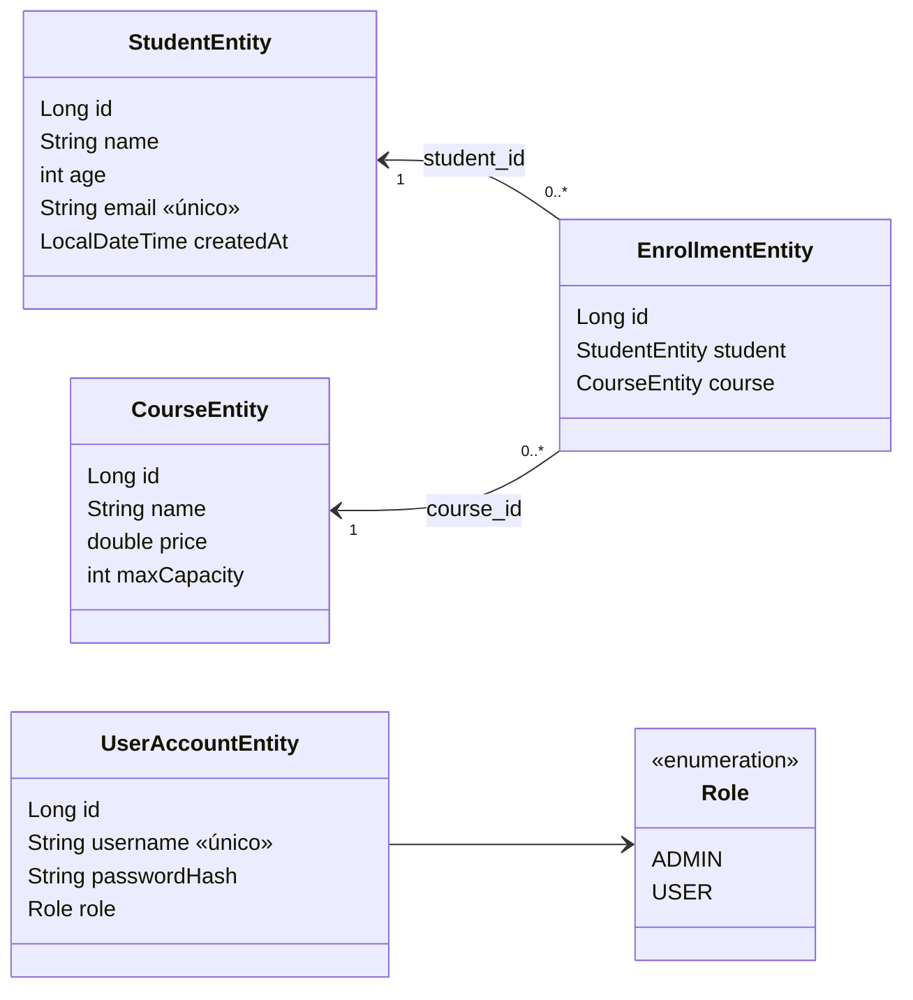
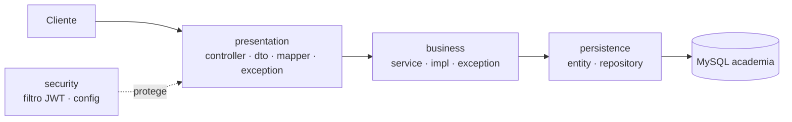

# 🎓 Guía práctica: construir la API Academia desde cero

> **Objetivo:** construir, paso a paso y en modo práctica, la API de **estudiantes, cursos y matrículas** con capas, DTO, validaciones, manejo de excepciones, Swagger y Spring Security + JWT.
> Es un resumen: solo lo esencial de cada concepto, corto y para teclear. El proyecto terminado está en [`academica-security`](../../../../curso-spring-boot-src/07-01-proyecto-academico/backend/academica-security/).

⏱️ ~2 h · ☕ Java 21 · Maven · MySQL 8 · Spring Boot 4.1.2

---

## 1. 🧩 Diagrama de clases (entidades)



- **Matrícula** = relación estudiante–curso (un estudiante no puede repetirse en un curso).
- **Cuenta de usuario** es independiente del estudiante: solo sirve para autenticarse.

### Arquitectura en 3 capas



Regla: cada capa solo habla con la de abajo. El controller **nunca** devuelve entidades: devuelve DTO.

---

## 2. 🌐 Endpoints que tendrá la API

Base: `http://localhost:8080` · Cabecera: `Authorization: Bearer <token>`

| Método | Ruta | Acceso | Éxito | Errores |
|---|---|---|---|---|
| `POST` | `/api/v1/auth/login` | 🌍 Público | 200 token | 400, 401 |
| `GET` | `/api/v1/auth/me` | 🔑 Autenticado | 200 | 401 |
| `GET` | `/api/v1/students` | 🔑 | 200 página | 400 |
| `GET` | `/api/v1/students/{id}` | 🔑 | 200 | 404 |
| `GET` | `/api/v1/students/by-email?email=` | 🔑 | 200 | 400, 404 |
| `POST` | `/api/v1/students` | 🔑 | 201 + `Location` | 400, 409 (correo repetido) |
| `GET` | `/api/v1/courses` | 🔑 | 200 página | 400 |
| `GET` | `/api/v1/courses/{id}` | 🔑 | 200 | 404 |
| `GET` | `/api/v1/courses/{id}/enrolled` | 🔑 | 200 `{courseId, enrolled}` | 404 |
| `POST` | `/api/v1/courses` | 👑 `ADMIN` | 201 + `Location` | 400, 403 |
| `GET` | `/api/v1/enrollments/{id}` | 🔑 | 200 | 404 |
| `POST` | `/api/v1/enrollments` | 🔑 | 201 + `Location` | 400, 404, 409 (repetida / sin cupo) |
| `GET` | `/internal/health` | 🌍 | 200 | — |
| `POST` | `/internal/seed` | 👑 `ADMIN` | 200 | 403 |
| `GET` | `/swagger-ui.html` · `/api-docs` | 🌍 | — | — |

**Servicios de negocio**

| Interfaz | Métodos |
|---|---|
| `StudentService` | `findAll(Pageable)` · `findById(id)` · `findByEmail(email)` · `create(student)` |
| `CourseService` | `findAll(Pageable)` · `findById(id)` · `create(course)` · `countEnrolled(courseId)` |
| `EnrollmentService` | `findById(id)` · `enroll(studentId, courseId)` |

**Reglas de negocio:** correo único · no matricular dos veces al mismo estudiante en el mismo curso · no pasar del cupo (`maxCapacity`).

**Cuentas de práctica:** `admin / admin123` (ADMIN) · `ana / ana123` (USER).

---

## 3. 🛠️ Paso a paso

### Paso 0 · Preparar el entorno

```bash
docker run -d --name academy-mysql -e MYSQL_ROOT_PASSWORD=root \
  -e MYSQL_DATABASE=academia -p 3306:3306 mysql:8.0
```

Crear el proyecto en <https://start.spring.io>: Maven · Java 21 · Spring Boot 4.1.x · group `com.academy` · artifact `academy`. Dependencias: **Spring Web, Spring Data JPA, Validation, MySQL Driver, Spring Security, DevTools**. Luego añade a mano (Swagger y JWT):

```xml
<dependency>
    <groupId>org.springdoc</groupId><artifactId>springdoc-openapi-starter-webmvc-ui</artifactId><version>3.2.0</version>
</dependency>
<dependency><groupId>io.jsonwebtoken</groupId><artifactId>jjwt-api</artifactId><version>0.12.6</version></dependency>
<dependency><groupId>io.jsonwebtoken</groupId><artifactId>jjwt-impl</artifactId><version>0.12.6</version><scope>runtime</scope></dependency>
<dependency><groupId>io.jsonwebtoken</groupId><artifactId>jjwt-jackson</artifactId><version>0.12.6</version><scope>runtime</scope></dependency>
```

Estructura de paquetes bajo `com.academy`:

```
persistence/{entity,repository}
business/{service,impl,exception}
presentation/{controller,dto,mapper,exception,config}
security
```

> ⚠️ Mientras no hagas el Paso 9, **deja Security comentada/excluida** o recibirás 401 en todo. Alternativa: haz los pasos 1-8 y agrega la dependencia de Security al final.

### Paso 1 · `application.properties`

```properties
spring.datasource.url=jdbc:mysql://localhost:3306/academia?createDatabaseIfNotExist=true
spring.datasource.username=root
spring.datasource.password=root
spring.jpa.hibernate.ddl-auto=create
spring.jpa.show-sql=true

# Protege la API: página máxima de 50
spring.data.web.pageable.default-page-size=10
spring.data.web.pageable.max-page-size=50

# No exponer detalles internos en los errores
server.error.include-stacktrace=never
server.error.include-message=never

# Swagger
springdoc.api-docs.path=/api-docs
springdoc.swagger-ui.path=/swagger-ui.html
```

✅ **Checkpoint:** `./mvnw spring-boot:run` arranca y crea la base `academia`.

### Paso 2 · Persistencia: entidades y repositorios

```java
@Entity @Table(name = "student")
public class StudentEntity {
    @Id @GeneratedValue(strategy = GenerationType.IDENTITY) private Long id;
    private String name;
    private int age;
    @Column(unique = true) private String email;
    @CreationTimestamp @Column(name = "created_at", updatable = false) private LocalDateTime createdAt;

    protected StudentEntity() {}                       // lo exige JPA
    public StudentEntity(String name, int age, String email) { ... }
    // solo getters (sin setters)
}

@Entity @Table(name = "course")
public class CourseEntity {
    @Id @GeneratedValue(strategy = GenerationType.IDENTITY) private Long id;
    private String name;  private double price;  private int maxCapacity;
    // constructor protegido + público (name, price, maxCapacity) + getters
}

@Entity @Table(name = "enrollment")
public class EnrollmentEntity {
    @Id @GeneratedValue(strategy = GenerationType.IDENTITY) private Long id;
    @ManyToOne @JoinColumn(name = "student_id") private StudentEntity student;
    @ManyToOne @JoinColumn(name = "course_id")  private CourseEntity course;
    // constructor protegido + público (student, course) + getters
}
```

```java
public interface StudentJpaRepository extends JpaRepository<StudentEntity, Long> {
    Optional<StudentEntity> findByEmailIgnoreCase(String email);
    boolean existsByEmailIgnoreCase(String email);
}
public interface CourseJpaRepository extends JpaRepository<CourseEntity, Long> {}
public interface EnrollmentJpaRepository extends JpaRepository<EnrollmentEntity, Long> {
    boolean existsByStudentIdAndCourseId(Long studentId, Long courseId);
    long countByCourseId(Long courseId);
}
```

💡 Los métodos se **derivan del nombre** (`findBy…`, `existsBy…`, `countBy…`): no se escribe SQL.

✅ **Checkpoint:** al arrancar, Hibernate crea las tablas `student`, `course`, `enrollment` (mira el SQL en consola).

### Paso 3 · Negocio: excepciones y servicios

Excepciones (todas `extends RuntimeException`, con mensaje claro):

| Clase | Mensaje |
|---|---|
| `StudentNotFoundException` | «No existe un estudiante con id X» (`byId`, `byEmail`) |
| `CourseNotFoundException` | «No existe un curso con id X» |
| `EnrollmentNotFoundException` | «No existe una matrícula con id X» |
| `StudentEmailAlreadyExistsException` | «El correo X ya está registrado» |
| `AlreadyEnrolledException` | «El estudiante X ya está matriculado en el curso Y» |
| `CourseFullException` | «El curso X ya alcanzó su cupo de N» |

Servicios: interfaz en `business/service` + `…Impl` en `business/impl` con `@Service`. Lectura con `@Transactional(readOnly = true)`, escritura con `@Transactional`.

```java
@Service
public class EnrollmentServiceImpl implements EnrollmentService {
    // inyección por constructor de students, courses, enrollments

    @Override @Transactional
    public EnrollmentEntity enroll(Long studentId, Long courseId) {
        StudentEntity student = students.findById(studentId)
                .orElseThrow(() -> StudentNotFoundException.byId(studentId));      // 404
        CourseEntity course = courses.findById(courseId)
                .orElseThrow(() -> new CourseNotFoundException(courseId));         // 404
        if (enrollments.existsByStudentIdAndCourseId(studentId, courseId))
            throw new AlreadyEnrolledException(studentId, courseId);               // 409
        if (enrollments.countByCourseId(courseId) >= course.getMaxCapacity())
            throw new CourseFullException(courseId, course.getMaxCapacity());      // 409
        return enrollments.save(new EnrollmentEntity(student, course));
    }
}
```

`StudentServiceImpl.create` valida `existsByEmailIgnoreCase` → `StudentEmailAlreadyExistsException`. `CourseServiceImpl.countEnrolled` valida que el curso exista y retorna `enrollments.countByCourseId`.

### Paso 4 · DTO con validaciones

Los DTO son `record`: lo que el cliente **envía** (Request) y lo que **ve** (Response).

```java
public record StudentRequest(
    @NotBlank(message = "es obligatorio") @Size(min = 2, max = 100, message = "debe tener entre 2 y 100 caracteres") String name,
    @Min(value = 16, message = "debe ser 16 o más") @Max(value = 99, message = "debe ser 99 o menos") int age,
    @NotBlank(message = "es obligatorio") @Email(message = "no tiene formato de correo electrónico") String email) {}

public record CourseRequest(
    @NotBlank @Size(min = 2, max = 100) String name,
    @Positive(message = "debe ser mayor que cero") double price,
    @Min(value = 1, message = "debe ser 1 o más") int maxCapacity) {}

public record EnrollmentRequest(@NotNull Long studentId, @NotNull Long courseId) {}
```

| Response | Campos |
|---|---|
| `StudentResponse` | `id, name, age, email` |
| `CourseResponse` | `id, name, price, maxCapacity` |
| `EnrollmentResponse` | `id, studentId, studentName, courseId, courseName` (aplanada) |
| `EnrolledResponse` | `courseId, enrolled` |
| `PageResponse<T>` | `content, page, size, totalElements, totalPages` |
| `ErrorResponse` | `timestamp, status, error, message, path, details[]` |

### Paso 5 · Mappers (entidad ⇄ DTO)

Clases `final` con métodos estáticos, sin lógica de negocio:

```java
public final class StudentMapper {
    public static StudentEntity toEntity(StudentRequest r) { return new StudentEntity(r.name(), r.age(), r.email()); }
    public static StudentResponse toResponse(StudentEntity e) { return new StudentResponse(e.getId(), e.getName(), e.getAge(), e.getEmail()); }
    public static PageResponse<StudentResponse> toPageResponse(Page<StudentEntity> p) {
        return new PageResponse<>(p.getContent().stream().map(StudentMapper::toResponse).toList(),
                p.getNumber(), p.getSize(), p.getTotalElements(), p.getTotalPages());
    }
}
```

Haz lo mismo con `CourseMapper` y `EnrollmentMapper` (este último aplana estudiante y curso).

### Paso 6 · Controladores

Patrón para todos: `@RestController` + `@RequestMapping` + servicio inyectado por constructor + `@Valid @RequestBody` + `ResponseEntity`.

```java
@RestController @RequestMapping("/api/v1/students")
public class StudentController {
    private final StudentService service;

    @GetMapping
    public PageResponse<StudentResponse> findAll(@ParameterObject Pageable pageable) {
        return StudentMapper.toPageResponse(service.findAll(pageable));
    }

    @GetMapping("/{id}")
    public StudentResponse findById(@PathVariable Long id) {
        return StudentMapper.toResponse(service.findById(id));
    }

    @GetMapping("/by-email")
    public StudentResponse findByEmail(@RequestParam String email) {
        return StudentMapper.toResponse(service.findByEmail(email));
    }

    @PostMapping
    public ResponseEntity<StudentResponse> create(@Valid @RequestBody StudentRequest request) {
        StudentResponse body = StudentMapper.toResponse(service.create(StudentMapper.toEntity(request)));
        URI location = ServletUriComponentsBuilder.fromCurrentRequest()
                .path("/{id}").buildAndExpand(body.id()).toUri();
        return ResponseEntity.created(location).body(body);            // 201 + Location
    }
}
```

- `CourseController`: `GET`, `GET /{id}`, `POST` (201), `GET /{id}/enrolled`.
- `EnrollmentController`: `GET /{id}`, `POST` (201).
- `InternalController`: `GET /internal/health` → `{"status":"UP"}` · `POST /internal/seed` → crea 3 estudiantes y 2 cursos de ejemplo.

✅ **Checkpoint (sin Security):** `POST /api/v1/students` crea; con `email` repetido todavía revienta con 500. Eso se arregla en el siguiente paso.

### Paso 7 · Manejo global de errores

Un solo `@RestControllerAdvice` que extiende `ResponseEntityExceptionHandler` y responde siempre con `ErrorResponse`:

| Excepción | HTTP |
|---|---|
| `*NotFoundException` | **404** |
| `StudentEmailAlreadyExists`, `AlreadyEnrolled`, `CourseFull` | **409** |
| `MethodArgumentNotValidException` (validación) | **400** + `details` campo a campo |
| JSON mal formado / tipo de parámetro inválido / falta parámetro | **400** |
| `PropertyReferenceException` (`?sort=xyz`) | **400** |
| `AuthenticationException` (login fallido) | **401** |
| `AccessDeniedException` | **403** |
| `Exception` (cualquier otra) | **500** genérico (el detalle solo va al log) |

```java
@RestControllerAdvice
public class GlobalExceptionHandler extends ResponseEntityExceptionHandler {

    @ExceptionHandler({StudentNotFoundException.class, CourseNotFoundException.class, EnrollmentNotFoundException.class})
    public ResponseEntity<Object> handleNotFound(RuntimeException ex, WebRequest req) {
        return build(HttpStatus.NOT_FOUND, ex.getMessage(), req, null);
    }

    @ExceptionHandler({StudentEmailAlreadyExistsException.class, AlreadyEnrolledException.class, CourseFullException.class})
    public ResponseEntity<Object> handleConflict(RuntimeException ex, WebRequest req) {
        return build(HttpStatus.CONFLICT, ex.getMessage(), req, null);
    }

    @Override
    protected ResponseEntity<Object> handleMethodArgumentNotValid(MethodArgumentNotValidException ex,
            HttpHeaders h, HttpStatusCode s, WebRequest req) {
        List<FieldIssue> details = ex.getBindingResult().getFieldErrors().stream()
                .map(e -> new FieldIssue(e.getField(), e.getDefaultMessage())).toList();
        return build(HttpStatus.BAD_REQUEST, "Los datos enviados no son válidos", req, details);
    }
    // + 401, 403, 400 de MVC y el catch-all 500: ver GlobalExceptionHandler del proyecto
}
```

💡 `build(...)` arma el `ErrorResponse` con `status`, `message` y la ruta (`request.getRequestURI()`).

✅ **Checkpoint:** correo repetido → **409**; `age: 5` → **400** con `details`; `/students/999` → **404**.

### Paso 8 · Swagger (documentación)

```java
@Configuration
public class OpenApiConfig {
    @Bean
    public OpenAPI academyOpenApi() {
        return new OpenAPI()
            .info(new Info().title("Academy API").version("1.0.0"))
            .addSecurityItem(new SecurityRequirement().addList("bearerAuth"))
            .components(new Components().addSecuritySchemes("bearerAuth",
                new SecurityScheme().type(SecurityScheme.Type.HTTP).scheme("bearer").bearerFormat("JWT")));
    }
}
```

En los controladores: `@Tag` (agrupa), `@Operation(summary=…)`, `@ApiResponse(responseCode=…)`; en los DTO `@Schema(description, example)`. Oculta con `@Hidden` lo que no sea API pública.

✅ **Checkpoint:** <http://localhost:8080/swagger-ui.html> muestra todos los endpoints y el botón **Authorize**.

### Paso 9 · Seguridad: cuenta, rol y BCrypt

Si aún no agregaste la dependencia `spring-boot-starter-security`, ahora es el momento.

```java
public enum Role { ADMIN, USER }

@Entity @Table(name = "user_account")
public class UserAccountEntity {
    @Id @GeneratedValue(strategy = GenerationType.IDENTITY) private Long id;
    @Column(nullable = false, unique = true) private String username;
    @Column(name = "password_hash", nullable = false) private String passwordHash;
    @Enumerated(EnumType.STRING) @Column(nullable = false) private Role role;
}

public interface UserAccountJpaRepository extends JpaRepository<UserAccountEntity, Long> {
    Optional<UserAccountEntity> findByUsername(String username);
}
```

```java
@Service
public class JpaUserDetailsService implements UserDetailsService {
    @Override
    public UserDetails loadUserByUsername(String username) {
        var a = accounts.findByUsername(username)
            .orElseThrow(() -> new UsernameNotFoundException("No existe la cuenta " + username));
        return User.withUsername(a.getUsername()).password(a.getPasswordHash())
                   .roles(a.getRole().name()).build();     // agrega el prefijo ROLE_
    }
}
```

Sembrar las cuentas al arrancar (solo en práctica):

```java
@Component
public class AccountSeeder implements CommandLineRunner {
    public void run(String... args) {
        createIfMissing("admin", "admin123", Role.ADMIN);
        createIfMissing("ana",   "ana123",   Role.USER);
    }
    private void createIfMissing(String u, String raw, Role r) {
        if (accounts.findByUsername(u).isEmpty())
            accounts.save(new UserAccountEntity(null, u, encoder.encode(raw), r));   // se guarda el HASH
    }
}
```

### Paso 10 · Seguridad: JWT

```properties
app.jwt.secret=${JWT_SECRET:academy-clave-solo-educativa-cambiar-en-produccion-0123456789}
app.jwt.expiration-seconds=3600
```

```java
@ConfigurationProperties(prefix = "app.jwt")
public record JwtProperties(String secret, long expirationSeconds) {}

@Service
public class JwtService {
    private final SecretKey key;  private final long expirationSeconds;
    public JwtService(JwtProperties p) {
        this.key = Keys.hmacShaKeyFor(p.secret().getBytes(StandardCharsets.UTF_8));   // ≥ 32 caracteres
        this.expirationSeconds = p.expirationSeconds();
    }
    public String generate(String username, String role) {
        Instant now = Instant.now();
        return Jwts.builder().subject(username).claim("role", role)
                .issuedAt(Date.from(now)).expiration(Date.from(now.plusSeconds(expirationSeconds)))
                .signWith(key, Jwts.SIG.HS256).compact();
    }
    public Claims parse(String token) {      // lanza JwtException si firma/expiración fallan
        return Jwts.parser().verifyWith(key).build().parseSignedClaims(token).getPayload();
    }
}

@Service
public class AuthService {
    public String login(String username, String password) {
        Authentication auth = authenticationManager.authenticate(
                new UsernamePasswordAuthenticationToken(username, password));         // 401 si falla
        String role = auth.getAuthorities().iterator().next().getAuthority().replace("ROLE_", "");
        return jwtService.generate(auth.getName(), role);
    }
}
```

**Filtro**: lee `Authorization: Bearer …`, valida y deja al usuario en el `SecurityContext`.

```java
public class JwtAuthenticationFilter extends OncePerRequestFilter {
    @Override
    protected void doFilterInternal(HttpServletRequest req, HttpServletResponse res, FilterChain chain)
            throws ServletException, IOException {
        String header = req.getHeader(HttpHeaders.AUTHORIZATION);
        if (header != null && header.startsWith("Bearer ")) {
            try {
                Claims c = jwtService.parse(header.substring(7));
                SecurityContextHolder.getContext().setAuthentication(
                    new UsernamePasswordAuthenticationToken(c.getSubject(), null,
                        List.of(new SimpleGrantedAuthority("ROLE_" + c.get("role", String.class)))));
            } catch (ExpiredJwtException e) { req.setAttribute("auth.error", "El token expiró"); }
              catch (JwtException | IllegalArgumentException e) { req.setAttribute("auth.error", "El token no es válido"); }
        }
        chain.doFilter(req, res);
    }
}
```

**401 y 403 en JSON:** los filtros corren *antes* de Spring MVC, así que el `@RestControllerAdvice` no los ve. Crea `SecurityErrorWriter` (escribe un `ErrorResponse` con `ObjectMapper`), `RestAuthenticationEntryPoint` (→ 401, cabecera `WWW-Authenticate: Bearer`) y `RestAccessDeniedHandler` (→ 403).

### Paso 11 · Seguridad: reglas de acceso

```java
@Configuration @EnableWebSecurity
@EnableConfigurationProperties(JwtProperties.class)
public class SecurityConfig {

    @Bean
    SecurityFilterChain filterChain(HttpSecurity http, JwtService jwt,
            RestAuthenticationEntryPoint entry, RestAccessDeniedHandler denied) throws Exception {
        http.csrf(c -> c.disable())
            .sessionManagement(s -> s.sessionCreationPolicy(SessionCreationPolicy.STATELESS))
            .exceptionHandling(e -> e.authenticationEntryPoint(entry).accessDeniedHandler(denied))
            .authorizeHttpRequests(a -> a
                .requestMatchers("/api/v1/auth/login", "/internal/health").permitAll()
                .requestMatchers("/swagger-ui.html", "/swagger-ui/**", "/api-docs/**").permitAll()
                .requestMatchers(HttpMethod.POST, "/api/v1/courses").hasRole("ADMIN")
                .requestMatchers("/internal/**").hasRole("ADMIN")
                .anyRequest().authenticated())
            .addFilterBefore(new JwtAuthenticationFilter(jwt), UsernamePasswordAuthenticationFilter.class);
        return http.build();
    }

    @Bean AuthenticationManager authenticationManager(AuthenticationConfiguration c) throws Exception {
        return c.getAuthenticationManager();
    }
    @Bean PasswordEncoder passwordEncoder() { return new BCryptPasswordEncoder(); }
}
```

⚠️ **El orden importa:** reglas específicas primero, `anyRequest()` al final.

### Paso 12 · `AuthController`

```java
@RestController @RequestMapping("/api/v1/auth")
public class AuthController {
    @PostMapping("/login")
    public LoginResponse login(@Valid @RequestBody LoginRequest r) {
        return new LoginResponse(service.login(r.username(), r.password()), "Bearer", service.expirationSeconds());
    }
    @GetMapping("/me")
    public MeResponse me(Authentication auth) {
        String role = auth.getAuthorities().iterator().next().getAuthority().replace("ROLE_", "");
        return new MeResponse(auth.getName(), role);
    }
}
```

DTO: `LoginRequest(username, password)` · `LoginResponse(token, tokenType, expiresIn)` · `MeResponse(username, role)`.

---

## 4. ▶️ Probar todo

```bash
./mvnw spring-boot:run
TOKEN=$(curl -s -X POST localhost:8080/api/v1/auth/login -H 'Content-Type: application/json' \
  -d '{"username":"admin","password":"admin123"}' | jq -r .token)

curl -s -X POST localhost:8080/internal/seed -H "Authorization: Bearer $TOKEN"
curl -s localhost:8080/api/v1/students -H "Authorization: Bearer $TOKEN"
curl -s -X POST localhost:8080/api/v1/enrollments -H "Authorization: Bearer $TOKEN" \
  -H 'Content-Type: application/json' -d '{"studentId":1,"courseId":1}'
```

### ✅ Matriz de verificación

| Prueba | Esperado |
|---|---|
| `GET /internal/health` sin token | 200 |
| `GET /api/v1/students` sin token | 401 |
| Token alterado | 401 «El token no es válido» |
| Login con clave incorrecta | 401 |
| `POST /students` con correo repetido | 409 |
| `POST /students` con `age: 5` y correo mal formado | 400 + `details` |
| `GET /students/999` | 404 |
| `GET /students?sort=xyz` | 400 |
| `POST /enrollments` repetida | 409 |
| `POST /enrollments` en curso sin cupo | 409 |
| `POST /courses` con `ana` / `admin` | 403 / 201 |
| `POST /internal/seed` con `ana` / `admin` | 403 / 200 |

Más pruebas: **Swagger UI** (botón *Authorize*), [`postman/`](../../../../curso-spring-boot-src/07-01-proyecto-academico/backend/academica-security/postman/) y [`probar-apis.sh`](../../../../curso-spring-boot-src/07-01-proyecto-academico/backend/academica-security/probar-apis.sh). Datos masivos de ejemplo: [`migrate.sql`](../../../../curso-spring-boot-src/07-01-proyecto-academico/backend/academica-security/migrate.sql) (100 estudiantes, 20 cursos, 30 matrículas).

---

## 5. 🧠 Conceptos clave

1. **3 capas:** presentation → business → persistence; el controller nunca toca el repositorio.
2. **DTO ≠ entidad:** protege la BD y controla qué entra y qué sale.
3. **Validar en el borde** (`@Valid`) y **reglas de negocio en el servicio** (excepciones propias).
4. **Un solo formato de error** (`ErrorResponse`) para 400/401/403/404/409/500.
5. **201 + `Location`** al crear.
6. **Stateless + JWT:** el token viaja en cada petición; el servidor no guarda sesión.
7. **BCrypt:** solo se guarda el hash. **401** = no sé quién eres · **403** = no tienes permiso.
8. **La clave JWT va en variable de entorno** (`JWT_SECRET`), nunca en el repositorio.

🏁 **Reto final:** agrega `DELETE /api/v1/enrollments/{id}` (solo `ADMIN`) con su 404 y su regla en `SecurityConfig`.
