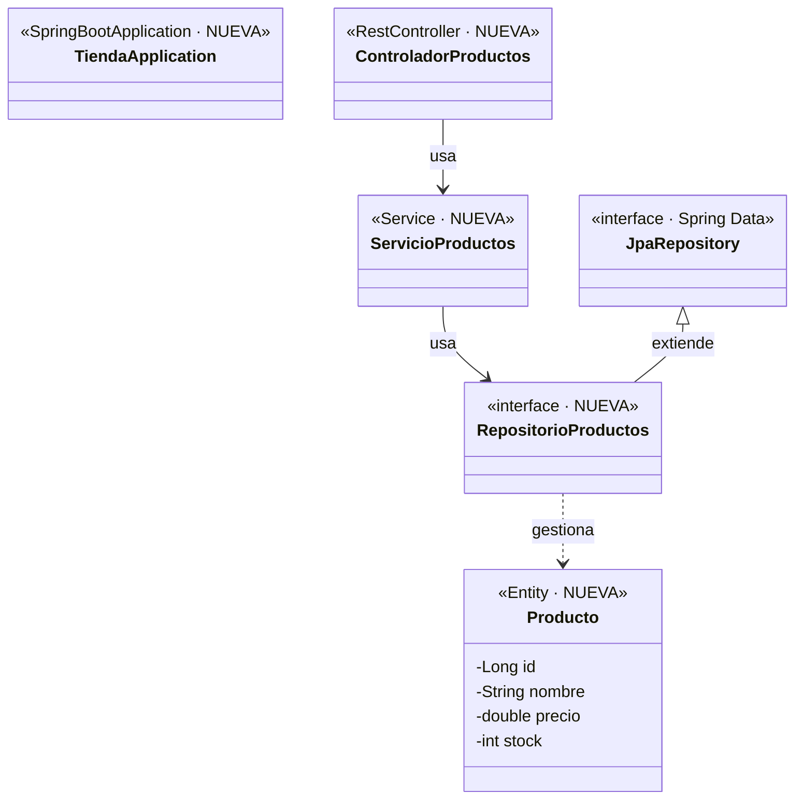

# 🛒 Guía 1 — Tienda en línea: CRUD de productos

> 🎯 **Qué vas a hacer:** crear tu primera **entidad JPA** (`Producto`) y exponer un **CRUD completo** con cinco endpoints.
> ⏱️ **Tiempo:** unos 30 minutos. 🧱 **Serie:** esta guía es la 1 de 3; la tienda **crece** en las guías 2 y 3.

## 📦 Dependencias

El proyecto se crea en [start.spring.io](https://start.spring.io) con **Maven · Java 21 · Spring Boot 3.x · Group `com.tienda` · Artifact `tienda`** y estas tres dependencias:

| Dependencia | Para qué sirve en esta guía |
|---|---|
| **Spring Web** | Los endpoints REST (`@RestController`) y la conversión a JSON. |
| **Spring Data JPA** | JPA + Hibernate + `JpaRepository`: guardar y consultar sin escribir SQL. |
| **H2 Database** | Base de datos **en memoria**: no hay que instalar nada (se borra al reiniciar). |

> 💡 Las dos siguientes guías **no agregan ninguna dependencia nueva**: todo lo que necesitan ya está aquí.

## 🗺️ Diagrama de clases (incremento 1)



Están **todas** las clases de la guía (`TiendaApplication` la genera Initializr; el resto lo escribís en los pasos). El flujo se lee de arriba hacia abajo: *controlador → servicio → repositorio → entidad*. La entidad `Producto` es la tabla `producto` (`id`, `nombre`, `precio`, `stock`).

## 🪜 Pasos

### 1. Configurar la base de datos

**`src/main/resources/application.properties`**

```properties
spring.datasource.url=jdbc:h2:mem:tienda;DB_CLOSE_DELAY=-1
spring.jpa.hibernate.ddl-auto=update
spring.jpa.show-sql=true
spring.h2.console.enabled=true
```

- `ddl-auto=update`: Hibernate **crea la tabla** a partir de la entidad.
- `show-sql=true`: ves en consola el SQL que genera.
- La consola de H2 queda en `http://localhost:8080/h2-console` (JDBC URL `jdbc:h2:mem:tienda`, usuario `sa`, sin contraseña).

### 2. La entidad

**`src/main/java/com/tienda/negocio/model/Producto.java`**

```java
package com.tienda.negocio.model;

import jakarta.persistence.Entity;
import jakarta.persistence.GeneratedValue;
import jakarta.persistence.GenerationType;
import jakarta.persistence.Id;

@Entity
public class Producto {

    @Id
    @GeneratedValue(strategy = GenerationType.IDENTITY)
    private Long id;

    private String nombre;

    private double precio;

    private int stock;

    protected Producto() {
    }

    public Producto(String nombre, double precio, int stock) {
        this.nombre = nombre;
        this.precio = precio;
        this.stock = stock;
    }

    public Long getId() { return id; }
    public String getNombre() { return nombre; }
    public double getPrecio() { return precio; }
    public int getStock() { return stock; }

    public void setNombre(String nombre) { this.nombre = nombre; }
    public void setPrecio(double precio) { this.precio = precio; }
    public void setStock(int stock) { this.stock = stock; }
}
```

- **`@Entity`**: la clase se guarda en una tabla. **`@Id`** + **`@GeneratedValue(IDENTITY)`**: la clave primaria la genera la base.
- El constructor `protected` sin argumentos lo necesita JPA para crear el objeto; los *setters* se usan al actualizar.

### 3. El repositorio

**`src/main/java/com/tienda/persistence/repository/RepositorioProductos.java`**

```java
package com.tienda.persistence.repository;

import com.tienda.negocio.model.Producto;
import org.springframework.data.jpa.repository.JpaRepository;

public interface RepositorioProductos extends JpaRepository<Producto, Long> {
}
```

Sin una sola línea de código, ya tenés `save`, `findAll`, `findById`, `delete`… **Spring Data genera la clase** al arrancar.

### 4. El servicio

**`src/main/java/com/tienda/negocio/service/ServicioProductos.java`**

```java
package com.tienda.negocio.service;

import com.tienda.negocio.model.Producto;
import com.tienda.persistence.repository.RepositorioProductos;
import java.util.List;
import java.util.NoSuchElementException;
import org.springframework.stereotype.Service;

@Service
public class ServicioProductos {

    private final RepositorioProductos repositorio;

    public ServicioProductos(RepositorioProductos repositorio) {
        this.repositorio = repositorio;
    }

    public Producto crear(Producto producto) {
        // Se crea uno nuevo: así se ignora cualquier id que envíe el cliente
        return repositorio.save(new Producto(producto.getNombre(), producto.getPrecio(), producto.getStock()));
    }

    public List<Producto> listar() {
        return repositorio.findAll();
    }

    public Producto obtener(Long id) {
        return repositorio.findById(id)
                .orElseThrow(() -> new NoSuchElementException("No existe el producto " + id));
    }

    public Producto actualizar(Long id, Producto datos) {
        Producto producto = obtener(id);
        producto.setNombre(datos.getNombre());
        producto.setPrecio(datos.getPrecio());
        producto.setStock(datos.getStock());
        return repositorio.save(producto);
    }

    public void eliminar(Long id) {
        repositorio.delete(obtener(id));
    }
}
```

> ⚠️ **Detalle importante:** en `crear` se construye un `Producto` **nuevo**. Si se guardara el que llega, un `POST` con `"id": 1` **actualizaría** el producto 1 en lugar de crear uno.

### 5. El controlador (los cinco endpoints)

**`src/main/java/com/tienda/presentacion/controlador/ControladorProductos.java`**

```java
package com.tienda.presentacion.controlador;

import com.tienda.negocio.model.Producto;
import com.tienda.negocio.service.ServicioProductos;
import java.util.List;
import org.springframework.http.HttpStatus;
import org.springframework.web.bind.annotation.DeleteMapping;
import org.springframework.web.bind.annotation.GetMapping;
import org.springframework.web.bind.annotation.PathVariable;
import org.springframework.web.bind.annotation.PostMapping;
import org.springframework.web.bind.annotation.PutMapping;
import org.springframework.web.bind.annotation.RequestBody;
import org.springframework.web.bind.annotation.RequestMapping;
import org.springframework.web.bind.annotation.ResponseStatus;
import org.springframework.web.bind.annotation.RestController;

@RestController
@RequestMapping("/productos")
public class ControladorProductos {

    private final ServicioProductos servicio;

    public ControladorProductos(ServicioProductos servicio) {
        this.servicio = servicio;
    }

    @PostMapping
    @ResponseStatus(HttpStatus.CREATED)
    public Producto crear(@RequestBody Producto producto) {
        return servicio.crear(producto);
    }

    @GetMapping
    public List<Producto> listar() {
        return servicio.listar();
    }

    @GetMapping("/{id}")
    public Producto obtener(@PathVariable Long id) {
        return servicio.obtener(id);
    }

    @PutMapping("/{id}")
    public Producto actualizar(@PathVariable Long id, @RequestBody Producto producto) {
        return servicio.actualizar(id, producto);
    }

    @DeleteMapping("/{id}")
    @ResponseStatus(HttpStatus.NO_CONTENT)
    public void eliminar(@PathVariable Long id) {
        servicio.eliminar(id);
    }
}
```

## 🧪 Probar con Postman

Header en los `POST` y `PUT`: `Content-Type: application/json`.

| # | Operación | Método y URL | Body | Esperado |
|:-:|---|---|---|:-:|
| 1 | Crear | `POST /productos` | `{"nombre":"Portátil","precio":2500000,"stock":10}` | `201` |
| 2 | Crear | `POST /productos` | `{"nombre":"Ratón","precio":45000,"stock":50}` | `201` |
| 3 | Listar | `GET /productos` | — | `200` con 2 productos |
| 4 | Consultar | `GET /productos/2` | — | `200` |
| 5 | Actualizar | `PUT /productos/2` | `{"nombre":"Ratón inalámbrico","precio":55000,"stock":40}` | `200` con los datos nuevos |
| 6 | Eliminar | `DELETE /productos/2` | — | `204` |
| 7 | Inexistente | `GET /productos/99` | — | `500` *(la consola muestra `NoSuchElementException`; el `404` llega en el Módulo 7)* |

Respuesta de la operación 1:

```json
{"id":1,"nombre":"Portátil","precio":2500000.0,"stock":10}
```

## 🔍 Mirá el SQL

Cada operación aparece en la consola. Por ejemplo, el `POST` genera `insert into producto (nombre,precio,stock,id) values (?,?,?,default)`
y el `GET /productos/2`, `select … from producto where id=?`.

## ✅ Qué comprobaste

- Una **clase Java** (`@Entity`) se convierte en una **tabla**.
- Una **interfaz** (`JpaRepository`) te da el CRUD sin implementarlo.
- Las capas: `presentacion` → `negocio` → `persistence`, cada una con su responsabilidad.

## 🚀 Reto

Agregá `GET /productos/agotados` que devuelva los productos con `stock` igual a `0`. *(Pista: método derivado `findByStock(int stock)` en el repositorio.)*

> 📚 **Para profundizar:** [Uso básico de Spring Data JPA](../../03-introduccion-a-jpa/material/ejemplos/07-uso-basico-de-spring-data-jpa.md) · [CRUD completo](../../04-gestion-de-bases-de-datos-mediante-jpa/material/ejemplos/06-crud-completo.md).

➡️ **Siguiente:** [Guía 2 — Relación uno a muchos](03-guia-tienda-2-uno-a-muchos.md)
