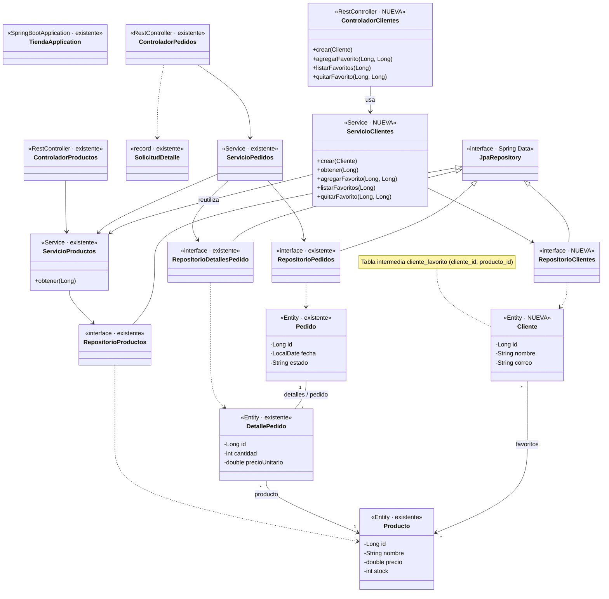

# 🛒 Guía 3 — Tienda en línea: productos favoritos (muchos a muchos)

> 🎯 **Qué vas a hacer:** permitir que los **clientes** guarden **productos favoritos** con `@ManyToMany` y `@JoinTable`.
> ⏱️ **Tiempo:** unos 30 minutos. 🧱 **Parte de:** el proyecto de las guías 1 y 2.

## 📦 Dependencias

**Ninguna nueva.** Seguís con Spring Web, Spring Data JPA y H2.

## 🗺️ Diagrama de clases (incremento 3)



Están **todas** las clases del proyecto; las de las guías 1 y 2 aparecen como `existente`. Fijate que `ServicioClientes` también **reutiliza** `ServicioProductos`.

Ejemplo: **Ana** y **Carlos** son clientes; los favoritos de Ana son *Portátil, Ratón y Teclado*; los de Carlos, *Ratón y Teclado*. El *Ratón* está en las listas de **varios** clientes, y cada cliente tiene **varios** productos.

> 💡 Un muchos a muchos **no se guarda en dos tablas**: hace falta una **tabla intermedia** con las dos claves foráneas. JPA la crea por vos.

## 🪜 Pasos

### 1. La entidad

**`src/main/java/com/tienda/negocio/model/Cliente.java`**

```java
package com.tienda.negocio.model;

import com.fasterxml.jackson.annotation.JsonIgnore;
import jakarta.persistence.Entity;
import jakarta.persistence.GeneratedValue;
import jakarta.persistence.GenerationType;
import jakarta.persistence.Id;
import jakarta.persistence.JoinColumn;
import jakarta.persistence.JoinTable;
import jakarta.persistence.ManyToMany;
import java.util.HashSet;
import java.util.Set;

@Entity
public class Cliente {

    @Id
    @GeneratedValue(strategy = GenerationType.IDENTITY)
    private Long id;

    private String nombre;

    private String correo;

    // Lado dueño: JPA crea la tabla intermedia cliente_favorito con dos claves foráneas
    @ManyToMany
    @JoinTable(name = "cliente_favorito",
            joinColumns = @JoinColumn(name = "cliente_id"),
            inverseJoinColumns = @JoinColumn(name = "producto_id"))
    @JsonIgnore
    private Set<Producto> favoritos = new HashSet<>();

    protected Cliente() {
    }

    public Cliente(String nombre, String correo) {
        this.nombre = nombre;
        this.correo = correo;
    }

    public Long getId() { return id; }
    public String getNombre() { return nombre; }
    public String getCorreo() { return correo; }
    public Set<Producto> getFavoritos() { return favoritos; }
}
```

- **`@ManyToMany`** declara la relación; **`@JoinTable`** nombra la tabla intermedia y sus dos columnas: `@JoinColumn` para **este** lado y `inverseJoinColumns` para el **otro**.
- Se usa un `Set` (no una `List`): un producto **no puede repetirse** en los favoritos de un mismo cliente.
- `Producto` **no se modifica**: no necesita saber qué clientes lo tienen como favorito (relación **unidireccional**).

### 2. El repositorio

**`src/main/java/com/tienda/persistence/repository/RepositorioClientes.java`**

```java
package com.tienda.persistence.repository;

import com.tienda.negocio.model.Cliente;
import org.springframework.data.jpa.repository.JpaRepository;

public interface RepositorioClientes extends JpaRepository<Cliente, Long> {
}
```

### 3. El servicio

**`src/main/java/com/tienda/negocio/service/ServicioClientes.java`**

```java
package com.tienda.negocio.service;

import com.tienda.negocio.model.Cliente;
import com.tienda.negocio.model.Producto;
import com.tienda.persistence.repository.RepositorioClientes;
import java.util.List;
import java.util.NoSuchElementException;
import org.springframework.stereotype.Service;
import org.springframework.transaction.annotation.Transactional;

@Service
public class ServicioClientes {

    private final RepositorioClientes repositorio;
    private final ServicioProductos servicioProductos;

    public ServicioClientes(RepositorioClientes repositorio, ServicioProductos servicioProductos) {
        this.repositorio = repositorio;
        this.servicioProductos = servicioProductos;
    }

    public Cliente crear(Cliente cliente) {
        return repositorio.save(new Cliente(cliente.getNombre(), cliente.getCorreo()));
    }

    public Cliente obtener(Long id) {
        return repositorio.findById(id)
                .orElseThrow(() -> new NoSuchElementException("No existe el cliente " + id));
    }

    // Al terminar el método, JPA detecta el cambio en la colección y inserta la fila en cliente_favorito
    @Transactional
    public List<Producto> agregarFavorito(Long clienteId, Long productoId) {
        Cliente cliente = obtener(clienteId);
        cliente.getFavoritos().add(servicioProductos.obtener(productoId));
        return List.copyOf(cliente.getFavoritos());
    }

    @Transactional(readOnly = true)
    public List<Producto> listarFavoritos(Long clienteId) {
        return List.copyOf(obtener(clienteId).getFavoritos());
    }

    @Transactional
    public void quitarFavorito(Long clienteId, Long productoId) {
        obtener(clienteId).getFavoritos().remove(servicioProductos.obtener(productoId));
    }
}
```

- No hay ningún `save`: dentro de `@Transactional`, el cliente está **gestionado**; al agregar un producto a `favoritos`, JPA detecta el cambio y ejecuta el `insert` en la tabla intermedia al terminar el método.
- Agregar dos veces el mismo favorito **no duplica** la fila (es un `Set`).

### 4. El controlador

**`src/main/java/com/tienda/presentacion/controlador/ControladorClientes.java`**

```java
package com.tienda.presentacion.controlador;

import com.tienda.negocio.model.Cliente;
import com.tienda.negocio.model.Producto;
import com.tienda.negocio.service.ServicioClientes;
import java.util.List;
import org.springframework.http.HttpStatus;
import org.springframework.web.bind.annotation.DeleteMapping;
import org.springframework.web.bind.annotation.GetMapping;
import org.springframework.web.bind.annotation.PathVariable;
import org.springframework.web.bind.annotation.PostMapping;
import org.springframework.web.bind.annotation.RequestBody;
import org.springframework.web.bind.annotation.RequestMapping;
import org.springframework.web.bind.annotation.ResponseStatus;
import org.springframework.web.bind.annotation.RestController;

@RestController
@RequestMapping("/clientes")
public class ControladorClientes {

    private final ServicioClientes servicio;

    public ControladorClientes(ServicioClientes servicio) {
        this.servicio = servicio;
    }

    @PostMapping
    @ResponseStatus(HttpStatus.CREATED)
    public Cliente crear(@RequestBody Cliente cliente) {
        return servicio.crear(cliente);
    }

    @PostMapping("/{id}/favoritos/{productoId}")
    @ResponseStatus(HttpStatus.CREATED)
    public List<Producto> agregarFavorito(@PathVariable Long id, @PathVariable Long productoId) {
        return servicio.agregarFavorito(id, productoId);
    }

    @GetMapping("/{id}/favoritos")
    public List<Producto> listarFavoritos(@PathVariable Long id) {
        return servicio.listarFavoritos(id);
    }

    @DeleteMapping("/{id}/favoritos/{productoId}")
    @ResponseStatus(HttpStatus.NO_CONTENT)
    public void quitarFavorito(@PathVariable Long id, @PathVariable Long productoId) {
        servicio.quitarFavorito(id, productoId);
    }
}
```

## 🧪 Probar con Postman

Con los productos 1, 2 y 3 de la guía 1 creados:

| # | Operación | Método y URL | Esperado |
|:-:|---|---|:-:|
| 1 | Crear a Ana | `POST /clientes` · `{"nombre":"Ana","correo":"ana@correo.com"}` | `201` |
| 2 | Crear a Carlos | `POST /clientes` · `{"nombre":"Carlos","correo":"carlos@correo.com"}` | `201` |
| 3 | Ana guarda Portátil, Ratón y Teclado | `POST /clientes/1/favoritos/1`, `…/2`, `…/3` | `201` cada una |
| 4 | Carlos guarda Ratón y Teclado | `POST /clientes/2/favoritos/2`, `…/3` | `201` cada una |
| 5 | **Favoritos de Ana** | `GET /clientes/1/favoritos` | `200` con **3** productos |
| 6 | **Favoritos de Carlos** | `GET /clientes/2/favoritos` | `200` con **2** productos |
| 7 | Repetir un favorito | `POST /clientes/1/favoritos/2` | `201`, y Ana **sigue** con 3 |
| 8 | Quitar un favorito | `DELETE /clientes/1/favoritos/3` | `204`; Ana queda con 2 |

> ℹ️ El **orden** de los productos en la respuesta no está garantizado (es un `Set`).

## 🔍 Mirá las tablas

```text
create table cliente (id …, correo varchar(255), nombre varchar(255), primary key (id))
create table cliente_favorito (cliente_id bigint not null, producto_id bigint not null, primary key (cliente_id, producto_id))
alter table cliente_favorito add constraint … foreign key (producto_id) references producto
alter table cliente_favorito add constraint … foreign key (cliente_id)  references cliente
```

La clave primaria `(cliente_id, producto_id)` es lo que impide **a nivel de base** repetir un favorito. En la consola de H2: `SELECT * FROM cliente_favorito;`

## ✅ Qué comprobaste

- `@ManyToMany` + `@JoinTable` crean una **tabla intermedia** sin que tengas que escribir una clase para ella.
- El lado que declara `@JoinTable` es el **dueño** de la relación.
- Las colecciones *lazy* (`favoritos`) necesitan `@Transactional` para leerse.

## 🚀 Reto

Imaginá que además querés guardar **la fecha** en que el cliente marcó cada favorito. Con `@ManyToMany` simple **no hay dónde ponerla**. ¿Qué entidad habría que crear? *(Pista: una entidad intermedia `Favorito`, con dos `@ManyToOne` y el atributo `fecha`: el
[Ejemplo 04 del M4](../../04-gestion-de-bases-de-datos-mediante-jpa/material/ejemplos/04-manyToMany-y-entidad-intermedia.md).)*

## 🧩 Así quedó la tienda

| Etapa | Entidades nuevas | Concepto |
|:-:|---|---|
| 1 | `Producto` | CRUD |
| 2 | `Pedido`, `DetallePedido` | Uno a muchos y muchos a uno |
| 3 | `Cliente` | Muchos a muchos con `Producto` |

> 📚 **Para profundizar:** [Relacionamiento entre clases](../../03-introduccion-a-jpa/material/ejemplos/03-relacionamiento-entre-clases.md) · [ManyToMany y entidad intermedia](../../04-gestion-de-bases-de-datos-mediante-jpa/material/ejemplos/04-manyToMany-y-entidad-intermedia.md).

⬅️ [Guía 2](03-guia-tienda-2-uno-a-muchos.md)
