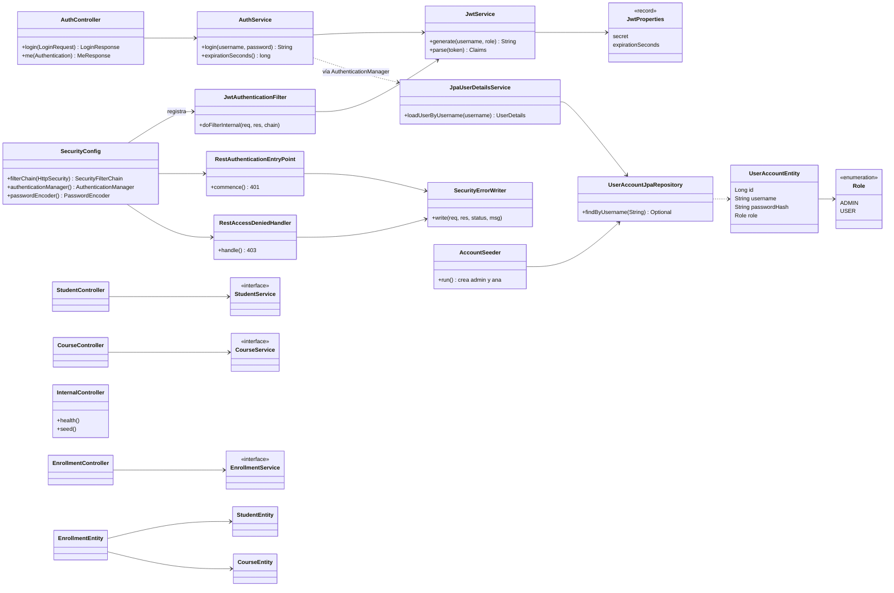
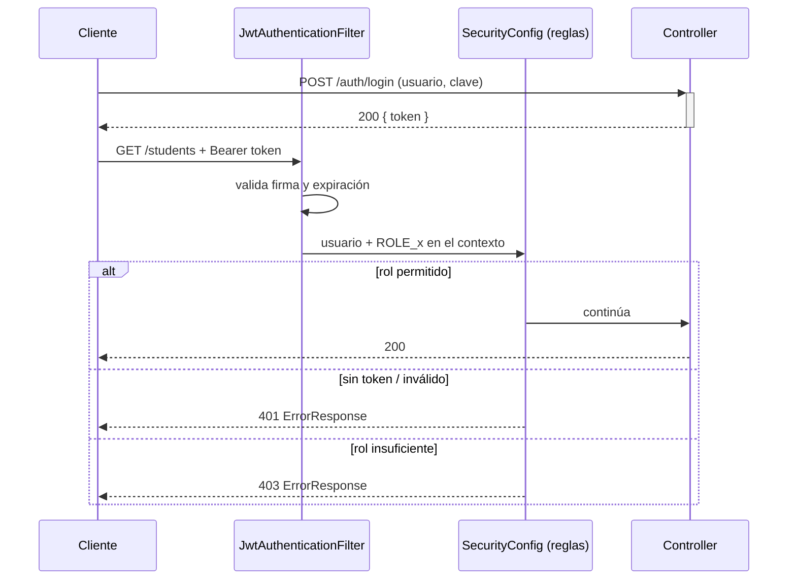

# 🔐 Guía rápida: Spring Security + JWT en `academica-security`

> **Resumen:** el negocio (estudiantes, cursos, matrículas) ya existe de las guías anteriores. Aquí solo se agrega la **capa de seguridad**: login, token JWT, roles y errores 401/403 con el mismo `ErrorResponse`.

⏱️ Duración estimada: 45 min · 📦 Todo el código nuevo vive en el paquete `com.academy.security` (+ `AuthController`).

---

## 1. 🎯 Qué se construye

| Pieza | Para qué sirve |
|---|---|
| `UserAccountEntity` + `Role` | Cuenta con usuario, **hash BCrypt** y rol (`ADMIN` / `USER`) |
| `JpaUserDetailsService` | Carga la cuenta desde la BD para Spring Security |
| `JwtService` | Genera y valida el token (firma HS256 + expiración) |
| `AuthService` | Valida usuario/contraseña y emite el token |
| `JwtAuthenticationFilter` | Lee `Authorization: Bearer …` y autentica cada petición |
| `SecurityConfig` | Reglas de acceso por ruta, sin sesión (stateless) |
| `RestAuthenticationEntryPoint` / `RestAccessDeniedHandler` | Respuestas JSON **401** / **403** |
| `AuthController` | `POST /auth/login` y `GET /auth/me` |

---

## 2. 🧩 Diagrama de clases



💡 **Idea clave:** el filtro JWT corre **antes** que los controladores; si el token es válido, deja al usuario autenticado en el `SecurityContext` y `SecurityConfig` decide si la ruta lo permite.

### Flujo de una petición



---

## 3. 🌐 Endpoints y reglas de acceso

Base: `http://localhost:8080` · Cabecera: `Authorization: Bearer <token>`

| Método | Ruta | Acceso | Descripción |
|---|---|---|---|
| `POST` | `/api/v1/auth/login` | 🌍 Público | Devuelve `{token, tokenType, expiresIn}` |
| `GET` | `/api/v1/auth/me` | 🔑 Autenticado | Usuario y rol del token |
| `GET` | `/internal/health` | 🌍 Público | Estado del servicio |
| `POST` | `/internal/seed` | 👑 `ADMIN` | Carga datos de ejemplo |
| `GET` | `/api/v1/students` | 🔑 Autenticado | Listar (paginado) |
| `GET` | `/api/v1/students/{id}` | 🔑 Autenticado | Buscar por id |
| `GET` | `/api/v1/students/by-email` | 🔑 Autenticado | Buscar por correo |
| `POST` | `/api/v1/students` | 🔑 Autenticado | Registrar estudiante |
| `GET` | `/api/v1/courses` | 🔑 Autenticado | Listar cursos |
| `GET` | `/api/v1/courses/{id}` | 🔑 Autenticado | Buscar curso |
| `GET` | `/api/v1/courses/{id}/enrolled` | 🔑 Autenticado | Contar matriculados |
| `POST` | `/api/v1/courses` | 👑 `ADMIN` | Crear curso |
| `GET` | `/api/v1/enrollments/{id}` | 🔑 Autenticado | Buscar matrícula |
| `POST` | `/api/v1/enrollments` | 🔑 Autenticado | Matricular estudiante en curso |
| `GET` | `/swagger-ui.html`, `/api-docs/**` | 🌍 Público | Documentación |

**Cuentas de práctica** (las crea `AccountSeeder`):

| Usuario | Clave | Rol |
|---|---|---|
| `admin` | `admin123` | `ADMIN` |
| `ana` | `ana123` | `USER` |

**Códigos de seguridad:** `401` = no hay token / expiró / es inválido · `403` = token válido pero rol insuficiente.

---

## 4. 🛠️ Paso a paso

### Paso 1 · Dependencias (`pom.xml`)

```xml
<dependency>
    <groupId>org.springframework.boot</groupId>
    <artifactId>spring-boot-starter-security</artifactId>
</dependency>
<dependency>
    <groupId>io.jsonwebtoken</groupId><artifactId>jjwt-api</artifactId><version>0.12.6</version>
</dependency>
<dependency>
    <groupId>io.jsonwebtoken</groupId><artifactId>jjwt-impl</artifactId><version>0.12.6</version><scope>runtime</scope>
</dependency>
<dependency>
    <groupId>io.jsonwebtoken</groupId><artifactId>jjwt-jackson</artifactId><version>0.12.6</version><scope>runtime</scope>
</dependency>
```

> ⚠️ Con solo agregar `starter-security`, **todo** queda protegido (401). Es normal: los pasos siguientes abren lo necesario.

### Paso 2 · Configuración JWT (`application.properties`)

```properties
app.jwt.secret=${JWT_SECRET:academy-clave-solo-educativa-cambiar-en-produccion-0123456789}
app.jwt.expiration-seconds=3600
```

```java
@ConfigurationProperties(prefix = "app.jwt")
public record JwtProperties(String secret, long expirationSeconds) {}
```

🚨 La clave debe tener **≥ 32 caracteres** (HS256). En producción va en una variable de entorno, nunca en el repo.

### Paso 3 · Cuenta de usuario y rol (persistencia)

```java
public enum Role { ADMIN, USER }

@Entity @Table(name = "user_account")
public class UserAccountEntity {
    @Id @GeneratedValue(strategy = GenerationType.IDENTITY) private Long id;
    @Column(nullable = false, unique = true) private String username;
    @Column(name = "password_hash", nullable = false) private String passwordHash;
    @Enumerated(EnumType.STRING) @Column(nullable = false) private Role role;
    // constructores y getters
}

public interface UserAccountJpaRepository extends JpaRepository<UserAccountEntity, Long> {
    Optional<UserAccountEntity> findByUsername(String username);
}
```

### Paso 4 · Cargar la cuenta para Spring Security

```java
@Service
public class JpaUserDetailsService implements UserDetailsService {
    private final UserAccountJpaRepository accounts;
    // constructor

    @Override
    public UserDetails loadUserByUsername(String username) {
        var a = accounts.findByUsername(username)
            .orElseThrow(() -> new UsernameNotFoundException("No existe la cuenta " + username));
        return User.withUsername(a.getUsername())
                   .password(a.getPasswordHash())
                   .roles(a.getRole().name())      // agrega el prefijo ROLE_
                   .build();
    }
}
```

### Paso 5 · Servicio JWT

```java
@Service
public class JwtService {
    private final SecretKey key;
    private final long expirationSeconds;

    public JwtService(JwtProperties p) {
        this.key = Keys.hmacShaKeyFor(p.secret().getBytes(StandardCharsets.UTF_8));
        this.expirationSeconds = p.expirationSeconds();
    }

    public String generate(String username, String role) {
        Instant now = Instant.now();
        return Jwts.builder().subject(username).claim("role", role)
                .issuedAt(Date.from(now))
                .expiration(Date.from(now.plusSeconds(expirationSeconds)))
                .signWith(key, Jwts.SIG.HS256).compact();
    }

    /** Lanza JwtException si la firma o la expiración no son válidas. */
    public Claims parse(String token) {
        return Jwts.parser().verifyWith(key).build()
                   .parseSignedClaims(token).getPayload();
    }
}
```

### Paso 6 · Servicio de login

```java
@Service
public class AuthService {
    private final AuthenticationManager authenticationManager;
    private final JwtService jwtService;
    // constructor

    public String login(String username, String password) {
        Authentication auth = authenticationManager.authenticate(
            new UsernamePasswordAuthenticationToken(username, password));   // 401 si falla
        String role = auth.getAuthorities().iterator().next()
                          .getAuthority().replace("ROLE_", "");
        return jwtService.generate(auth.getName(), role);
    }
}
```

### Paso 7 · Filtro JWT

```java
public class JwtAuthenticationFilter extends OncePerRequestFilter {
    @Override
    protected void doFilterInternal(HttpServletRequest req, HttpServletResponse res,
                                    FilterChain chain) throws ServletException, IOException {
        String header = req.getHeader(HttpHeaders.AUTHORIZATION);
        if (header != null && header.startsWith("Bearer ")) {
            try {
                Claims c = jwtService.parse(header.substring(7));
                SecurityContextHolder.getContext().setAuthentication(
                    new UsernamePasswordAuthenticationToken(c.getSubject(), null,
                        List.of(new SimpleGrantedAuthority("ROLE_" + c.get("role", String.class)))));
            } catch (ExpiredJwtException e) {
                req.setAttribute("auth.error", "El token expiró");
            } catch (JwtException | IllegalArgumentException e) {
                req.setAttribute("auth.error", "El token no es válido");
            }
        }
        chain.doFilter(req, res);
    }
}
```

### Paso 8 · Errores 401 y 403 en JSON

Los filtros corren **antes** de Spring MVC: el `@RestControllerAdvice` no los ve. Se escribe el `ErrorResponse` a mano.

```java
@Component
public class SecurityErrorWriter {
    private final ObjectMapper mapper;
    public void write(HttpServletRequest req, HttpServletResponse res,
                      HttpStatus status, String message) throws IOException {
        res.setStatus(status.value());
        res.setContentType(MediaType.APPLICATION_JSON_VALUE);
        res.setCharacterEncoding("UTF-8");
        mapper.writeValue(res.getWriter(), ErrorResponse.of(status, message, req.getRequestURI()));
    }
}
```

- `RestAuthenticationEntryPoint` → `401` (usa `auth.error` del filtro si existe; agrega `WWW-Authenticate: Bearer`).
- `RestAccessDeniedHandler` → `403` ("No tiene permisos para realizar esta operación").

### Paso 9 · Reglas de acceso (`SecurityConfig`)

```java
@Configuration @EnableWebSecurity
@EnableConfigurationProperties(JwtProperties.class)
public class SecurityConfig {

    @Bean
    SecurityFilterChain filterChain(HttpSecurity http, JwtService jwt,
            RestAuthenticationEntryPoint entry, RestAccessDeniedHandler denied) throws Exception {
        http.csrf(c -> c.disable())
            .sessionManagement(s -> s.sessionCreationPolicy(SessionCreationPolicy.STATELESS))
            .exceptionHandling(e -> e.authenticationEntryPoint(entry).accessDeniedHandler(denied))
            .authorizeHttpRequests(a -> a
                .requestMatchers("/api/v1/auth/login", "/internal/health").permitAll()
                .requestMatchers("/swagger-ui.html", "/swagger-ui/**", "/api-docs/**").permitAll()
                .requestMatchers(HttpMethod.POST, "/api/v1/courses").hasRole("ADMIN")
                .requestMatchers("/internal/**").hasRole("ADMIN")
                .anyRequest().authenticated())
            .addFilterBefore(new JwtAuthenticationFilter(jwt), UsernamePasswordAuthenticationFilter.class);
        return http.build();
    }

    @Bean AuthenticationManager authenticationManager(AuthenticationConfiguration c) throws Exception {
        return c.getAuthenticationManager();
    }
    @Bean PasswordEncoder passwordEncoder() { return new BCryptPasswordEncoder(); }
}
```

⚠️ **El orden importa:** las reglas más específicas van primero; `anyRequest()` siempre al final.

### Paso 10 · Controlador de autenticación

```java
@RestController @RequestMapping("/api/v1/auth")
public class AuthController {
    @PostMapping("/login")
    public LoginResponse login(@Valid @RequestBody LoginRequest r) {
        String token = service.login(r.username(), r.password());
        return new LoginResponse(token, "Bearer", service.expirationSeconds());
    }

    @GetMapping("/me")
    public MeResponse me(Authentication auth) {
        String role = auth.getAuthorities().iterator().next().getAuthority().replace("ROLE_", "");
        return new MeResponse(auth.getName(), role);
    }
}
```

DTO: `LoginRequest(username, password)` · `LoginResponse(token, tokenType, expiresIn)` · `MeResponse(username, role)`.

### Paso 11 · Sembrar las cuentas

```java
@Component
public class AccountSeeder implements CommandLineRunner {
    public void run(String... args) {
        createIfMissing("admin", "admin123", Role.ADMIN);
        createIfMissing("ana",   "ana123",   Role.USER);
    }
    private void createIfMissing(String u, String raw, Role r) {
        if (accounts.findByUsername(u).isEmpty())
            accounts.save(new UserAccountEntity(null, u, encoder.encode(raw), r));  // se guarda el HASH
    }
}
```

---

## 5. ▶️ Ejecutar y probar

```bash
docker run -d --name academy-mysql -e MYSQL_ROOT_PASSWORD=root \
  -e MYSQL_DATABASE=academia -p 3306:3306 mysql:8.0
./mvnw spring-boot:run
```

```bash
# 1) Login → guardar el token
TOKEN=$(curl -s -X POST localhost:8080/api/v1/auth/login \
  -H 'Content-Type: application/json' \
  -d '{"username":"ana","password":"ana123"}' | jq -r .token)

# 2) Quién soy
curl -s localhost:8080/api/v1/auth/me -H "Authorization: Bearer $TOKEN"

# 3) Ruta autenticada
curl -s localhost:8080/api/v1/students -H "Authorization: Bearer $TOKEN"
```

### ✅ Matriz de verificación

| Prueba | Esperado |
|---|---|
| `GET /internal/health` sin token | `200` |
| `GET /api/v1/students` sin token | `401` |
| `GET /api/v1/students` con token inválido | `401` "El token no es válido" |
| Login con clave incorrecta | `401` |
| `GET /api/v1/students` con token de `ana` | `200` |
| `POST /api/v1/courses` con token de `ana` | `403` |
| `POST /api/v1/courses` con token de `admin` | `201` |
| `POST /internal/seed` con `ana` / `admin` | `403` / `200` |

📌 También puedes probar desde **Swagger UI** (`/swagger-ui.html`) con el botón **Authorize**, o con la colección en [`postman/`](../postman/) y el script [`probar-apis.sh`](../probar-apis.sh).

---

## 6. 🧠 Conceptos clave (para recordar)

1. **Stateless:** no hay sesión; el token viaja en **cada** petición.
2. **BCrypt:** en la BD solo se guarda el hash, nunca la clave.
3. **JWT = header.payload.firma:** el payload es legible (no pongas secretos); la firma evita que lo alteren.
4. **`401` vs `403`:** 401 = «no sé quién eres»; 403 = «sé quién eres, pero no puedes».
5. **Prefijo `ROLE_`:** `hasRole("ADMIN")` busca la autoridad `ROLE_ADMIN`.
6. **Clave en variable de entorno** (`JWT_SECRET`) fuera del desarrollo.
