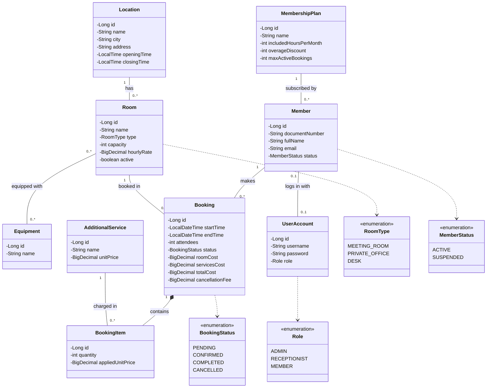

# 🏆 Proyecto final Spring Boot - R2 — CoWorkHub

> **Trabajo**: individual · **Integra**: módulos 01 a 08 · **Se evalúa con**: la [rúbrica](rubrica.md)

## 🎯 Qué vas a construir

Una **API REST con Spring Boot** para una red de coworking que hoy gestiona sus
reservas en una hoja de cálculo. El sistema debe evitar las reservas duplicadas,
controlar las horas que consume cada miembro, cobrar las cancelaciones siempre con la
misma regla y limitar a cada usuario a lo que le corresponde.

No hay interfaz gráfica: la API se prueba con Swagger UI, Postman (o Insomnia) y `curl`.

## 1. Usuarios

| Rol | Qué puede hacer |
|---|---|
| `ADMIN` | Todo. Es el único que crea, modifica o elimina catálogos. |
| `RECEPTIONIST` | Gestiona los miembros y todas las reservas. |
| `MEMBER` | Consulta catálogos y disponibilidad. Crea, ve, modifica y cancela **solo sus** reservas, y ve **solo su** consumo. |

**Personal** = `ADMIN` o `RECEPTIONIST`.

## 2. Modelo de datos

Las entidades, sus atributos y las tablas de la base de datos se nombran en inglés.

| Entidad · tabla | Qué es | Atributos | Relaciones |
|---|---|---|---|
| `Location` · `locations` | Sede | name, city, address, openingTime, closingTime | 1 → N `Room` |
| `Room` · `rooms` | Sala | name, type, capacity, hourlyRate, active | N ↔ N `Equipment` (tabla intermedia `room_equipment`) |
| `Equipment` · `equipment` | Equipamiento | name | — |
| `MembershipPlan` · `membership_plans` | Plan de membresía | name, includedHoursPerMonth, overageDiscount (%), maxActiveBookings | 1 → N `Member` |
| `Member` · `members` | Miembro | documentNumber, fullName, email, status | 1 ↔ 1 `UserAccount` |
| `UserAccount` · `user_accounts` | Usuario de acceso | username, password (BCrypt), role | — |
| `Booking` · `bookings` | Reserva | startTime, endTime, attendees, status, roomCost, servicesCost, totalCost, cancellationFee | N → 1 `Room`, N → 1 `Member`, 1 → N `BookingItem` |
| `AdditionalService` · `additional_services` | Servicio adicional | name, unitPrice | 1 → N `BookingItem` |
| `BookingItem` · `booking_items` | Detalle de una reserva | quantity, appliedUnitPrice | Entidad intermedia, con `cascade` y `orphanRemoval` desde `Booking` |

| Enumeración | Valores |
|---|---|
| `RoomType` | `MEETING_ROOM`, `PRIVATE_OFFICE`, `DESK` |
| `MemberStatus` | `ACTIVE`, `SUSPENDED` |
| `BookingStatus` | `PENDING`, `CONFIRMED`, `COMPLETED`, `CANCELLED` |
| `Role` | `ADMIN`, `RECEPTIONIST`, `MEMBER` |

Los nombres de tabla se fijan con `@Table(name = "...")`. La entidad del usuario se llama
`UserAccount` y no `User` para no confundirse con la clase `User` de Spring Security.

### Diagrama de clases de las entidades



Cómo leerlo: los números son las multiplicidades (`0..*` = ninguno o muchos). El rombo
negro (`*--`) indica que los detalles pertenecen a la reserva: se guardan y se borran
con ella. Un miembro puede no tener usuario todavía, y el personal tiene usuario pero
no es miembro: por eso `Member`–`UserAccount` es `0..1` de los dos lados. Qué lado es el
dueño de cada relación lo decidís vos y lo justificás en el análisis.

## 3. Reglas de negocio

| Código | Regla |
|---|---|
| **RN-01** | Una sala no puede tener dos reservas `PENDING` o `CONFIRMED` que se crucen, ni siquiera si llegan dos solicitudes al mismo tiempo. Si una termina justo cuando empieza la otra, no se cruzan. |
| **RN-02** | Una reserva dura entre 30 min y 8 h, en múltiplos de 30 min, y empieza y termina el mismo día. |
| **RN-03** | Debe caer dentro del horario de la sede, ser futura y hacerse con al menos 1 h de anticipación. |
| **RN-04** | La sala debe estar activa y los asistentes no pueden superar su capacidad. |
| **RN-05** | Solo reserva un miembro `ACTIVE`. |
| **RN-06** | Un miembro no puede tener más reservas activas futuras que las que permite su plan (`maxActiveBookings`). |
| **RN-07** | **Costo.** Las horas que el plan incluye en el mes no se cobran; las excedentes valen `hourlyRate × (1 − overageDiscount)`. Los servicios suman `quantity × unitPrice`, y `appliedUnitPrice` guarda el precio vigente al agregarlos. |
| **RN-08** | **Cancelación.** Con 24 h o más de anticipación, sin cargo y se devuelven las horas. Entre 24 h y 2 h, se cobra el 50 % del costo de la sala. Con menos de 2 h, o si ya empezó, no se puede cancelar. |
| **RN-09** | **Estados.** `PENDING → CONFIRMED → COMPLETED`, o `PENDING/CONFIRMED → CANCELLED`. Ninguna otra transición. |
| **RN-10** | Los servicios de una reserva solo se cambian mientras está `PENDING`. |
| **RN-11** | Son únicos: el documento, el email y el usuario del miembro; el nombre de la sala dentro de su sede; y el nombre del equipamiento, del servicio y del plan. |
| **RN-12** | No se elimina nada que esté en uso: una sede con salas, un plan con miembros, una sala o un miembro con reservas, un equipamiento o un servicio usado. |
| **RN-13** | Cada rol solo hace lo que indica la sección 1. |

## 4. Requisitos funcionales

| RF | El sistema debe… |
|---|---|
| **RF-01** | Permitir crear, consultar, actualizar y eliminar sedes, salas (con su equipamiento), equipamiento, servicios adicionales y planes. |
| **RF-02** | Registrar un miembro junto con su usuario, y consultarlo, listarlo (paginado y con filtros), actualizarlo, suspenderlo, reactivarlo y eliminarlo. |
| **RF-03** | Mostrar las salas libres de una sede en una fecha y un rango horario, con filtros opcionales de capacidad mínima y equipamiento. |
| **RF-04** | Crear una reserva con sus servicios adicionales y devolver el costo calculado. |
| **RF-05** | Consultar una reserva, y listar reservas por miembro, por sala y fecha, o por estado. |
| **RF-06** | Agregar o quitar servicios de una reserva `PENDING` y recalcular su costo. |
| **RF-07** | Confirmar una reserva. |
| **RF-08** | Cancelar una reserva aplicando RN-08 y devolver el cargo. |
| **RF-09** | Marcar una reserva como completada. |
| **RF-10** | Mostrar el consumo mensual de un miembro: horas incluidas, usadas, restantes y excedentes. |
| **RF-11** | Iniciar sesión con usuario y contraseña, y devolver un JWT que vence en 60 min. |
| **RF-12** | Exigir un JWT válido en todo endpoint que no sea público, y aplicar los permisos de la sección 1. |
| **RF-13** | Documentar toda la API en Swagger UI. |
| **RF-14** | Devolver los datos del usuario que inició sesión (usuario, rol y `miembroId`). |
| **RF-15** | Informar si el servicio está funcionando. |

## 5. Endpoints

Base: `http://localhost:8080`. Salvo los públicos, todos llevan el encabezado
`Authorization: Bearer <token>`.

### Autenticación y plataforma

| Método | Ruta | Acceso | Qué hace | RF |
|---|---|---|---|---|
| `POST` | `/auth/login` | Público | Devuelve el JWT | RF-11 |
| `GET` | `/auth/perfil` | Autenticado | Usuario, rol y `miembroId` del token | RF-14 |
| `GET` | `/actuator/health` | Público | `{"status":"UP"}` | RF-15 |
| `GET` | `/doc/swagger-ui.html` y `/v3/api-docs` | Público | Documentación | RF-13 |

### Catálogos (RF-01)

Recursos: `/api/sedes`, `/api/salas`, `/api/equipamientos`, `/api/servicios-adicionales`
y `/api/planes`. Cada uno tiene los mismos cinco endpoints:

| Método | Ruta | Acceso | Qué hace |
|---|---|---|---|
| `GET` | `/api/{recurso}` | Autenticado | Lista (salas acepta `?sedeId=`) |
| `GET` | `/api/{recurso}/{id}` | Autenticado | Consulta uno |
| `POST` | `/api/{recurso}` | `ADMIN` | Crea |
| `PUT` | `/api/{recurso}/{id}` | `ADMIN` | Actualiza |
| `DELETE` | `/api/{recurso}/{id}` | `ADMIN` | Elimina |

### Miembros

| Método | Ruta | Acceso | Qué hace | RF |
|---|---|---|---|---|
| `GET` | `/api/miembros?nombre=&estado=&page=&size=&sort=` | Personal | Lista paginada | RF-02 |
| `GET` | `/api/miembros/{id}` | Personal o el propio miembro | Consulta uno | RF-02 |
| `POST` | `/api/miembros` | Personal | Registra miembro y usuario | RF-02 |
| `PUT` | `/api/miembros/{id}` | Personal | Actualiza nombre, email y plan | RF-02 |
| `PATCH` | `/api/miembros/{id}/suspender` | Personal | Suspende | RF-02 |
| `PATCH` | `/api/miembros/{id}/activar` | Personal | Reactiva | RF-02 |
| `DELETE` | `/api/miembros/{id}` | Personal | Elimina | RF-02 |
| `GET` | `/api/miembros/{id}/consumo?mes=yyyy-MM` | Personal o el propio miembro | Consumo del mes | RF-10 |

### Disponibilidad

| Método | Ruta | Acceso | Qué hace | RF |
|---|---|---|---|---|
| `GET` | `/api/disponibilidad?sedeId=&fecha=&horaInicio=&horaFin=` (+ `capacidadMinima`, `equipamientoIds`) | Autenticado | Salas libres | RF-03 |

### Reservas

| Método | Ruta | Acceso | Qué hace | RF |
|---|---|---|---|---|
| `POST` | `/api/reservas` | Personal, o el miembro a su nombre | Crea la reserva | RF-04 |
| `GET` | `/api/reservas/{id}` | Personal o el dueño | Consulta una | RF-05 |
| `GET` | `/api/reservas?miembroId=` · `?salaId=&fecha=` · `?estado=` | Personal (el miembro, solo con su `miembroId`) | Lista con un filtro | RF-05 |
| `POST` | `/api/reservas/{id}/servicios` | Personal o el dueño | Agrega un servicio | RF-06 |
| `DELETE` | `/api/reservas/{id}/servicios/{servicioId}` | Personal o el dueño | Quita un servicio | RF-06 |
| `POST` | `/api/reservas/{id}/confirmar` | Personal | Confirma | RF-07 |
| `POST` | `/api/reservas/{id}/cancelar` | Personal o el dueño | Cancela | RF-08 |
| `POST` | `/api/reservas/{id}/completar` | Personal | Completa | RF-09 |

### Respuestas

| Código | Cuándo |
|---|---|
| `200` / `201` | Éxito (`201` al crear; `DELETE` responde `200` sin cuerpo) |
| `400` | Datos faltantes o con formato inválido |
| `401` | Sin token, o con un token alterado o vencido |
| `403` | El usuario no tiene permiso |
| `404` | El recurso no existe |
| `409` | Se viola una regla de negocio o hay un duplicado |

Todo error responde con el mismo cuerpo, donde `codigo` es la regla violada o el tipo
de error:

```json
{"error": "La sala ya está reservada en ese horario", "codigo": "RN-01", "timestamp": "2030-06-03T13:00:00Z"}
```

## 6. Requisitos técnicos

Java 21, Spring Boot 4.1.x, Maven y **MySQL 8**. Con la base de datos corriendo, el
proyecto arranca con `mvn spring-boot:run`.

### Base de datos

La base de datos es **MySQL**. La conexión se configura en `application.properties` y
usa el driver `mysql-connector-j`:

```properties
spring.datasource.url=jdbc:mysql://localhost:3306/coworkhub
spring.datasource.username=coworkhub
spring.datasource.password=coworkhub
```

Para crear la base tenés dos opciones:

| Opción | Cómo |
|---|---|
| **A. MySQL instalado** en tu equipo | Creá la base `coworkhub` y un usuario `coworkhub` con permisos sobre ella. |
| **B. Docker** | Creá un contenedor de MySQL con el comando de abajo. No hace falta instalar MySQL. |

Este comando crea el contenedor `coworkhub-mysql`, con la base, el usuario y la
contraseña `coworkhub` (solo para desarrollo). Los datos quedan en el volumen
`coworkhub-datos` y se conservan aunque detengas el contenedor:

```bash
docker run -d --name coworkhub-mysql \
  -e MYSQL_DATABASE=coworkhub \
  -e MYSQL_USER=coworkhub \
  -e MYSQL_PASSWORD=coworkhub \
  -e MYSQL_ROOT_PASSWORD=root \
  -p 3306:3306 \
  -v coworkhub-datos:/var/lib/mysql \
  mysql:8.4
```

En Windows (PowerShell o CMD), escribilo en una sola línea, sin las `\`. La primera vez
tarda unos segundos en preparar la base: esperá a que `docker logs coworkhub-mysql`
muestre `ready for connections` antes de arrancar el proyecto.

| Para… | Comando |
|---|---|
| Ver si está corriendo | `docker ps` |
| Detenerlo y volver a iniciarlo | `docker stop coworkhub-mysql` · `docker start coworkhub-mysql` |
| Abrir la consola de MySQL (contraseña `coworkhub`) | `docker exec -it coworkhub-mysql mysql -u coworkhub -p coworkhub` |
| Borrarlo, con todos sus datos | `docker rm -f coworkhub-mysql` y después `docker volume rm coworkhub-datos` |

Si el puerto 3306 ya está ocupado, por ejemplo por un MySQL instalado, usá
`-p 3307:3306` y cambiá el puerto también en la URL de conexión.

### Datos de prueba: `import.sql` (obligatorio)

Todo proyecto debe tener el archivo **`src/main/resources/import.sql`** con los datos de
prueba iniciales. Hibernate lo ejecuta solo al arrancar, justo después de crear las
tablas, siempre que `ddl-auto` sea `create` (o `create-drop`):

```properties
spring.jpa.hibernate.ddl-auto=create
```

Con `create`, cada arranque borra las tablas, las vuelve a crear y ejecuta `import.sql`:
siempre empezás con los mismos datos, sin duplicados. Con `update` o `none`, el archivo
no se ejecuta.

El `import.sql` debe cargar, como mínimo:

| Datos | Mínimo |
|---|---|
| Sedes (`locations`) | 2 |
| Salas (`rooms`) | 6, una inactiva, con su equipamiento |
| Equipamiento (`equipment`) | 4 |
| Servicios adicionales (`additional_services`) | 3 |
| Planes (`membership_plans`) | 3 |
| Miembros (`members`) | 5, uno suspendido |
| Usuarios (`user_accounts`) | 4: un `ADMIN`, un `RECEPTIONIST` y dos `MEMBER` vinculados a su miembro |
| Reservas (`bookings` y `booking_items`) | 15 en distintos estados, algunas con servicios |

Reglas del archivo:

- Usa los nombres de tabla de la sección 2 (`locations`, `rooms`…) y los nombres de columna
  tal como quedan creados en la base (los ves con `DESCRIBE locations;`).
- Cada sentencia va en **una sola línea** y termina en `;`.
- Las contraseñas van ya codificadas con BCrypt, nunca en texto plano.
- Cada fila se inserta después de las filas a las que apunta su clave foránea (por
  ejemplo, las sedes antes que las salas).

### Qué debe verse de cada módulo

Cada módulo del curso debe verse en el código:

| Módulo | Qué debe tener tu proyecto |
|---|---|
| **01** Spring Boot | Proyecto creado con Spring Initializr y sus *starters*; DTO como `record`; `Optional` y streams; inyección por constructor; Actuator |
| **02** Dependencias y beans | Servicios como interfaz + implementación; `@Configuration` con `@Bean` (`Clock`, `PasswordEncoder`); `@Value`; un `@Qualifier` o `@Primary`; un `@PostConstruct` que valide la configuración |
| **03** JPA | Entidades con sus anotaciones; repositorios con consultas derivadas, una `@Query` en JPQL y una consulta paginada |
| **04** Base de datos y relaciones JPA | Conexión a MySQL en `application.properties`; las relaciones de la sección 2 con lado dueño, `fetch` (`LAZY` en colecciones), `cascade` y `orphanRemoval` justificados; datos de prueba en `import.sql`; listados sin el problema N+1 |
| **05** API REST | Capas `presentation` → `business` → `persistence`; DTO de entrada validados con `@Valid` y DTO de salida (nunca entidades); `@Transactional` en las escrituras |
| **06** Swagger | Swagger UI con grupos, descripciones, respuestas de error, ejemplos y botón **Authorize**; `openapi.json` exportado |
| **07** Excepciones | Excepciones propias en la capa de negocio; un `@RestControllerAdvice` con el cuerpo de error único; ninguna regla de negocio responde `500` |
| **08** Seguridad | Primero Basic Auth y después JWT *stateless*; contraseñas con BCrypt; roles y dueño del recurso con `@PreAuthorize`; `401` y `403` con el cuerpo de error |

**Orden sugerido**: análisis → base de datos MySQL y proyecto base (01, 02) → modelo JPA e `import.sql` (03, 04) → servicios
y controladores (05) → excepciones (07) → Swagger (06) → seguridad (08) → pruebas.

## 7. Escenarios de aceptación

| # | Escenario | Resultado |
|---|---|---|
| 1 | Reservar una sala libre con 2 servicios | `201` con el costo calculado |
| 2 | Reservar en un horario que se cruza con otra reserva | `409` `RN-01` |
| 3 | Reservar de 10:00 a 11:00 cuando otra va de 09:00 a 10:00 | `201` |
| 4 | Reservar 45 min, o fuera del horario de la sede | `409` |
| 5 | Cancelar con 30 h de anticipación | `200`, cargo 0 |
| 6 | Cancelar con 5 h de anticipación | `200`, cargo del 50 % |
| 7 | Cancelar con 1 h de anticipación | `409` |
| 8 | Confirmar una reserva cancelada | `409` |
| 9 | Un miembro consulta la reserva de otro | `403` |
| 10 | Llamar a un endpoint protegido sin token, o con un token alterado | `401` |
| 11 | Eliminar una sala con reservas futuras | `409` |
| 12 | Crear una sede sin nombre | `400` |
| 13 | Enviar dos solicitudes simultáneas para la misma sala y horario | Una `201` y la otra `409` |
| 14 | Listar miembros con `?page=0&size=2` | `200` con el total de elementos y de páginas |

## 8. Entregables

1. `docs/analisis.md`: casos de uso, diagrama entidad-relación (con lado dueño, `fetch` y
   `cascade`), matriz RF → RN → endpoint y los supuestos que hayas tomado.
2. El repositorio, con un commit por fase y el `src/main/resources/import.sql` con los
   datos de prueba.
3. Una colección de Postman o Insomnia con los 14 escenarios.
4. `docs/openapi.json`.
5. `README.md`: cómo crear la base de datos (con MySQL instalado o con Docker), cómo
   ejecutar el proyecto, usuarios de prueba y dirección de Swagger UI.

## 9. Evaluación

| Criterio | Peso |
|---|---|
| Análisis | 15 % |
| Modelo JPA | 15 % |
| Reglas de negocio | 25 % |
| Arquitectura y calidad del código | 15 % |
| Excepciones y códigos HTTP | 10 % |
| Seguridad | 10 % |
| Swagger, README y pruebas | 10 % |

El detalle está en la [rúbrica](rubrica.md).

## 💡 Pistas

- **La hora actual.** RN-03 y RN-08 dependen de "ahora". Inyectá un `Clock` en lugar de
  llamar a `LocalDateTime.now()`, así podés fijar la hora en las pruebas.
- **Fechas en `import.sql`.** Si escribís fechas fijas, las reservas futuras se vuelven
  pasadas con el tiempo. Calculalas a partir de hoy con funciones de MySQL:
  `TIMESTAMP(CURDATE() + INTERVAL 1 DAY, '10:00:00')` es mañana a las 10:00. Si en las
  pruebas fijás la hora con el `Clock`, usá la misma fecha.
- **Solicitudes simultáneas.** Revisar el cruce de horarios y después guardar no alcanza
  para cumplir RN-01 si llegan dos solicitudes a la vez.
